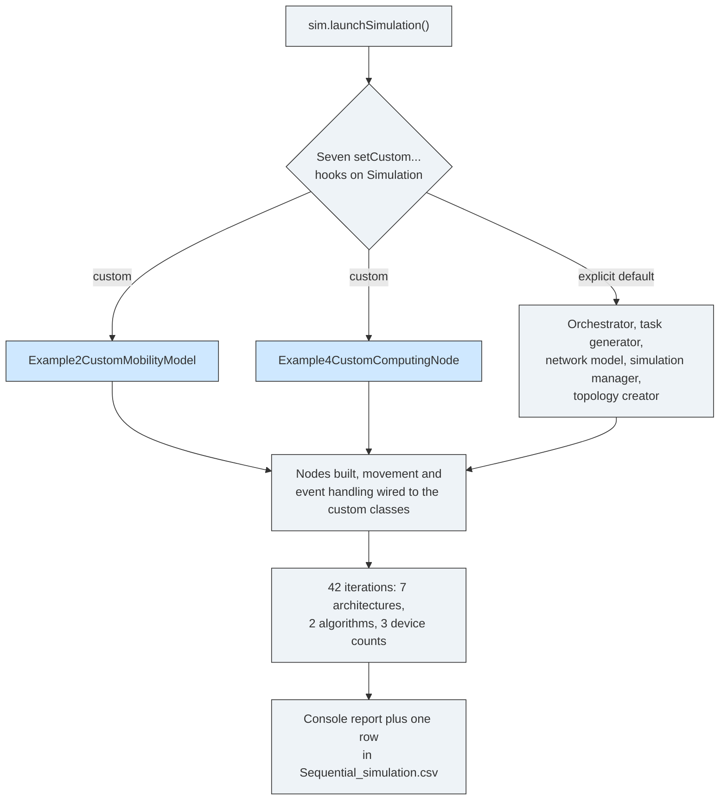

# Example 1: wiring the extension points

## What it shows

This is the smallest runnable simulation and the tour of the `Simulation`
class. It is the example to read first if you want to know where PureEdgeSim
lets you replace a model. It registers one class for every point the framework
exposes, then launches the run:

| Extension point | Class used here |
| --- | --- |
| Mobility model | `Example2CustomMobilityModel` |
| Task orchestrator | `DefaultOrchestrator` |
| Computing node | `Example4CustomComputingNode` |
| Task generator | `DefaultTaskGenerator` |
| Network model | `DefaultNetworkModel` |
| Simulation manager | `DefaultSimulationManager` |
| Topology creator | `DefaultTopologyCreator` |

The point is not the classes themselves. Three of them are the framework
defaults, which shows that registering a default explicitly changes nothing.
The other two are the small custom models from Example 2 and Example 4, wired
here so every hook is visible in one place. Removing any `setCustom...` line
restores the default for that hook.



## The scenario

This example uses its own `settings/` folder, a copy of the repository
defaults: a 200 by 200 meters map, 100 to 300 edge devices, a ten minute run, and
the default applications. Real time charts are enabled, so a Swing window opens
while the simulation runs, and `random_seed` is left empty, so no two runs are
alike.

## Run it

From the repository root, after `mvn clean install -DskipTests`:

```bash
mvn exec:java -Dexec.mainClass="examples.Example1"
```

## What to look for

The run finishes in `4 minutes, 58 seconds` of wall clock and writes 42 rows
(one per architecture, algorithm, and device-count triple) to `output/`. The
last row, `ALL / ROUND_ROBIN / 300 devices`, is what the console prints at the
end of the capture, so it is the clearest place to check that the wiring works:

| Metric | Value |
| --- | --- |
| Tasks generated, sent | 33740, 100 % of generated |
| Successfully executed | 25913, 76.802 % of sent |
| Failed on delay, on mobility, on device death | 6816 (20.2015 %), 1011 (2.9964 %), 0 |
| Average execution, waiting, request makespan | 0.1974 s, 0.0329 s, 0.2972 s |
| Tasks placed on cloud, edge, mist | 2439, 14386, 16915 |
| Energy (computing, WAN, MAN, LAN) | 101.3257 Wh, 1.8524 Wh, 0 Wh, 22.795 Wh |
| WAN time, LAN time, total traffic | 976.528 s, 189.1895 s, 33184.61 MBytes |
| Average remaining device battery | 99.5397 %, 0 dead devices |

Reading the run against the point of the example:

- The wiring is proven, not the policy. Every hook was accepted, the custom
  computing node fires its `DO_SOMETHING` event once per node at simulation
  start (the "Event received, you can do any action here" lines fill the
  capture), and the framework reaches the final report. Nothing in the numbers
  says this run is *better* than the same settings with the defaults only,
  because the registered classes come from Examples 2 and 4 and add no new
  decision logic.
- The straight-line walk is visible in the mobility column. 1011 tasks
  (2.9964 % of sent) fail because their destination moved out of range, while
  zero devices die and the average battery stays at 99.5397 %, 32.784 Wh. A
  walk that adds one meter per tick never drains the battery, it only changes
  distances.
- The energy split is what one expects from `ALL` plus `ROUND_ROBIN`: the mist
  tier carries 16915 tasks and 69.763 Wh of the 101.3257 Wh total, the edge
  tier 14386 tasks and 26.2182 Wh, the cloud tier 2439 tasks and 5.3446 Wh.
  WAN time is 83.7706 % of network usage and only 1.8524 Wh of energy, which
  matches the 20 Mbps WAN default in `settings/simulation_parameters.properties`.
- Results go to a timestamped folder under `PureEdgeSim/examples/Example1/output/`,
  next to a `run.properties` file that records the resolved seed and the five
  input paths, plus a `Final results/` subfolder of chart images.

To turn the demo into a comparison, edit `settings/simulation_parameters.properties`
and drop `ALL` down to `CLOUD_ONLY` or `EDGE_ONLY`, or drop `ROUND_ROBIN` in
favour of `TRADE_OFF`, then rerun and read the new row against these numbers.

## Files

- `Example1.java`
- `settings/`, a copy of the packaged defaults in `PureEdgeSim/settings/`

## Where to go next

- [Writing orchestrators](../../../docs/writing-orchestrators.md)
- [Customizing models](../../../docs/customizing-models.md)
- [Getting started](../../../docs/getting-started.md)
