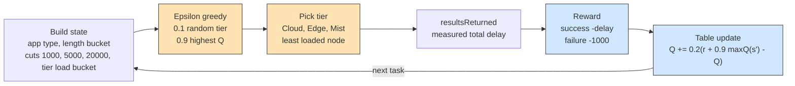

# Example 11: Q-learning orchestration

## What it shows

How to learn the placement policy instead of writing it. The orchestrator keeps
a table of action values. A state is the application type, a coarse bucket of the
task length, and a coarse bucket of the pending load per node of a tier. An
action is a tier: cloud, edge, or mist. The chosen tier executes the task on its
least loaded eligible node, scored like `TRADE_OFF`.

When the task returns, `resultsReturned` receives it with its measured total
delay. A successful task gives a reward equal to the negative delay, a failed one
a large penalty. The update is the standard Q-learning rule, with the next state
rebuilt after the task leaves the tier:

```java
values[action] += LEARNING_RATE
        * (reward + DISCOUNT_RATE * maxValue(nextState) - values[action]);
```

The policy is epsilon-greedy, so one decision in ten explores a random tier. The
three application types of the default settings (hard, soft, and non real-time)
give the agent states that differ in their latency requirement.



## The scenario

The files in `settings/` describe:

- 100 devices on the default map, five simulated minutes;
- the `ALL` architecture, so the three tiers are candidates;
- `Q_LEARNING` as the only algorithm in the sweep;
- a fixed seed of 42, no charts, and no log file;
- the default applications, with their hard, soft, and non real-time types.

## Run it

From the repository root, after `mvn clean install -DskipTests`:

```bash
mvn exec:java -Dexec.mainClass="examples.Example11"
```

## What to look for

With the same seed and scenario, and only the policy changed, the two runs give:

| Policy | Average delay (s) | Succeeded | Failed (delay) | Failed (mobility) | Cloud tasks | Edge tasks | Mist tasks | Energy (Wh) |
| --- | --- | --- | --- | --- | --- | --- | --- | --- |
| `TRADE_OFF` | 0.1736 | 4018 | 1394 | 138 | 465 | 2600 | 2485 | 23.6954 |
| `Q_LEARNING` | 0.1588 | 4030 | 1502 | 18 | 1081 | 3071 | 1398 | 24.5304 |

Both rows are the measured output of `settings/` with seed 42, 5550 tasks. The
baseline comes from the same files with the custom orchestrator removed and
`orchestration_algorithms=TRADE_OFF`, so the difference is only the policy.

- The learned policy lowers the average delay from 0.1736 to 0.1588 s and completes
  slightly more tasks, 4030 against 4018. It gets there by moving work off the
  mist tier: 1398 tasks against 2485, and 1221 of them succeed.
- Mobility failures collapse, from 138 to 18, for the same reason. A task that
  stays on the device it was generated on cannot be lost when the device moves out
  of range.
- The price is on the other two tiers and on energy. The cloud takes 1081 tasks and
  only 226 of them meet their latency, and consumption rises from 23.6954 to
  24.5304 Wh; the WAN share alone goes from 0.3108 to 0.5074 Wh, which is what
  those extra cloud round trips cost.
- The values are learned during the run, so five simulated minutes are enough to
  show a difference but not to converge. Raise `simulation_time` or lower
  `EXPLORATION_RATE` to give the agent more experience.
- The table is small: 3 application types times 4 length buckets times 3 load
  buckets times 3 actions.
- Results go to `PureEdgeSim/examples/Example11/output/`.

## The paper behind the scenario

The example follows the reinforcement-learning approach to workload
orchestration evaluated on PureEdgeSim by:

- Safavifar, Z., Ghanadbashi, S., & Golpayegani, F. (2021). *Adaptive workload
  orchestration in pure edge computing: A reinforcement-learning model.* 2021
  IEEE 33rd International Conference on Tools with Artificial Intelligence
  (ICTAI), 856-860. https://doi.org/10.1109/ICTAI52525.2021.00137
- Safavifar, Z., Gyamfi, E., Mangina, E., & Golpayegani, F. (2024).
  *Multi-objective deep reinforcement learning for efficient workload
  orchestration in extreme edge computing.* IEEE Access, 12, 74558-74571.
  https://doi.org/10.1109/ACCESS.2024.3405411

This is a compact tabular agent with a delay reward, not the deep or
multi-objective models of those papers. The scenario, the action space, and the
parameters are ours; the papers motivate the learning formulation and the use of
PureEdgeSim for its evaluation.

## Files

- `Example11.java`
- `Example11QLearningOrchestrator.java`
- `settings/` with `orchestration_algorithms=Q_LEARNING`

## Where to go next

- [Writing orchestrators](../../../docs/writing-orchestrators.md) for the callback
  used to observe completed tasks
- [Example 8](../Example8/README.md) for a fuzzy-logic policy that does not learn
- [Example 10](../Example10/README.md) for a genetic search over service graphs
