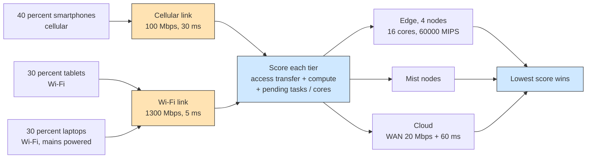

# Example 12: multi-access MEC with an access-aware orchestrator

## What it shows

How the access network changes the placement decision. Devices reach the
network over Wi-Fi or cellular, and `Example12AccessAwareOrchestrator` scores
every allowed tier from:

- the transfer delay of the device access link (Wi-Fi or cellular latency and
  bandwidth, plus the WAN hop for cloud candidates);
- the compute delay on the candidate node;
- the tasks already pending on that node, divided by its cores.

The lowest score wins. A cellular device pays 30 ms and a 100 Mbps uplink, while
a Wi-Fi device pays 5 ms and 1300 Mbps. The same task can therefore prefer the
edge when it is generated over cellular and prefer another tier when it is
generated over Wi-Fi.

This is a compact scenario inspired by multi-access MEC studies, not a
reproduction of their experiments.



## The scenario

The files in `settings/` describe:

- four edge data centers at the corners of a 2000 by 2000 meters map, each with
  16 cores at 60000 MIPS, linked in a ring over the MAN;
- 300 devices: 40 percent cellular smartphones, 30 percent Wi-Fi tablets, and
  30 percent mains-powered laptops, all thin clients (5000 to 20000 MIPS), so
  local execution is slower than the edge;
- 10 simulated minutes, seed 42, the `ALL` architecture, and the `ACCESS_AWARE`
  algorithm;
- a 20 Mbps WAN and a 100 Mbps cellular uplink, which make the cloud a poor
  choice for latency-sensitive work and leave the edge as the natural MEC host.

## Run it

From the repository root, after `mvn clean install -DskipTests`:

```bash
mvn exec:java -Dexec.mainClass="examples.Example12"
```

Results go to `PureEdgeSim/examples/Example12/output/`.

## What to look for

With seed 42 the run executes 43456 of 43500 tasks on the edge tier, 44 on mist
devices, and none in the cloud. The average execution delay is 0.1058 s and 90.8
percent of the tasks succeed. The edge tier is chosen because the estimated
edge delay (access transfer plus compute) stays below both the cloud estimate
(WAN transfer) and the mist estimate (slow thin clients). Energy consumption is
179.31 Wh.

The per-technology energy lines in the text report and the network usage show
the cellular traffic separately, which is the part that changes when you edit
the access rates.

Two experiments make the access effect visible:

1. Set `cellular_bandwidth=10` and rerun. Cellular tasks pay ten times the
   transfer delay, so more of them miss their latency and the delay-failure
   count rises while the Wi-Fi tasks are unaffected.
2. Set `wan_bandwidth=1000` and `wan_latency=0.005`, then add `EDGE_AND_CLOUD`
   to `orchestration_architectures`. Cloud candidates become competitive for
   the longest non-real-time tasks.

## Files

- `Example12.java`
- `Example12AccessAwareOrchestrator.java`
- `settings/` with three access device types and four edge data centers

## Where to go next

- [Example 3: cooperative edge data centers](../Example3/README.md) for edge
  orchestration without the access distinction
- [Writing orchestrators](../../../docs/writing-orchestrators.md)
- [Configuration: network](../../../docs/configuration.md)

## References

- MECSim, a multi-access edge computing simulator, doi:10.1016/j.sysarc.2026.103706
- Multi-access edge computing in 5G networks, doi:10.1109/ISCC55528.2022.9912802
