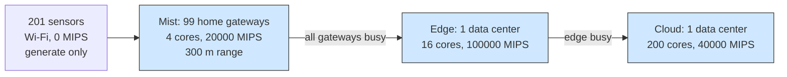

# Example 13: multi-layer fog for a smart home

## What it shows

How a layered placement policy behaves when a fog deployment has three
concentric layers: home gateways in the mist, one neighbourhood edge data
center, and the cloud. `Example13FogLayersOrchestrator` walks the layers in the
order mist, edge, cloud and stops at the first one that contains a feasible
node. Inside that layer it chooses the node with the fewest tasks pending, so
the gateways are filled before a task moves outward.

Sensors have no computing capacity, so their tasks cannot run locally. Every
task therefore exercises the hierarchy: it starts at a gateway, spreads to the
next gateway while one is free, reaches the edge server when the gateways are
busy, and falls back to the cloud only when the architecture allows it and no
closer layer can serve the task.

This is a compact scenario inspired by multi-layer fog studies, not a
reproduction of their experiments.

The policy walks inward-out, so it keeps each task on the closest feasible layer
and only overflows outward when the nearer layer has no free node.



## The scenario

The files in `settings/` describe:

- 300 devices on a 2000 by 2000 meters map: 67 percent sensors that only
  generate tasks, 201 of them, and 33 percent home gateways, 99 of them, with 4
  cores at 20000 MIPS that only execute;
- a 300 meters mist range, wide enough for a sensor to see the gateways of its
  neighbourhood;
- one edge data center in the middle of the map with 16 cores at 100000 MIPS;
- 5 simulated minutes, seed 42, the `ALL` architecture, and `FOG_LAYERS`;
- Wi-Fi access, no container registry, and no orchestrator delegation, because
  the policy itself implements the hierarchy.

## Run it

From the repository root, after `mvn clean install -DskipTests`:

```bash
mvn exec:java -Dexec.mainClass="examples.Example13"
```

Results go to `PureEdgeSim/examples/Example13/output/`.

## What to look for

With seed 42, 14035 of 14515 tasks execute on the mist layer, 480 reach the edge
data center, and none needs the cloud. The average execution delay is 0.3098 s
and 72.42 percent of the tasks succeed (10512 of 14515); 4003 tasks, 27.58
percent, miss their latency, all of them in the mist layer, since the 480 tasks
that overflowed to the edge all complete. The gap between the layers is the
expected effect of the policy: the gateways are the first feasible layer, so
they receive almost all the work. Their 4 cores are saturated by the sensor
traffic, which is why more than a quarter of the tasks miss their latency and
why the edge server sees the overflow. Energy consumption is 40.0222 Wh, 31.0512
Wh of it in the device layer and 8.9709 Wh in the edge data center, and the WAN
is never used because no task goes to the cloud.

Three changes show the trade-off:

1. Raise the gateway percentage to 50 and lower the sensor percentage to 50 to
   add mist capacity, then watch the success rate rise.
2. Add `EDGE_ONLY` or `CLOUD_ONLY` to `orchestration_architectures` and rerun:
   the same policy then has only one layer to choose from, which isolates the
   effect of the hierarchy.
3. Shrink `edge_devices_range` to 50 and rerun: fewer sensors find a gateway, so
   the edge server takes a larger share.

## Files

- `Example13.java`
- `Example13FogLayersOrchestrator.java`
- `settings/` with the sensor and gateway types

## Where to go next

- [Example 3: cooperative edge data centers](../Example3/README.md)
- [Writing orchestrators](../../../docs/writing-orchestrators.md)
- [Configuration: orchestration](../../../docs/configuration.md)

## References

- Multi-layer fog and edge resource management for smart environments,
  doi:10.1007/s10723-025-09802-9
