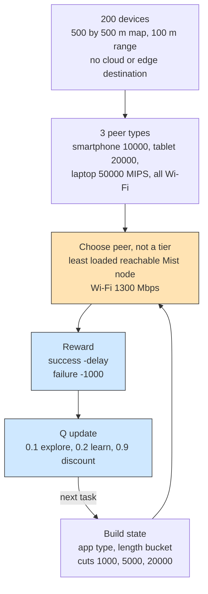

# Example 14: mist-only reinforcement placement

## What it shows

What the Q-learning agent of [Example 11](../Example11/README.md) does when the
cloud and the edge data centers are removed from the action space. The
`MIST_ONLY` architecture leaves only nearby devices as destinations, so every
task is placed on a peer and the agent learns which peer gives the lowest delay.
The state, reward, and update rule are the same as in Example 11; only the set
of allowed actions changes.

The scenario is the device-to-device side of edge computing, where devices
cooperate directly instead of sending their work to an infrastructure node.

This is a compact scenario inspired by pure mist and device-to-device
reinforcement placement studies, not a reproduction of their experiments.

With a single tier the agent trades off peers instead of tiers: the state keeps
the task signals, but the action selects which nearby device runs the task.



## The scenario

The files in `settings/` describe:

- 200 devices on a 500 by 500 meters map with a 100 meters range, so every
  device sees many peers;
- three types of devices (smartphones, tablets, and laptops), all of which
  generate and execute tasks, and none of which is a sensor;
- no cloud or edge destination in the action space: the architecture is
  `MIST_ONLY`, so the cloud and the single edge data center only anchor the
  topology;
- the same `Q_LEARNING` algorithm as Example 11, with 10 percent exploration,
  a 0.2 learning rate, and a 0.9 discount rate;
- 5 simulated minutes and seed 42.

## Run it

From the repository root, after `mvn clean install -DskipTests`:

```bash
mvn exec:java -Dexec.mainClass="examples.Example14"
```

Results go to `PureEdgeSim/examples/Example14/output/`.

## What to look for

With seed 42, all 14500 tasks are placed on the mist layer, 11539 of them
succeed (79.58 percent), and the average execution delay is 0.2295 s. The cloud
and edge columns of the report stay at zero tasks. Energy consumption is 48.8867
Wh, most of it in the device layer (39.9978 Wh, against 8.8889 Wh for the edge
data center that only anchors the topology). The 2961 failures split into 2943
tasks that exceeded their latency on a busy peer and 18 that lost their
destination to mobility, which is the cost of having no infrastructure fallback.
The whole run stays local: 106.92 s of network usage, all of it on the LAN, 17375.2 MB transferred, and no WAN time.

Compare this run with Example 11, which uses the same agent and seed but lets
the cloud and the edge compete for the tasks. The difference in success rate and
destination counts is the effect of the architecture on the learned policy.

Raise `edge_devices_range` to 300 to connect more peers, or lower the
percentage of fast laptops to 10 to watch the delay rise.

## Files

- `Example14.java`
- `../Example11/Example11QLearningOrchestrator.java`
- `settings/` with three device types that both generate and execute tasks

## Where to go next

- [Example 11: Q-learning over cloud, edge, and mist](../Example11/README.md)
- [Writing orchestrators](../../../docs/writing-orchestrators.md)
- [Configuration: orchestration](../../../docs/configuration.md)

## References

- Tabular reinforcement learning for pure edge and mist placement,
  doi:10.1109/ICTAI52525.2021.00137
