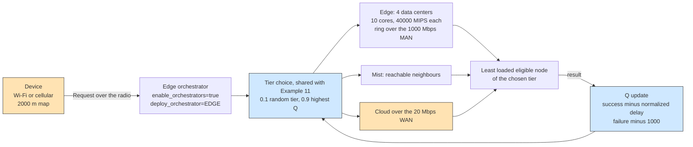

# Example 15: multi-layer guided reinforcement learning

## What it shows

How the Q-learning agent behaves when the placement is delegated to an
orchestrator on the edge tier and the deployment spans many layers and many
nodes. The agent chooses the layer, and a guided heuristic inside the layer
selects the least loaded eligible node, so the learned part and the
estimate-based part of the policy stay separate.

The scenario is the neighbourhood-scale version of [Example 11](../Example11/README.md):
500 devices, four linked edge data centers on a 2000 by 2000 meters map, and a
decision that travels to the edge orchestrator before the task is dispatched.
The agent observes the layer load after each completed task, as in Example 11.

This is a compact scenario inspired by multi-layer guided reinforcement
learning studies, not a reproduction of their experiments.



## The scenario

The files in `settings/` describe:

- four peripheral edge data centers with 40000 MIPS and 10 cores each, linked in
  a ring over the MAN;
- 500 devices of the default mix, including Wi-Fi sensors and battery-powered
  phones, on a 2000 by 2000 meters map;
- 10 simulated minutes, seed 7, the `ALL` architecture, and `Q_LEARNING`;
- `enable_orchestrators=true` with `deploy_orchestrator=EDGE`, so every request
  reaches the closest edge orchestrator;
- a 20 Mbps WAN and a 1000 Mbps MAN.

## Run it

From the repository root, after `mvn clean install -DskipTests`:

```bash
mvn exec:java -Dexec.mainClass="examples.Example15"
```

Results go to `PureEdgeSim/examples/Example15/output/`.

## What to look for

With seed 7, 56550 tasks are generated and 41462 of them, 73.32 percent,
complete within their latency. The edge layer executes 37650 tasks and 36499 of
them succeed. The mist layer executes 4805 tasks with 4303 successes, and the
cloud receives 14095 tasks of which only 660 succeed. The average execution
delay is 0.1653 s and energy consumption is 201.2012 Wh. Of the 15088 failures,
15082 are deadline misses and 6 are mobility losses; no task was dropped for
want of resources.

The cloud share is the honest negative result of this run: 14095 placements, 24.9
percent of the workload, against a 10 percent exploration floor, and a 4.68
percent success rate on that tier (660 of 14095). The WAN carries 935.61 s of the
1322.88 s of network usage, so a cloud sample almost always misses its bound, and
the table has to learn to stop choosing that tier.

The most useful comparison is with Example 11: same agent, same reward, but a
larger map, four edge servers, and a delegating orchestrator. The cloud share
grows because the layer is part of the action space, and its low success rate is
what the agent has to learn to avoid.

Two changes show the guided part of the policy:

1. Set `enable_orchestrators=false` and rerun. The device decides locally, so the
   request no longer travels to the edge orchestrator, and the layer counts and
   delays change while the learned values do not.
2. Reduce `max_number_of_edge_devices` to 200 and rerun. The edge layer is less
   loaded and its success rate rises.

## Files

- `Example15.java`
- `../Example11/Example11QLearningOrchestrator.java`
- `settings/` with four linked edge data centers and 500 devices

## Where to go next

- [Example 11: Q-learning over cloud, edge, and mist](../Example11/README.md)
- [Example 3: cooperative edge data centers](../Example3/README.md)
- [Writing orchestrators](../../../docs/writing-orchestrators.md)

## References

- Multi-layer guided reinforcement learning for task offloading,
  doi:10.1016/j.comnet.2022.109476
