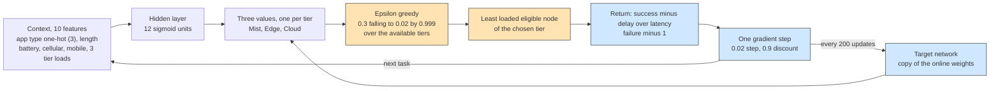

# Example 17: context-aware deep reinforcement offloading

## What it shows

How a reinforcement agent can generalize across devices and tasks it was not
trained on. Instead of a table indexed by a handful of buckets, the action value
of each layer is approximated by a small neural network (one hidden layer of 12
units). Its inputs describe the task and the device: the application type, the
task length, the battery level, the access technology, the device mobility, and
the load of each tier. Two devices with a similar context share the same
weights, so a decision generalizes even when that exact combination never
occurred before.

The agent trains online: every returned task gives a reward, the chosen layer's
value moves by one temporal-difference step, and a target network is refreshed
every 200 updates to keep the target stable. The reward is the negated delay
normalized by the task latency, and a failed task receives a penalty of one.

This is a compact scenario inspired by context-aware deep reinforcement
learning for multi-access edge computing, not a reproduction of its
experiments or of its network architecture.



## The scenario

The files in `settings/` describe:

- four peripheral edge data centers with 40000 MIPS and 10 cores each, linked in
  a ring over the MAN;
- 300 devices of the default mix on a 2000 by 2000 meters map, including
  cellular phones, Wi-Fi tablets, and laptops;
- 10 simulated minutes, seed 17, the `ALL` architecture, and `CONTEXT_AWARE`;
- local decisions (`enable_orchestrators=false`);
- a 20 Mbps WAN and a 1000 Mbps MAN, with a 100 Mbps cellular access link.

The exploration probability decays from 0.3 to 0.02, the step size is 0.02, and
the discount rate is 0.9.

## Run it

From the repository root, after `mvn clean install -DskipTests`:

```bash
mvn exec:java -Dexec.mainClass="examples.Example17"
```

Results go to `PureEdgeSim/examples/Example17/output/`.

## What to look for

With seed 17, 43500 tasks are generated and 89.18 percent of them complete
within their latency. The edge layer executes 34239 tasks and 33636 of them
succeed, the mist layer executes 1798 tasks with 1214 successes, and the cloud
receives 7463 tasks of which only 3944 succeed. The average execution delay is
0.158 s and energy consumption is 200.4542 Wh, spread over the cloud
(24.0907 Wh), the edge (70.9367 Wh), and the mist devices (105.4268 Wh). The WAN
carries 72.9 percent of the network usage.

The cloud share stays high because the network values a layer by its average
outcome across all contexts: Wi-Fi laptops on a quiet map genuinely complete
cloud tasks within their latency. The cellular devices, whose contexts include
the narrow uplink, are the ones the network learns to keep near the edge.

Two changes show the context:

1. Set the cellular device percentage in `edge_devices.xml` to 100 and rerun.
   Every task now carries the cellular feature, so the cloud share can be
   compared with the mixed-access run.
2. Raise `TARGET_SYNC` in `Example17ContextAwareOrchestrator` to 2000 and rerun.
   The targets lag behind the online weights, which slows the separation between
   the layer values.

## Files

- `Example17.java`
- `Example17ContextAwareOrchestrator.java`
- `settings/` with four linked edge data centers and 300 multi-access devices

## Where to go next

- [Example 12: access-aware multi-access placement](../Example12/README.md)
- [Example 16: softmax policy](../Example16/README.md)
- [Writing orchestrators](../../../docs/writing-orchestrators.md)

## References

- Context aware task orchestration with deep reinforcement learning in real
  time fog computing simulation environment, IEEE Access 13:85004-85025, 2025,
  doi:10.1109/ACCESS.2025.3569781
