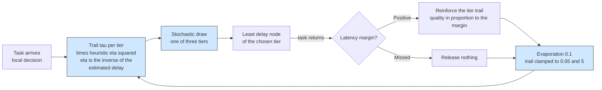

# Example 18: ant colony offloading

## What it shows

How a swarm-inspired heuristic adapts to the workload without any model of it.
Each tier lays a pheromone trail. A placement is sampled from the trail
multiplied by a heuristic desirability, the inverse of the estimated delay, so
the fastest tier is preferred from the first task. When a task returns, its tier
reinforces the trail with a quality in proportion to the latency margin, or
releases nothing if the task failed. The trail evaporates at every update, so an
early success cannot lock the choice forever.

This is the classical ant colony scheme applied to the tier decision: pheromone
over three destinations, a delay heuristic, and a stochastic assignment. Inside
the chosen tier, the node with the smallest estimated delay, including its
pending tasks, executes the task.

This is a compact scenario inspired by ant colony scheduling for mobile edge
computing, not a reproduction of its experiments.



## The scenario

The files in `settings/` describe:

- four peripheral edge data centers with 40000 MIPS and 10 cores each, linked in
  a ring over the MAN;
- 300 devices of the default mix on a 2000 by 2000 meters map;
- 5 simulated minutes, seed 29, the `ALL` architecture, and `ANT_COLONY`;
- local decisions (`enable_orchestrators=false`);
- a 20 Mbps WAN and a 1000 Mbps MAN.

The colony uses an evaporation rate of 0.1, an exponent of 1 on the trail and 2
on the heuristic, an initial trail of 0.5, and bounds of 0.05 and 5 so that every
tier stays reachable.

## Run it

From the repository root, after `mvn clean install -DskipTests`:

```bash
mvn exec:java -Dexec.mainClass="examples.Example18"
```

Results go to `PureEdgeSim/examples/Example18/output/`.

## What to look for

With seed 29, 16870 tasks are generated and 12255 of them, 72.64 percent,
complete within their latency, with an average execution delay of 0.1737 s. The
edge layer executes 12017 tasks and 9406 of them succeed, the mist layer executes
2492 tasks with 2189 successes, and the cloud receives 2361 tasks of which 660
succeed. Energy consumption is 77.1513 Wh, split between the cloud (4.1533 Wh),
the edge (38.0976 Wh), and the mist devices (34.9004 Wh). Of the 4615 failures,
4613 are deadline misses and 2 are mobility losses.

The cloud takes 14.0 percent of the placements and returns the worst tier
success rate of the run, 27.95 percent (660 of 2361), against 78.27 percent on
the edge and 87.84 percent in the mist. Its trail loses mass whenever a
WAN-bound task misses its latency, which is most of them, and the WAN alone
accounts for 747.87 s of the 848.11 s of network usage. The mist trail stays
healthy because local tasks are cheap to serve, even though mist nodes are
slower than the edge servers.

Two changes show the trail:

1. Set `EVAPORATION` in `Example18AntColonyOrchestrator` to 0.5 and rerun. The
   trail forgets faster, so the colony follows short-term outcomes instead of
   the average.
2. Set `BETA` to 0 and rerun. The decision ignores the delay estimate and moves
   to a trail-only search, which starts from a uniform choice.

## Files

- `Example18.java`
- `Example18AntColonyOrchestrator.java`
- `settings/` with four linked edge data centers and 300 devices

## Where to go next

- [Example 16: softmax policy](../Example16/README.md)
- [Example 11: tabular Q-learning](../Example11/README.md)
- [Writing orchestrators](../../../docs/writing-orchestrators.md)

## References

- Energy criticality avoidance-based delay minimization ant colony algorithm
  for task assignment in mobile-server-assisted mobile edge computing,
  Sensors 23(13):6041, 2023, doi:10.3390/s23136041
