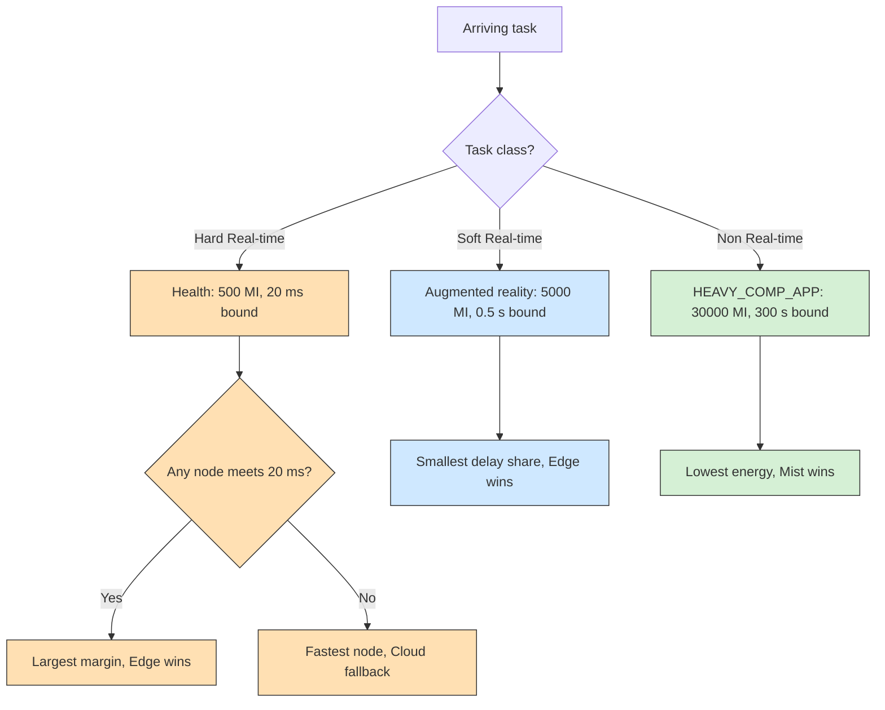

# Example 19: deadline-aware placement by criticality

## What it shows

How one orchestrator can serve three task classes with different objectives.
The application type decides the rule:

- a **hard real-time** task goes to the eligible node whose estimated finish
  time leaves the largest margin before its latency bound, and falls back to the
  fastest node only when no node can meet the deadline;
- a **soft real-time** task goes where the estimated delay is the smallest
  fraction of its latency;
- a **non real-time** task goes where the estimated energy is the lowest, which
  keeps long background jobs off the edge servers that latency-sensitive tasks
  need.

The estimate covers the compute time, the tasks already queued on the node, the
device access latency, and the WAN latency for the cloud. Energy is estimated as
the active consumption of the node multiplied by the compute time.



The criticality test is the deadline check on the hard branch: the hard class
only trades its margin rule for the raw-capacity fallback when no node can meet
the 20 ms bound.

This is a compact scenario inspired by deadline-aware and energy-efficient
offloading studies, not a reproduction of their experiments.

## The scenario

The files in `settings/` describe:

- four peripheral edge data centers with 40000 MIPS and 10 cores each, linked in
  a ring over the MAN;
- 300 devices of the default mix on a 2000 by 2000 meters map;
- 5 simulated minutes, seed 41, the `ALL` architecture, and `PRIORITY_AWARE`;
- local decisions (`enable_orchestrators=false`);
- the default applications: a hard real-time health task with a 20 ms bound, a
  soft real-time augmented reality task, and a background computation.

## Run it

From the repository root, after `mvn clean install -DskipTests`:

```bash
mvn exec:java -Dexec.mainClass="examples.Example19"
```

Results go to `PureEdgeSim/examples/Example19/output/`.

## What to look for

With seed 41, 16870 tasks are generated and 72.64 percent complete within their
latency (12255 tasks), with an average execution delay of 0.1804 s. All 4615
failures are deadline misses; none comes from a device that moved away or died.
The edge layer executes 13929 tasks and 9990 of them succeed, the mist layer
executes 2926 tasks with 2265 successes, and the cloud receives only 15 tasks,
none of which succeeds. Energy consumption is 73.0572 Wh, almost all of it on the
edge (38.4911 Wh) and the mist devices (34.551 Wh), with only 0.015 Wh on the
cloud.

The cloud is nearly unused because none of the three rules sends work there for
this workload: the WAN delay breaks the 20 ms bound of the hard tasks, the edge
serves the soft tasks sooner, and the cloud draws far more power than a mist
device for the background job. The few cloud tasks are the hard ones that no
feasible node could take and that the fallback sent to the fastest machine.

Two changes show the rules:

1. Raise the `task_length` of the health application in `applications.xml` to
   50000 and keep its 20 ms bound. Every tier now misses the deadline, so the
   fallback compares the raw estimates and the cloud's larger capacity wins
   those health tasks.
2. Set the type of the background application to `Hard Real-time`. The energy
   objective disappears, and those tasks compete for the edge servers under the
   deadline rule instead of moving to the mist devices.

## Files

- `Example19.java`
- `Example19PriorityOrchestrator.java`
- `settings/` with four linked edge data centers and 300 devices

## Where to go next

- [Example 12: access-aware multi-access placement](../Example12/README.md)
- [Example 17: context-aware reinforcement learning](../Example17/README.md)
- [Writing orchestrators](../../../docs/writing-orchestrators.md)

## References

- DECO: A deadline-aware and energy-efficient algorithm for task offloading in
  mobile edge computing, IEEE Systems Journal 17(1):952-963, 2023,
  doi:10.1109/JSYST.2022.3185011
