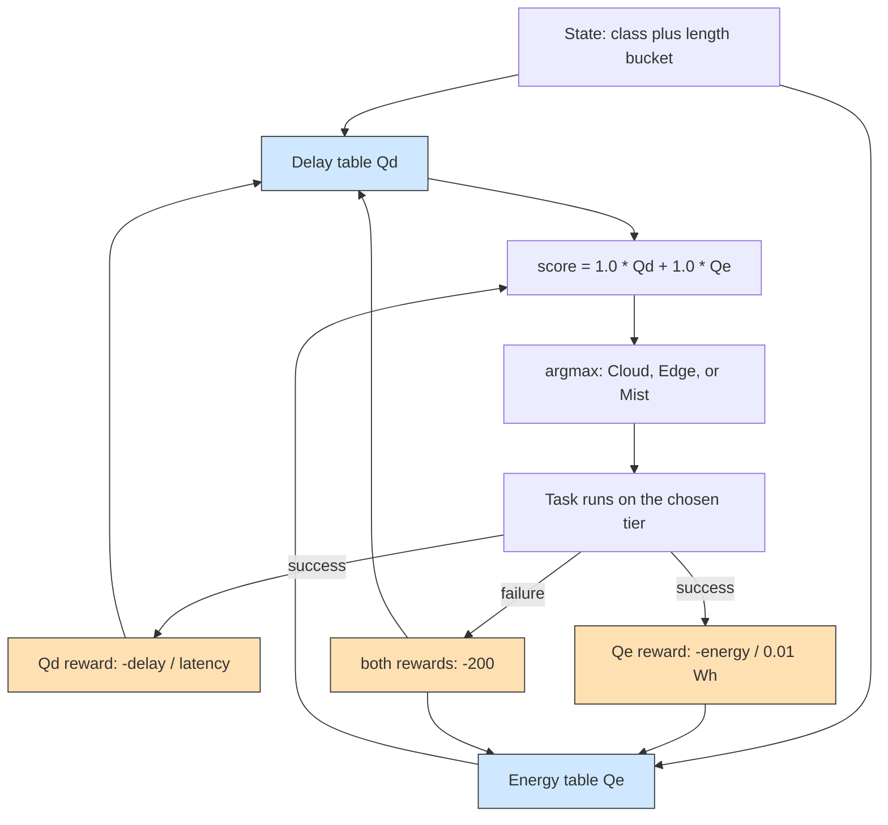

# Example 20: multi-objective reinforcement learning

## What it shows

How an agent can optimize two objectives at once without collapsing them into a
single number before learning. The agent keeps two value tables, one for delay
and one for energy, over the same state (application type and task-length
bucket) and the same actions (cloud, edge, mist). It updates each table with its
own reward and combines them only when it chooses, by multiplying each value by
a weight.

The delay reward is the negated delay normalized by the task latency, as in the
other learning examples. The energy reward is the negated estimated energy of
the chosen node, normalized by a reference of 0.01 Wh, so a cloud task that
consumes a hundred times more than a mist task is penalized accordingly. A
failure applies the same penalty to both tables.

This is a compact scenario inspired by multi-objective reinforcement learning
for offloading, not a reproduction of its experiments or of its network
architecture.



The two tables keep the objectives separate, so the weights, both 1.0 here, are
applied only at decision time and can be retuned without relearning.

## The scenario

The files in `settings/` describe:

- four peripheral edge data centers with 40000 MIPS and 10 cores each, linked in
  a ring over the MAN;
- 300 devices of the default mix on a 2000 by 2000 meters map;
- 5 simulated minutes, seed 53, the `ALL` architecture, and `SCALARIZED_Q`;
- local decisions (`enable_orchestrators=false`);
- a 20 Mbps WAN and a 1000 Mbps MAN, and a cloud that draws 5776 W against 150 W
  for each edge data center.

Both weights are 1, the exploration rate is 0.1, the step size 0.2, and the
discount rate 0.9.

## Run it

From the repository root, after `mvn clean install -DskipTests`:

```bash
mvn exec:java -Dexec.mainClass="examples.Example20"
```

Results go to `PureEdgeSim/examples/Example20/output/`.

## What to look for

With seed 53, 16870 tasks are generated and 72.69 percent complete within their
latency (12263 tasks), with an average execution delay of 0.1816 s. The edge layer
executes 11068 tasks and 9251 of them succeed, the mist layer executes 3858 tasks
with 2847 successes, and the cloud receives 1944 tasks of which only 165 succeed.
Energy consumption is 73.7211 Wh, with 1.1766 Wh on the cloud, 38.326 Wh on the
edge, and 34.2186 Wh on the mist devices.

The cloud share is the interesting part. It takes 1944 tasks, 11.5 percent of the
workload, which is the exploration rate `EPSILON` of 0.1 plus a little greedy
spillage: the learned values send essentially no task there, because the hard
real-time tasks miss their 20 ms bound over the WAN and each failure writes a
large negative value into both tables. The network report shows the cost of that
exploration, 210.288 s of WAN occupancy out of 311.2585 s of total link usage,
and 0.3908 Wh of the 73.7211 Wh. The two objectives barely disagree for this
scenario: 4606 of the 4607 failures are deadline misses, so both tables punish the
same placement and the weights have little to trade off.

To see the weights matter, give the cloud a chance to succeed:

1. Raise the health application latency in `applications.xml` to 0.5 and rerun.
   With cloud tasks no longer failing, the energy value becomes the term that
   decides between a fast and a cheap destination, and changing `ENERGY_WEIGHT`
   shifts the cloud and mist shares.
2. Raise `EPSILON` to 0.3 and rerun. The cloud share should grow towards the
   random share, since the greedy part of the policy avoids the cloud.

## Files

- `Example20.java`
- `Example20MultiObjectiveOrchestrator.java`
- `settings/` with four linked edge data centers and 300 devices

## Where to go next

- [Example 11: tabular Q-learning](../Example11/README.md)
- [Example 19: deadline-aware placement](../Example19/README.md)
- [Writing orchestrators](../../../docs/writing-orchestrators.md)

## References

- Multi-objective task offloading optimization using deep reinforcement
  learning with resource distribution clustering, ICT Express, 2025,
  doi:10.1016/j.icte.2025.05.006
