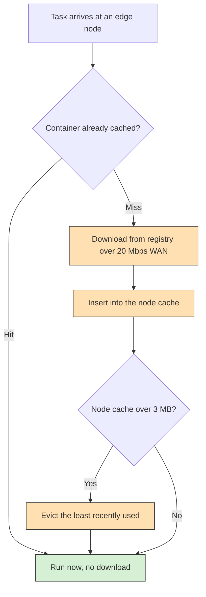

# Example 21: storage-aware container caching

## What it shows

How to keep application containers at the node that executes them instead of
downloading them from the cloud for every request. Each node dedicates a small
part of its storage to containers. A request whose container is already there
runs immediately; a request whose container is missing downloads it from the
registry first, and the downloaded container is kept for the next request. When
the cache is full, the least recently used container is evicted.



The savings this produces show up in the report as WAN usage (3140.92 s cached
against 7894.40 s without) and transferred data (29090.3 MB against 40974.0 MB),
both quoted under What to look for.

Two classes implement it:

- `Example21CacheDevice` gives every node a least-recently-used cache, sized
  from its storage;
- `Example21ContainerCacheNetworkModel` overrides the transfer completion of
  the default network model: with the registry in `CACHE` mode it asks the
  destination whether it holds the application before starting a download,
  stores the container when the download finishes, and prints the hit ratio at
  the end of the run.

This is a compact scenario inspired by service and task caching studies, not a
reproduction of their experiments or of their optimization models.

## The scenario

The files in `settings/` describe:

- 300 devices on a 2000 by 2000 meters map, 5 simulated minutes, seed 61;
- four peripheral edge data centers, and the `EDGE_ONLY` architecture, so every
  task that offloads runs on the edge and the cloud is never a destination;
- the registry enabled in `CACHE` mode;
- orchestrators enabled on `CLOUD`: the placement decision travels to the
  cloud, which keeps the cloud out of the execution path while making every
  request cross the WAN;
- a 20 Mbps WAN, and the default three applications whose containers weigh
  0.02, 1.5, and 2.2 MB.

Each node reserves at most 3 MB for containers, and never more than its own
storage, so the cache cannot hold the three containers at once and has to evict.

## Run it

From the repository root, after `mvn clean install -DskipTests`:

```bash
mvn exec:java -Dexec.mainClass="examples.Example21"
```

Results go to `PureEdgeSim/examples/Example21/output/`. The console ends with a line such as:

```text
Example21 - container cache: 10477 hits, 6393 misses (62,10 % hit ratio), 1323 evictions, 0 refused, 7,42 MB used of 372,00 MB
```

The line is printed with the locale decimal comma, and the numbers are those of
the run described below.

## What to look for

With seed 61, 16870 tasks are generated and all of them execute on the edge.
The cache serves 10477 requests without a download and misses 6393 times, a hit
ratio of 62.10 percent, while evicting 1323 containers because the 3 MB budget
fills up. The run succeeds on 8565 tasks, 50.77 percent of the total, with an
average execution delay of 0.1599 s and 78.2528 Wh of energy.

Change `registry_mode` to `CLOUD` and rerun with the same seed to get the
baseline in which every task downloads its container. The difference is the
point of the example:

| Registry mode | WAN usage | Total traffic | Successful tasks | Energy |
| --- | --- | --- | --- | --- |
| `CACHE` | 3140.92 s | 29090.3 MB | 50.77 % | 78.2528 Wh |
| `CLOUD` | 7894.40 s | 40974.0 MB | 10.49 % | 81.8710 Wh |

The cache removes 60.2 percent of the WAN usage and 29.0 percent of the traffic.
The success rate moves much more than the network figures, because a container
download over the 20 Mbps WAN also delays the task: without the cache almost
every hard real-time task misses its 20 ms bound, even though the edge node has
plenty of computing capacity.

Two changes make the storage constraint visible:

1. Lower `CACHE_CAPACITY_MB` in `Example21CacheDevice` to 1.5 and rerun. The heavy
   application container is then larger than the cache, so it is refused and every
   heavy request downloads again: the hit ratio and the success rate both fall.
2. Lower it to 1.0 and rerun. Only the 20 KB health container fits, so the cache
   barely helps: almost every request is refused and the run returns to the
   no-cache behaviour.

The request and the results still travel to and from the cloud orchestrator, so
the cache only removes container traffic. Turn orchestrators off and the tasks
execute where they are generated, which bypasses the cache path entirely.

## Files

- `Example21.java`
- `Example21CacheDevice.java`
- `Example21ContainerCache.java`
- `Example21ContainerCacheNetworkModel.java`
- `settings/` with four edge data centers and 300 devices

## Where to go next

- [Example 7: cooperative container caching](../Example7/README.md)
- [Example 13: a three-layer fog](../Example13/README.md)
- [Customizing models](../../../docs/customizing-models.md)

## References

- Energy efficient task caching and offloading for mobile edge computing,
  IEEE Access, 2018, doi:10.1109/ACCESS.2018.2805798
- Joint service caching and task offloading for mobile edge computing in dense
  networks, IEEE INFOCOM 2018, doi:10.1109/INFOCOM.2018.8485977
