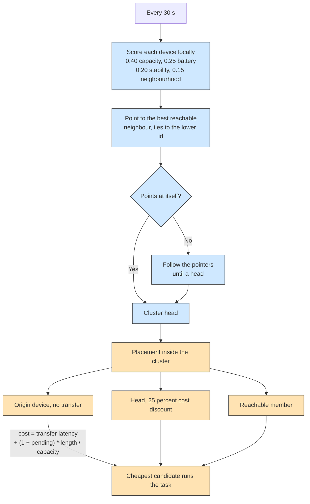

# Example 22: devices that cluster themselves

## What it shows

This scenario adds no central cluster manager. Each device scores itself from
four local signals, points to the best neighbor it can reach, and the clusters
emerge from those pointers. The example connects two extension points:

| Extension point | Class |
| --- | --- |
| Computing node | `Example22SelfClusteringDevice` |
| Task orchestrator | `Example22ClusterOrchestrator` |

The computing node carries the election and its periodic refresh. The
orchestrator reads the resulting clusters and places each task inside the
cluster of the origin device. Neither class needs a change in the framework;
both are registered with `setCustomComputingNode` and
`setCustomEdgeOrchestrator`.

## How the election works

A device scores itself with four weighted terms:

| Signal | Weight | Detail |
| --- | --- | --- |
| Capacity | 0.40 | total MIPS divided by the most powerful device of the fleet |
| Battery | 0.25 | remaining percentage, or 1 for a mains-powered device |
| Stability | 0.20 | 1 for a fixed device, decreasing with speed, 0 at 10 m/s |
| Neighborhood | 0.15 | devices within `edge_devices_range`, saturating at 10 |

Each device then compares its score with every neighbor within range and points
to the best one, itself included. Ties go to the lower device identifier. A
device that points to itself is a cluster head. Every other device follows the
pointers until it reaches a head, so a device can join a head through one or
more intermediate devices. Dead devices and sensors are left out.

The first alive device acts as coordinator for a round: it runs the election in
one pass and writes the result into every device. If it dies, the next alive
device takes over on the following round. Rounds happen every 30 seconds, and
no message is exchanged to decide membership, which is why the scheme is called
self-organizing.



## How tasks are placed

The orchestrator considers the head, the members of the head's cluster that the
origin can reach, and the origin itself. Each candidate costs:

```text
transfer latency + (1 + pending tasks) * task length / capacity
```

The transfer term is the wireless latency plus the time to send the task over
the device-to-device link. The head then receives a 25 percent discount, so at
equal capacity the head wins, and a much faster member still wins over a slow
head. Tasks placed on the origin cost no transfer, which is why the origin often
keeps latency-sensitive work: a hard real-time task has 20 milliseconds to
spend, and 5 milliseconds of Wi-Fi latency is a quarter of that budget.

## The scenario

`settings/` starts from the mist-only fleet of Example 14: 200 devices on a
500 by 500 meters map, a 100 meter mist range, and a five minute run. All three
device types generate and execute tasks; there are no sensors in this fleet.
Orchestrators are disabled, so each device consults its own cluster without an
extra network hop. The seed is 71.

## Run it

From the repository root, after `mvn clean install -DskipTests`:

```bash
mvn exec:java -Dexec.mainClass="examples.Example22"
```

Results go to `PureEdgeSim/examples/Example22/output/`.

## What to look for

At the end of the run the console prints two lines:

```text
Example22 - cluster placement: 3051 placements, 18.6 % to heads, 2.0 % to members, 79.4 % local, 0.0 % outside the cluster
Example22 - clustering: 10 clusters over 200 devices, 11 rounds, average size 20.0, largest 33
```

A placement is an orchestration decision. Once an application is placed on a
device, its later tasks go to the same device directly, so the placement count
is smaller than the number of tasks. The CSV in the timestamped folder holds the
usual latency, success, network and energy columns.

## Measured run

The seed 71 run above produced the following report:

| Metric | Cluster placement |
| --- | --- |
| Tasks successfully executed | 79.94 percent (11592 of 14500) |
| Failed due to latency | 20.00 percent (2900 tasks) |
| Lost to mobility | 0.0552 percent (8 tasks) |
| Average task execution time | 0.1332 s |
| Total task execution time | 1930.6 s |
| Network usage | 81.1428 s, all of it on the LAN |
| Transferred data | 13185.7 MB |
| Energy consumption | 45.1608 Wh |
| Average CPU utilization | 0.3733 percent |

The cluster policy keeps most tasks on the device that generated them (79.4
percent of the 3051 placements, against 18.6 percent on the heads, 2.0 percent
on other members, and 0.0 percent outside the cluster). Every one of the 14500
tasks is executed in the mist: the cloud and edge columns stay at zero, and the
WAN and MAN report 0 seconds, so the placement rule only ever spends local radio
time.

The 200 devices form 10 clusters of 20 devices on average, the largest holding
33, over 11 election rounds. With a 100 meter range on a 500 by 500 meters map,
that is roughly one head per neighborhood, which is what the degree and capacity
terms should produce.

The ablation that would isolate the placement rule, keeping the clustering
device but placing tasks with the built-in `TRADE_OFF` policy at the same seed,
has no capture or CSV on disk, so this README quotes no comparison against it.
Run it once and fill the table above with both columns.

## Tune it

- Change the weights in `Example22SelfClusteringDevice`: capacity-heavy
  elections promote laptops, battery-heavy elections keep mobile phones alive
  longer.
- Change `CLUSTER_UPDATE_INTERVAL` to see how stale membership affects
  placement: shorter rounds react faster to mobility and cost more scans.
- Change `HEAD_COST_FACTOR` to 1.0 to remove the head discount, or below 0.5 to
  concentrate even more work on the heads.
- Change `edge_devices_range` to grow or shrink the neighborhoods and therefore
  the number of clusters.

## Files

- `Example22.java`
- `Example22SelfClusteringDevice.java`
- `Example22ClusterOrchestrator.java`
- `examples/Example22/settings/`

## References

The election follows the decentralized, self-organizing, spatial approach of:

> R. Casadei and M. Viroli, "Coordinating Computation at the Edge: a
> Decentralized, Self-Organizing, Spatial Approach," 2019 Fourth International
> Conference on Fog and Mobile Edge Computing (FMEC), Rome, Italy, 2019,
> pp. 60-67, doi: 10.1109/FMEC.2019.8795355.

That work partitions the edge into areas governed by an elected manager and
sets up coordination flows between managers and peripheral nodes. This example
keeps the elected-manager idea and implements the election with local scores, a
30 second refresh, and a placement rule that prefers the elected head.

## Where to go next

- [Example 7](../Example7/README.md) for cluster heads that also cache
  containers
- [Customizing models](../../../docs/customizing-models.md)
- [Writing orchestrators](../../../docs/writing-orchestrators.md)
