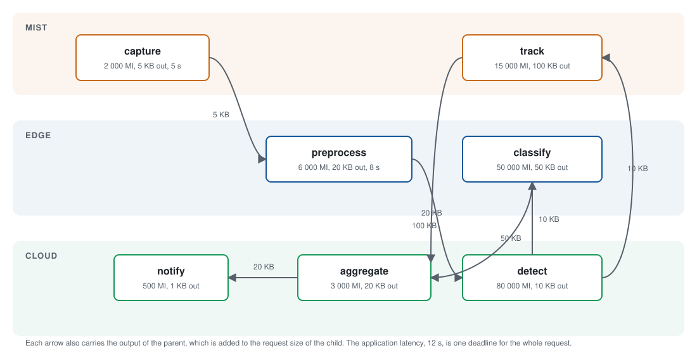
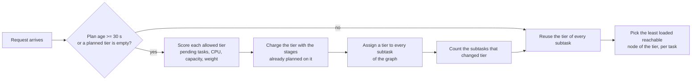
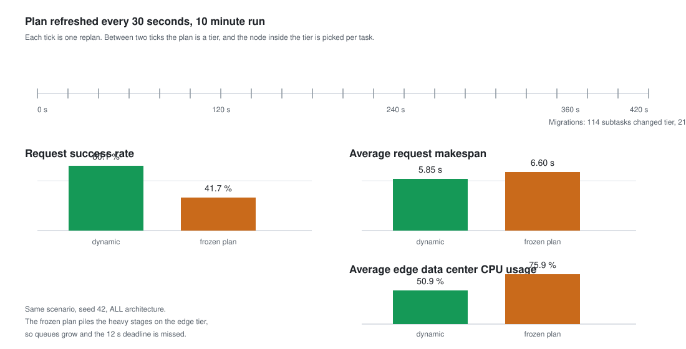

# Example 24: repartitioning a service graph while the simulation runs

## What it shows

How to recompute the placement of a service graph during the simulation instead
of deciding once at the start. The applications file declares one video
analytics pipeline: seven subtasks, from `capture` to `notify`, one instance of
each per request.



`Example24DynamicRepartitionOrchestrator` assigns a tier to every subtask and
refreshes that plan every 30 seconds:

1. it scores every allowed tier by the pending tasks, the current CPU
   utilization, the capacity of the nodes, and a tier weight (cloud 1.8, mist
   edge devices 1.3, edge data centers 1.2);
2. it also charges the tier with the subtasks of the same graph already planned
   on it, so a single request does not pile every stage onto the same tier;
3. after each replan it counts the subtasks that changed tier, which is the
   migration count printed in the console;
4. it replans immediately, without waiting for the interval, when a tier of the
   current plan no longer has a live node that can host a subtask.

The plan is a tier, not a node. The node inside the tier is chosen per task
among the reachable nodes, least loaded first, so a mobile device that moved out
of range of one node is served by another without invalidating the plan.





## The API detail this example exists to show

PureEdgeSim caches an application placement per device. A plan that changes over
time cannot survive that cache, so the orchestrator clears it after every
decision, exactly as Examples 9 and 10 do:

```java
@Override
public void orchestrate(Task task) {
    super.orchestrate(task);
    task.getEdgeDevice().setApplicationPlaced(false);
}
```

The plan also depends on state that only exists while the run is going: queues,
CPU utilization, and the uplink a moving device is currently attached to. This is
why it is rebuilt from the node list on each refresh and not from the application
profile alone.

## The scenario

The files in `settings/` describe:

- 200 devices on a 2000 by 2000 meters map, in four types: mobile smartphones,
  faster vehicles that cross the coverage of several data centers, fixed
  Raspberry Pis that add mist capacity, and sensors that generate requests
  without offering any capacity;
- four linked edge data centers and the `ALL` architecture, so all three tiers
  are candidates for the plan;
- ten simulated minutes, a fixed seed of 42, and no container registry;
- the same application latency, 12 seconds, as the end-to-end deadline of every
  request. A request fails if its last result returns after that deadline, which
  is what turns an outdated placement into a visible result.

## Run it

From the repository root, after `mvn clean install -DskipTests`:

```bash
mvn exec:java -Dexec.mainClass="examples.Example24"
```

Run the static baseline in the same scenario by computing the plan once on the
first request and never updating it:

```bash
mvn exec:java -Dexec.mainClass="examples.Example24" -Dexample24.frozenPlan=true
```

## What to look for

The console prints every replan and the number of subtasks it moved:

```text
Example24DynamicRepartitionOrchestrator - 615,0 s: plan of application 0 recomputed, 5 subtasks moved, 114 migrations so far
```

With seed 42 the two runs give:

| Metric | Dynamic plan | Frozen plan |
| --- | --- | --- |
| Replans | 21 | 1 |
| Subtasks moved between tiers | 114 | 0 |
| Requests that completed successfully | 80.1 % | 41.7 % |
| Average request makespan | 5.85 s | 6.60 s |
| Average task waiting time | 0.10 s | 0.74 s |
| Tasks executed on edge / cloud / mist | 22318 / 21405 / 6270 | 27277 / 10544 / 5275 |
| Average CPU utilization on edge | 50.9 % | 75.9 % |

The frozen plan keeps most of the graph on the edge tier, where the queues grow
until the end-to-end deadline is missed. The dynamic plan moves stages to the
cloud as the edge saturates, so the edge keeps half of its capacity free and far
more requests meet their deadline. A request succeeds only when all seven of its
subtasks succeed, which is why the request-level gap is wider than the task-level
gap (96.8 percent against 85.3 percent).

The plan is not free: the dynamic run spends more energy on the cloud and sends
more bits over the WAN, as the per-tier energy lines of the report show. Whether
that trade-off is worth it depends on the deadline, which is exactly what the
example lets you vary.

- Results go to `output/Example24_output/`.
- Changing the number of simulated minutes or the seed changes the numbers; run
  both modes to compare them in your own scenario.

## Files

- `Example24.java`
- `Example24DynamicRepartitionOrchestrator.java`
- `settings/applications.xml` with the service graph and its end-to-end deadline

## Where to go next

- [Writing orchestrators: placing the subtasks of a service graph](../../../docs/writing-orchestrators.md#placing-the-subtasks-of-a-service-graph)
- [Configuration: service graphs](../../../docs/configuration.md#service-graphs)
- [Example 9: a static plan from graph theory](../Example9/README.md)
- [Example 10: a static plan from a genetic algorithm](../Example10/README.md)
