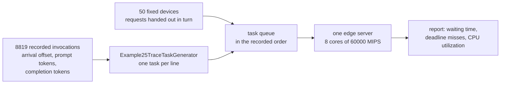

# Example 25: replaying a recorded production workload

## What it shows

How to feed the simulator with measured traffic instead of a random one. The
workload is a real trace: 8819 invocations of an LLM inference service in
production, with the instant each one arrived and how many tokens it read and
produced. `Example25TraceTaskGenerator` turns every recorded invocation into one
request, so the burstiness of the traffic, which is what overloads a server,
reaches the orchestrator untouched.

The trace is `trace/azure_llm_code_1h.csv`, the code completion sample of the
Azure LLM inference dataset released with the Splitwise paper (see
`trace/NOTICE.md` for the source, the licence, the citation, and the one
transformation applied: absolute timestamps replaced by offsets). Its numbers,
measured on the file:

| | mean | median | p90 | p99 | max |
| --- | --- | --- | --- | --- | --- |
| time between two arrivals | 0.390 s | 0.064 s | 0.273 s | 2.205 s | 217.2 s |
| prompt tokens | 2047.8 | 1469 | 5194 | 7436 | 7437 |
| completion tokens | 27.9 | 13 | 55 | 252 | 1899 |

The hour spans 3435.948 s, so the mean rate is 2.57 requests per second. The
coefficient of variation of the inter-arrival time is 13.15, against 1 for the
poisson gaps that `applications.xml` draws. Measured on the seconds the example
replays: the busiest sliding ten-second window carries 412 requests, 16 times the
hourly mean, one second alone carries 68, and 12 of the 58 minutes of the run carry
nothing, the longest quiet gap being 217 s. That is the whole argument for trace
driven simulation: a generator tuned to the same mean rate sees none of this.



## The API detail this example exists to show

`TaskGenerator.generate()` returns the whole queue before the first event is
scheduled, so a generator is free to build its tasks from anything: the
distributions of `applications.xml`, as the default one does, or a file. The
only structure the rest of the framework requires is that each task carries its
generation time, its sizes, its length, and its deadline:

```java
Task task = createTask(++id).setType(appParams.getType())
        .setFileSizeInBits(Math.round(contextTokens * BYTES_PER_TOKEN * 8))
        .setOutputSizeInBits(Math.round(generatedTokens * BYTES_PER_TOKEN * 8))
        .setContainerSizeInBits(appParams.sampleContainerSize())
        .setMaxLatency(latency)
        .setLength(contextTokens * MI_PER_CONTEXT_TOKEN + generatedTokens * MI_PER_GENERATED_TOKEN)
        .setEdgeDevice(dev).setRegistry(cloud);
task.setRequest(++requestId, 1, time, time + latency);
scheduleTask(task, time);
```

The recorded stream describes one service, not one device, so the requests are
handed to the devices in turn. The fleet stays evenly loaded while the
instantaneous arrival rate remains exactly as recorded. Because the generator
draws nothing, the replay is reproducible on its own: the same file and the same
fleet give the same task list whatever `random_seed` says (the test suite checks
this).

## From tokens to simulator units

A trace names what a request is, not how long it takes on the machine being
simulated, so the mapping is explicit and every constant is a tuning knob:

| System property | Default | Meaning |
| --- | --- | --- |
| `example25.bytesPerToken` | 4 | bytes of text per token, for the up and down traffic |
| `example25.miPerContextToken` | 12 | cost of reading the prompt (the prefill phase) |
| `example25.miPerGeneratedToken` | 2000 | cost of producing one completion token (the decode phase) |
| `example25.ttftBudget` | 2 | seconds promised before the first token comes back |
| `example25.decodeBudget` | 0.1 | seconds promised per completion token |

The two cost constants are a throughput statement rather than a guess: on a
60000 MIPS core, 12 MI per prompt token is 5000 prompt tokens per second, and
2000 MI per completion token is 30 completion tokens per second. The ratio
between the two phases, about 167, is the asymmetry that the Splitwise paper,
which published this trace, measures on the serving hardware. The deadline model
follows the same logic: 10 completion tokens per second promised to the user,
against 30 per second of the machine, so a request only misses when it waited in
a queue rather than because the budget was impossible from the start.

With those values the hour asks for 708,511,688 MI over 3436 s, a mean of
206203 MIPS against the 480000 MIPS of the server. The server is therefore
sized to the trace, not the trace to the server, and the report confirms the
arithmetic: 42.42 percent mean edge CPU utilization.

## The scenario

The files in `settings/` describe:

- 50 fixed devices on a 2000 by 2000 meters map, 40 percent on a cellular access
  and 60 percent on wifi, none of them mobile and none of them on a battery, so
  that the only variability left in the run is the trace itself;
- one edge data center of 8 cores at 60000 MIPS, and `EDGE_ONLY` so that no
  request escapes to the cloud or to the mist tier;
- 58 simulated minutes, which covers the 3436 s of the recorded hour plus a
  minute for the requests still running when it ends;
- one application declaration, whose rate, sizes and length are the means of the
  trace. They are only used by the baseline mode described below, and they are
  what makes the two runs comparable.

Arrival times are recorded in milliseconds and the simulation clock ticks in
whole seconds, so each replayed request is rounded to its second. This is a real
limitation of the framework rather than of the trace: the 8819 requests of the
hour collapse onto 945 distinct instants, 99.6 percent of them share their second
with at least one other request, and one second holds 68 of them at the peak.
Bursts survive the rounding, their internal order does not.

## Run it

From the repository root, after `mvn clean install -DskipTests`:

```bash
mvn exec:java -Dexec.mainClass="examples.Example25"
```

Run the same scenario with the requests drawn at random instead, at the mean rate
and mean sizes of the trace:

```bash
mvn exec:java -Dexec.mainClass="examples.Example25" -Dexample25.syntheticBaseline=true
```

Both runs take a few seconds. To replay only part of the hour, lower
`simulation_time` in `settings/simulation_parameters.properties`: the generator
drops the requests that arrive after the end of the run and says how many it
dropped, rather than failing.

## What to look for

The console prints what the replay did before the first event is executed:

```text
0 (s) : Trace replay: 8819 requests scheduled between 1 and 3480 s, 0 dropped because they arrive after the end of the run.
```

and then, with seed 42, the two modes give:

| Metric | Recorded trace | Synthetic poisson |
| --- | --- | --- |
| Requests generated | 8819 | 8665 |
| Total compute executed | 11808.53 s | 11602.29 s |
| Average task execution time | 1.339 s | 1.339 s |
| Average edge CPU utilization | 42.42 % | 41.56 % |
| Total time spent waiting | 120201.01 s | 173.11 s |
| Average task waiting time | 13.630 s | 0.020 s |
| Requests that completed successfully | 36.06 % (3180) | 100 % (8665) |
| Average request makespan | 2.907 s | 1.389 s |
| Total traffic | 73.22 MB | 70.26 MB |
| Energy of the run | 529.06 Wh | 528.08 Wh |

The two runs do nearly the same amount of work for the same server: the compute
total differs by 1.8 percent, the mean utilization by under a point, the average
task by nothing at all, and the traffic by 4 percent. What differs is when that
work arrives. The recorded hour spends 120201 seconds waiting in the queue and the
synthetic hour spends 173, and the difference is not a reporting artefact: the
average request of the replay waits 13.6 seconds before its first instruction is
executed, while its deadline budget is 4.8 seconds on average. 63.94 percent of the
requests miss it, and they miss it inside the bursts that a poisson generator with
the same mean never produces.

Two more runs separate the effect of the deadline model from the effect of the
queue. Both replay the same trace:

| Run | Edge CPU utilization | Average waiting time | Successful requests |
| --- | --- | --- | --- |
| recorded trace, default budget | 42.42 % | 13.630 s | 36.06 % |
| `-Dexample25.decodeBudget=0.5` | 42.42 % | 13.630 s | 57.71 % |
| `-Dexample25.miPerGeneratedToken=1000` | 27.69 % | 4.459 s | 61.72 % |

Loosening the promise to the user moves the pass mark and leaves the waiting time
untouched: the queue is really 13.6 seconds deep, and whether a request meets its
deadline is decided by where the line is drawn. Cutting the cost of a completion
token in half removes a third of the offered load (11808.53 s of compute become
7710.26 s), and 38.28 percent of the requests still miss: at 27.69 percent mean
utilization the server is idle most of the hour and overloaded for a few seconds at
a time. A capacity study run on synthetic traffic at the same means would have
concluded that this server has headroom.

- Results go to `PureEdgeSim/examples/Example25/output/`.
- The numbers above are the measured output of the runs of 2026-10-28, with the
  committed `settings/` and seed 42 for the baseline mode.

## Files

- `Example25.java`
- `Example25TraceTaskGenerator.java`
- `trace/azure_llm_code_1h.csv`, the recorded invocations
- `trace/NOTICE.md`, source, licence, citation, and transformation
- `settings/applications.xml` with the means that the baseline mode replays

## Where to go next

- [Customizing models: the task generator](../../../docs/customizing-models.md#a-generator-that-reads-a-file)
- [Models: recorded traces](../../../docs/models.md#recorded-traces)
- [Example 23: four extension points in one scenario](../Example23/README.md)
