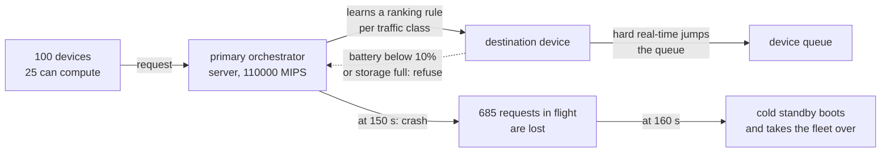

# Example 26: a pure edge fleet that survives the crash of its orchestrator

## What it shows

How to put fault tolerance, robustness and adaptation into one orchestrator, and
how to measure each of them separately. The scenario has no server to fall back
on: one hundred devices form the whole infrastructure, twenty five of them can
compute, and two of them carry the orchestration. Halfway through the run the
primary orchestrator crashes. Everything the example does is about what happens
around that moment.

Four classes carry the paper's mechanisms, and each one is a different extension
point:

- `Example26FaultTolerantOrchestrator` (a custom edge orchestrator) learns which
  way of ranking the fleet returns the most tasks for each class of traffic.
- `Example26OrchestratedDevice` (a custom computing node) puts hard real-time
  tasks at the head of the queue of their destination, and refuses work a device
  can no longer afford.
- `Example26FaultTolerantSimulationManager` (a custom simulation manager)
  schedules the crash, boots the standby ten seconds later, and prints the
  summary the ablation is read from.
- The three application classes and the fleet come from the scenario files in
  `settings/`.

The paper is Safavifar, Mechalikh and Golpayegani, "Fault tolerant robust
adaptive workload orchestration in pure edge computing", ICAART 2023, published
in the Springer Lecture Notes in Computer Science series, pages 370-386.



## The scenario

Three classes of traffic share the fleet, with the budgets, shares, container
sizes and task lengths the paper publishes:

| Application | Class | Share of the fleet | Tasks per minute per device | Budget | Task length | Container |
| --- | --- | --- | --- | --- | --- | --- |
| Health | Hard Real-time | 25% | 30 | 15 ms | 200 MI | 30 MB |
| Augmented reality | Soft Real-time | 35% | 30 | 500 ms | 5000 MI | 50 MB |
| HEAVY_COMP_APP | Normal | 40% | 60 | 30 s | 10000 MI | 40 MB |

Over the five simulated minutes that is 3750, 5250 and 12000 requests, 21000 in
total, and every number in the tables below is a fraction of those.

The fleet is one hundred fixed devices: two servers that orchestrate (one of
them a cold standby, switched off until the crash), five servers at 110000 MIPS
with 250 MB of storage, eight workstations at 25000 MIPS with 180 MB, ten phones
at 8000 MIPS with 120 MB, and seventy five sensors that compute nothing. Fifty
four of them run on a battery, and five of the computing devices start almost
flat, below the level at which a device stops accepting work that can be done
elsewhere.

The fifteen milliseconds of the health monitor are tight because of the radio as
much as the processor. An offloaded request crosses four wireless hops, so at
the one millisecond per hop this scenario sets those hops cost 4 ms, and the 200
million instructions then take 2 ms on a server, 8 ms on a workstation and 25 ms
on a phone. A phone can therefore never answer a health monitor that is not its
own, and a workstation only when nothing is queued in front of it. That is the
trade the orchestrator has to learn: the fast devices are the only ones that can
carry real time, and they are the ones every background computation would like
to have.

## Run it

From the repository root, after `mvn clean install -DskipTests`:

```bash
mvn exec:java -Dexec.mainClass="examples.Example26"
```

A run takes five to eight minutes of wall-clock time. To switch one mechanism
off, pass its property before the main class:

```bash
mvn exec:java -Dexample26.fault=false -Dexec.mainClass="examples.Example26"
mvn exec:java -Dexample26.backup=false -Dexec.mainClass="examples.Example26"
mvn exec:java -Dexample26.priority=false -Dexec.mainClass="examples.Example26"
mvn exec:java -Dexample26.reallocation=false -Dexec.mainClass="examples.Example26"
```

The switches are read once, when the class loads, so they cannot be changed
inside a running JVM. That is also why the test suite drives them through
separate runs rather than asserting on both branches in one.

## What to look for

The manager prints a block of its own at the end of the run, after the standard
report:

```text
fault tolerance: orchestrator 2 crashed at 150 s, standby 3 took over at 160 s,
  685 requests lost with the primary (Hard Real-time 125, Soft Real-time 170, Normal 390)
success by class: Hard Real-time 85% (3192/3750), Soft Real-time 85% (4507/5250), Normal 59% (7162/12000)
delay by class: Hard Real-time 17 ms, Soft Real-time 124 ms, Normal 906 ms
robustness: 1120 hard real-time tasks jumped a queue, 3641 tasks were reallocated,
  0 found no device at all
learned rules: LEAST_LOADED used 3916 (1745 ok, 2171 lost), FASTEST used 870 (267 ok, 603 lost),
  MOST_POWER used 128 (41 ok, 87 lost), NEAREST used 379 (157 ok, 222 lost); 443 explorations
```

## The learning agent

The state is the class of the task, a bucket of its length, and a bucket of how
much of the fleet is already busy. The action is one of four ways of ranking the
reachable devices: `LEAST_LOADED`, `FASTEST`, `MOST_POWER`, `NEAREST`. The agent
does not place tasks, it learns which ranking brings the most of them back for
the traffic it is shown.

| Constant | Value | Effect |
| --- | --- | --- |
| reward of a returned task | 1 | |
| reward of a lost task | `-weight x delay / budget` | a hard real-time miss costs 3 times, a soft real-time one 1.5, a normal one 1 |
| learning step | `1 / min(visits, 200)` | the table settles instead of oscillating |
| exploration rate | `min(1, 6 / clock)` | 100% at the first second, under 5% after two simulated minutes |
| reallocation threshold | 10% battery | below it a device keeps elastic work only if it can serve it in time |

There is no discount factor: every task is a decision of its own, which is what
makes the table readable at the end of the run.

## The ablation, measured

Each line is one run of the committed `settings/` with seed 42, measured on
2026-10-28. The first line is the example as it ships.

| Run | Hard real-time | Soft real-time | Normal | Hard rt. delay | Queue jumps | Reallocations | Requests lost to the crash | Failed requests |
| --- | --- | --- | --- | --- | --- | --- | --- | --- |
| all mechanisms | **85%** | 85% | 59% | **17 ms** | 1120 | 3641 | 685 | 6139 |
| `-Dexample26.fault=false` | 84% | 86% | 61% | 21 ms | 1355 | 3749 | 0 | 5849 |
| `-Dexample26.backup=false` | 68% | 68% | 49% | 17 ms | 963 | 3040 | 4085 | 8910 |
| `-Dexample26.priority=false` | 83% | 84% | 59% | 22 ms | **0** | 4078 | 685 | 6350 |
| `-Dexample26.reallocation=false` | 82% | 88% | **73%** | 17 ms | 1413 | 726 | 685 | **4427** |

**The standby is the mechanism that pays.** The same crash costs 685 requests
when a cold standby boots ten seconds later and 4085 when nothing takes over:
recovery saves 3400 requests, six of every seven the fault would have destroyed.
Hard real-time success goes from 68% to 85% across those two runs, which is the
result the paper's fault tolerance section is about.

**The queue jump buys delay, not success.** With priority off, no task jumps
(the counter reads 0, which is the switch working rather than the fleet being
idle) and the mean delay of the hard real-time class rises from 17 to 22 ms,
30% of its own budget, while its success drops two points. The class is served
in time because it is allowed to overtake, not because the orchestrator places
it better.

**Reallocation costs more than it saves in a five minute run.** With devices
refusing work they can no longer afford, 3641 tasks are pushed elsewhere, and
the run loses 1712 requests it would otherwise have kept: Normal success falls
from 73% to 59%. The reason is visible in the standard report: no device
actually dies in five minutes (`Dead edge devices due to battery drain: 0`), so
refusal pays a second transfer and a longer queue on another device and is never
repaid by a task saved from death. It does pay for the tightest class, where
success is 85% with the mechanism and 82% without. The paper runs thirty
minutes, long enough for batteries to reach zero; the same switch there is a
different trade.

**Ablating a learning policy is not a controlled experiment.** Turning the fault
off should recover exactly the 685 requests the crash destroys, and it recovers
290 of the 6139 failed. The gap is not a bug: a run that never crashes feeds the
agent a different stream of rewards, so it converges on a different ranking, and
the five runs above differ in their learned table as well as in their switch.
Read the columns that count a mechanism directly (queue jumps, reallocations,
requests lost to the crash) as the effect, and the success rates as the effect
plus the trajectory.

## Where the scenario is scaled down from the paper

Four things are smaller so that a run fits on one machine and reads on one
screen. Each is a change of scale, not of mechanism:

| | The paper | This example | Why |
| --- | --- | --- | --- |
| Arrival rate | 135 / 135 / 270 tasks per minute per device | a quarter of it | the generator spaces the arrivals of an application by a whole number of seconds, so a rate above sixty is emitted in one burst |
| Cores per device | 8 | 1 | the settings files describe one core, so the speed of a device is the speed of that core |
| Run length | 30 minutes | 5 minutes | the batteries do not reach zero in five minutes, which is the one mechanism the paper has and this example loses |
| Wireless latency | | 1 ms per hop, against the 5 ms framework default | an offloaded request crosses four hops, and at 5 ms the hops alone spend the whole budget of the health monitor |

The placement policy is a tabular Q-learning agent over four ranking rules, not
the fuzzy decision tree the paper grows out of its Q-table: the tree needs a
fuzzy-logic library and only pays off on a much larger state space. Everything
the paper is about, the real-time classes, the crash, the recovery, the queue
priority and the battery-aware refusal, is here and is measured.

## Files

- `Example26.java`
- `Example26FaultTolerantOrchestrator.java`
- `Example26OrchestratedDevice.java`
- `Example26FaultTolerantSimulationManager.java`
- `settings/`, the fleet, the three classes, and the crash timing
- `../../test/java/examples/Example26FaultToleranceTest.java`, which drives the
  same mechanisms through a smaller scenario and asserts on each switch

## Where to go next

- [Writing orchestrators](../../../docs/writing-orchestrators.md): the learned
  table as orchestrator state, and the test pattern this example's suite uses.
- [Customizing models](../../../docs/customizing-models.md): the custom node
  that refuses work, and the manager that injects the crash.
- [Example 25](../Example25/README.md): the other way to break a default
  assumption, by replaying measured traffic instead of drawing it.
