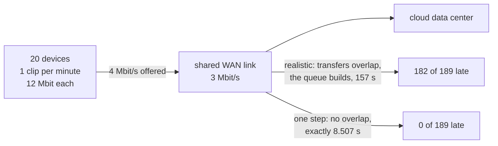

# Example 27: a shared uplink that is offered more than it can carry

## What it shows

What a saturated link does to a delay budget, and what the default network model
hides when it happens. Twenty devices upload a megabyte and a half of video once
a minute into a three megabit per second shared WAN link. That is four megabits
per second offered against three carried, so the link is over its own capacity
for the whole run, and every request is late.

The point of the example is the comparison, not the congestion. Two network
models ship with PureEdgeSim, and only one of them can see the queue:

- With `realistic_network_model=true`, a transfer lives on the link: it advances
  by `network_update_interval` at a share of the capacity, and a request that
  arrives while the link is busy waits for the one in front of it. The upload of
  one clip takes 157 s and 96% of the requests miss their deadline.
- With `realistic_network_model=false`, the default, a transfer is charged its
  serialization time and completes in one step. Requests never overlap in
  reality even though the offered load says they must. Every one of the 189
  requests succeeds, in exactly 8.507 s, and the run reports the link running at
  precisely its nominal three megabits per second.

The class doing the measuring is `Example27CongestionAuditor`, a custom
simulation manager. The standard report gives one network average per scenario;
congestion is not an average, it is a tail, so the auditor keeps the network
time of every task that reaches an end, successful or not, and prints its median,
ninetieth percentile and maximum next to the mean, plus the share of the end to
end delay the network accounts for.



## The scenario

| Setting | Value | Why it matters |
| --- | --- | --- |
| Edge devices | 20, fixed, no battery | the offered load is twenty times one request per minute |
| Application | one clip per device per minute, poisson arrivals | poisson is what makes the two models disagree; see below |
| Request | 1500 KB, 12 Mbit | the transfer time is the whole delay |
| Results | 50 KB | the return leg is a tenth of the forward one |
| Task length | 5000 MI | a tenth of a second on any destination, so nothing else explains a late request |
| Budget | 25 s | a promise about the link, not about the processor |
| WAN | 3 Mbps, 60 ms | the bottleneck |
| Wi-Fi | 1300 Mbps, 5 ms | fast enough that the radio is never the limit |
| Architectures | `CLOUD_ONLY`, then `EDGE_ONLY` | the congested iteration and the reference iteration |
| Algorithm | `TRADE_OFF` | the default: it ignores queue state, so the congestion is not an artefact of a smart placement |

The `EDGE_ONLY` iteration is the control. It sends the same clips to the edge
data center over the one point three gigabit radio instead of the three megabit
WAN, and both models agree that nothing is congested.

Arrivals are poisson rather than evenly spaced on purpose. The default generator
spreads a per-minute rate over whole seconds, so all twenty devices would emit
their clip in the same second and both models would charge the same sharing: the
bursts overlap even when a transfer has no duration. Spread over the minute, a
clip that is still crossing the link when the next one arrives has to hold that
next one back, and only a model in which transfers occupy the link over time can
say so.

## Run it

From the repository root, after `mvn clean install -DskipTests`:

```bash
mvn exec:java -Dexec.mainClass="examples.Example27"
```

That is the congested, realistic model. The ablation is the second parameters
file, selected with one system property:

```bash
mvn exec:java -Dexample27.realistic=false -Dexec.mainClass="examples.Example27"
```

`linear-network-model.properties` differs from `simulation_parameters.properties`
in exactly one setting line, which `Example27CongestionTest` checks, so the two
runs are the same scenario seen through two models. A run takes about three
seconds of wall-clock time for both iterations.

## What to look for

The auditor prints one block per iteration, after the standard report:

```text
CLOUD_ONLY - 189 tasks sampled, 7 succeeded, 182 failed (FAILED_DUE_TO_LATENCY 182).
CLOUD_ONLY - network time: mean 158.932 s, median 157.440 s, p90 254.440 s, max 262.540 s.
CLOUD_ONLY - the network accounts for 99.9 percent of the end to end delay.
```

## The ablation, measured

Every number below is a run of the committed `settings/` with seed 42, measured
on 2026-10-29. The network times are the auditor's own samples; the usage and
speed columns are the framework's standard report.

| Run | Architecture | Requests | Succeeded | Network time, median | p90 | Max | Network share | Link usage | Reported speed |
| --- | --- | --- | --- | --- | --- | --- | --- | --- | --- |
| realistic | CLOUD_ONLY | 189 | **7** (3.7%) | **157.440 s** | 254.440 s | 262.540 s | 99.9% | 841.4 s of WAN | 1.582 Mbps |
| `-Dexample27.realistic=false` | CLOUD_ONLY | 189 | **189** (100%) | **8.507 s** | 8.507 s | 8.507 s | 98.6% | 781.2 s of WAN | 3 Mbps |
| realistic | EDGE_ONLY | 222 | 222 (100%) | 0.210 s | 0.210 s | 0.210 s | 62.7% | 44.4 s of LAN | 1300 Mbps |
| `-Dexample27.realistic=false` | EDGE_ONLY | 222 | 222 (100%) | 0.020 s | 0.020 s | 0.020 s | 13.5% | 2.1 s of LAN | 1300 Mbps |

**The one step model does not see a saturated link, and says so confidently.**
Eight point five zero seven seconds is exactly one request's own serialization
time: twelve megabits up and four hundred kilobits back, each crossing the shared
link twice, plus the latencies. It is the same number for all 189 requests,
median and maximum alike, because in that model no transfer is ever in front of
another. The link is then reported at exactly 3 Mbps, which is its capacity, as
if it were running perfectly flat.

**The usage column is where the default model contradicts itself.** It books
781.2 seconds of WAN transfer inside a 600 second scenario: 130% utilization,
which no physical link reaches. Nothing in that run warns about it, because the
one step model never asks the link whether it had the time. The realistic run
books 841.4 seconds too, but it notices: the transfers queue, the run is
stretched to 770 seconds by `wait_for_all_tasks`, and the average speed drops to
1.582 Mbps because two clips are on the link on average at once.

**The delay is the network, entirely.** 99.9% of the end to end delay of the
sampled cloud tasks is transfer time: the 5000 MI task is a tenth of a second on
a 200 core data center, and the queue in front of the processor is empty
(`Average CPU utilization: 0.0007 %`). A placement algorithm that scores
candidates on their queue length alone, like the default `TRADE_OFF`, finds
nothing to improve here. The only lever is the link.

**The reference iteration is not a rounding error.** The same clips, offloaded
to the edge data center over the radio, cross it in 0.210 s against 157.440 s.
That is a factor of seven hundred and fifty, and it is the result a researcher
would report as the value of edge placement. The default network model would
report it as a factor of four hundred and twenty five (8.507 against 0.020), and
would additionally report no deadline misses at all in the cloud case.

## Two caveats about the numbers

**The update interval is the resolution of the realistic model, not an error of
the scenario.** A hop cannot finish between two updates, so the shortest time it
can be charged is one `network_update_interval`, and a transfer is rounded up to
the next whole tick. That is why the two megabit return leg of an edge upload
costs 0.210 s in the realistic run against 0.020 s in the one step run: eleven
ticks of 0.1 s against its true twenty milliseconds. The example sets the
interval to 0.1 s rather than the framework default of 1 s, so that the floor is
a fraction of the 25 s budget instead of a tenth of it. Raise it and every
transfer time in the realistic run shifts by roughly the same amount; the
congestion itself does not depend on it.

**The average makespan of the standard report is not the same measurement as the
auditor's.** It is booked only for requests that completed, so on the congested
iteration it averages the seven survivors of 189 and prints 18.7021 s, which
reads as a mild delay. It is also not the sum of the task delays: the edge
iteration prints 0.135 s of makespan against 0.210 s of sampled network time,
because the framework charges the serialization to the task and books the
makespan on the return event. The median network time of every sampled task,
157.440 s, is the number that describes the scenario, and it exists only because
the auditor samples failures as well as successes.

## Files

- `Example27.java`, which reads the `-Dexample27.realistic` switch and picks the
  parameters file
- `Example27CongestionAuditor.java`
- `settings/simulation_parameters.properties`, the congested scenario
- `settings/linear-network-model.properties`, the ablation
- `settings/applications.xml`, `edge_devices.xml`, `edge_datacenters.xml`,
  `cloud.xml`
- `../../test/java/examples/Example27CongestionTest.java`, which checks that the
  offered load really exceeds the capacity, that the two parameter files differ
  in one setting, and that a real run of both models disagrees in the direction
  the models predict

## Where to go next

- [The network model](../../../docs/models.md): how transfers share a link, and
  what the realistic switch changes in the code.
- [Configuration reference](../../../docs/configuration.md): `realistic_network_model`,
  `network_update_interval`, `one_shared_wan_network`.
- [Example 8](../Example8/README.md): fuzzy orchestration that feeds the live WAN
  utilization into its first stage, which is the lever this scenario leaves you.
