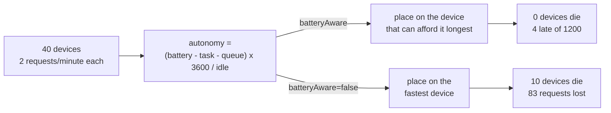

# Example 28: a battery powered fleet that dies of the work it is handed

## What it shows

What a placement policy is worth when the devices run out of energy, and why the
answer is not the fastest device. Forty fixed devices, all of them on a battery,
all of them generating two requests a minute and all of them able to compute,
serve each other in a `MIST_ONLY` scenario. The batteries hold between sixteen
and thirty minutes of each device's own idle draw against a run of fifteen
minutes, so nothing dies of staying awake: a device goes when the work it was
handed pushes its drain past what it holds. A device that goes takes its queued
tasks with it and never generates the requests it had left.

The orchestrator ranks the candidates by their *autonomy*, the seconds a device
could still stay alive at its idle power after paying for this task and for the
work already in its queue. Two switches ablate the two parts of that policy:

- `-Dexample28.batteryAware=false` ranks by estimated service time instead, the
  way a throughput oriented orchestrator does. The fast devices win every
  contest, carry the fleet, and die first.
- `-Dexample28.perTask=false` lets the framework reuse the first placement of a
  device for all its later tasks. That turns one decision into a commitment to
  serve one neighbour for the whole run, which regathers the work the ranking
  was spreading.

Each switch is a single semantic change, and each one changes the outcome of the
run in the direction its description predicts.



## The scenario

| Setting | Value | Why it matters |
| --- | --- | --- |
| Edge devices | 40, four types, all battery powered, all generating | the fleet serves itself, there is no mains fallback |
| Gateway | 1 core, 20000 MIPS, 4 W idle, 10 W full, 1.07 to 2 Wh | the fast, expensive device |
| Phone | 2 cores, 8000 MIPS each, 2 W idle, 6 W full, 0.53 to 1 Wh | the middle of the fleet |
| Wearable | 2 cores, 3000 MIPS each, 1 W idle, 3 W full, 0.27 to 0.5 Wh | the poor neighbour a task can still be handed to |
| Old phone | 1 core, 4000 MIPS, 2 W idle, 6 W full, 0.53 to 1 Wh | slow at the same price as the phone |
| Battery capacity | uniform over sixteen to thirty minutes of the device's idle draw | no device can die of idling; only the work can kill it |
| Applications | 20000, 80000 and 200000 MI, 2 requests a minute, 50/30/20% | the energy of computing is a quarter of the fleet's energy, not a rounding error |
| Latency budgets | 30, 60 and 150 s | wide on purpose: a miss here is queueing, not energy |
| Links | unrealistic model, wide radios | the battery is the only constraint |
| Duration | 900 s of simulated time | the run ends at 950 s because in-flight tasks keep it open |
| Algorithm | `BATTERY_AWARE` | the autonomy ranking |

The energy is what the scenario is built around. Measured over a run, the fleet
burns 32.34 Wh, of which 23.8 Wh go to idling and 8.5 Wh to computing. The 8.5
are the only part a placement policy can move. That share is not accidental:
with tasks ten times smaller the computing energy fell below 5%, and every arm
of the scenario then lost a third of its fleet regardless of the ranking. The
task lengths were raised until the placement was the thing that decided who
dies.

## Run it

From the repository root, after `mvn clean install -DskipTests`:

```bash
mvn exec:java -Dexec.mainClass="examples.Example28"
```

The two ablations, one switch at a time and then both:

```bash
mvn exec:java -Dexample28.batteryAware=false -Dexec.mainClass="examples.Example28"
mvn exec:java -Dexample28.perTask=false -Dexec.mainClass="examples.Example28"
mvn exec:java -Dexample28.batteryAware=false -Dexample28.perTask=false -Dexec.mainClass="examples.Example28"
```

A run takes a few seconds of wall-clock time for fifteen simulated minutes.

## What to look for

`Example28FleetReporter`, a custom simulation manager, prints four lines after
the standard report: the fleet, a census of the alive devices at the end of each
simulated minute, the three ways a task can be lost, and what the policy did.

```text
BATTERY_AWARE - fleet: 40 devices, 0 died, first at 0.0 s, last at 0.0 s.
BATTERY_AWARE - devices alive by minute: 40 40 40 40 40 40 40 40 40 40 40 40 40 40 40 40.
BATTERY_AWARE - tasks lost: 0 never generated because their device was dead, 0 died with their device, 4 came back too late.
BATTERY_AWARE - policy: 1169 decisions, 150 candidates refused for the deadline, 1120 placements moved off the fastest device, 41 kept at home, 0 tasks with nobody left to serve them, mean chosen autonomy 830.0 s.
```

The census is the shape of the collapse, not just its endpoint. Run the
`batteryAware=false` arm and it reads
`40 40 40 40 40 40 40 40 39 38 38 37 37 35 34 32`: the fleet is complete for
eight minutes, then loses a device roughly every other minute.

## The ablation, measured

Every number below is a run of the committed `settings/` with seed 42, measured
on 2026-10-29. The fleet, loss and policy columns are the reporter's; success
rate, energy and remaining power are the framework's standard report.

| Run | Died | First death | Never generated | Died with device | Late | Succeeded | Mean remaining power | Mist energy | Decisions | Moved |
| --- | --- | --- | --- | --- | --- | --- | --- | --- | --- | --- |
| default | **0** | none | 0 | 0 | 4 | **1196/1200** (99.67%) | 6.47% | 32.34 Wh | 1169 | 1120 |
| `-Dexample28.batteryAware=false` | **10** | 476 s | 58 | 25 | 0 | 1117/1142 (97.81%) | 27.31% | 28.60 Wh | 1123 | **0** |
| `-Dexample28.perTask=false` | **15** | 594 s | 42 | 43 | 35 | 1080/1158 (93.26%) | 12.31% | 32.11 Wh | **105** | 101 |
| both | 9 | 454 s | 56 | 79 | 5 | 1060/1144 (92.66%) | 26.62% | 28.69 Wh | 99 | 0 |

**The ranking is the difference between a fleet that survives and one that does
not.** The default arm ends with all forty devices alive and four late requests
out of twelve hundred, all four from queueing, none from energy. Ranking by
speed instead kills ten devices, the first at 476 s, and loses 83 requests: 58
that their device never lived to generate and 25 that died in its queue. The
orchestrator's own counter says why: it moved 1120 placements off the fastest
device, which the delay ranking does zero times by construction.

**Killing the fleet looks like it saves energy, and the standard report will let
you believe it.** The delay-first arm burns 28.60 Wh against 32.34 Wh for the
default, a 12% saving. Nothing was saved: a dead device stops drawing power. The
same accounting makes its average remaining power look excellent, 27.31% against
6.47%, because the average is taken over the survivors, and the survivors of that
arm are the devices that were never asked to do anything. The mean chosen
autonomy column of the reporter tells the same story from the other side: 830 s
under the default policy against 681 s under the delay ranking, because the
latter hands work to devices that are about to stop existing.

**A cached placement is a commitment, and commitments gather work.** With
`perTask=false` the framework asks the orchestrator 105 times in a run instead
of 1169, once per device instead of once per task, and the outcome is the worst
fleet of the four: fifteen devices dead. Counting every task that is not served,
the default arm loses 4, the ranking-off arm loses 83, the cache arm loses 120
(42 never generated, 43 died with their device, 35 late) and both together lose
140. The first placement of a device is made when its battery is full and its
queue is empty, so every following task of that neighbour lands on a device
whose autonomy has fallen since. The two losses add up rather than overlap.
That the ranking still matters inside the cache, 9 deaths against 15, is because
the cached placement was itself chosen by the autonomy.

**The two switches are not the same mechanism twice.** Turning the ranking off
kills fast devices early and leaves a tail of requests never generated; the cache
kills slower, starting at 594 s, and more of its loss is queued work dying with
its device (43 against 25). The reporter separates those two counts on purpose:
a request that is never generated is a loss the traffic model cannot even see,
while a request that dies in a queue is a loss of work already accepted. Which
of the two dominates is the difference between starving the fleet and
overcommitting it.

## Caveats about the numbers

**The last death can be after the last simulated minute.** The scenario lasts
900 s, but the standard report ends the default run at 950 s and the
`perTask=false` run at 1030 s: `wait_for_all_tasks` keeps the simulation open
until every in-flight task is done. The deaths at 1028 s in that arm happen in
that tail, and the census has eighteen entries rather than sixteen for the same
reason.

**The battery never quite reaches zero in the default run, and that is fine.**
The fleet ends at 6.47% of its initial charge on average. The batteries are sized
so that the idle draw of the whole run fits: what the ranking buys is not a
reserve but the order in which the computing energy is spent.

**The remaining power column is a survivor statistic.** It averages over the
devices still alive, so the arms that killed their poorest devices report the
best figures. Read it together with the death count, never alone.

**Four late requests under the default policy are not an energy result.** They
come from the queues of the busiest devices meeting the 30 s budget of the
sensor traffic. The autonomy ranking has no deadline term beyond refusing a
candidate that would return the result late, and it does not try to optimise
latency.

## Files

- `Example28.java`, which reads the two switches and registers the orchestrator
  and the reporter
- `Example28BatteryAwareOrchestrator.java`, the autonomy ranking and the
  placement cache switch
- `Example28FleetReporter.java`, the census and the loss accounting
- `settings/simulation_parameters.properties`, the scenario
- `settings/applications.xml`, `edge_devices.xml`, `edge_datacenters.xml`,
  `cloud.xml`
- `../../test/java/examples/Example28EnergyTest.java`, which checks the energy
  and autonomy arithmetic against the framework's own formulas, then runs the
  scenario three times and checks that the default fleet survives, that the
  delay ranking kills devices, and that the cached placement decides far less
  often

## Where to go next

- [The energy model](../../../docs/models.md): how the framework books idle and
  dynamic energy, and why a task is charged against the whole machine.
- [Example 26](../Example26/README.md): the same fleet idea with the orchestrating
  device itself able to crash.
- [Example 24](../Example24/README.md): repartitioning work while the simulation
  runs, which is the natural extension of a placement that is re-decided per task.
