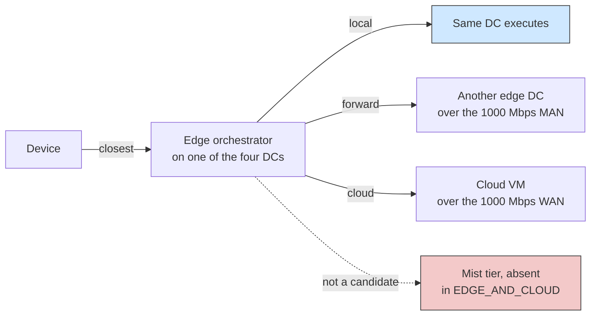

# Example 3: cooperative edge data centers

## What it shows

What changes when edge data centers can work together instead of each one
serving only its own devices. The scenario places four edge data centers at the
corners of a 2000 by 2000 meters map and links them in a ring, so a task can
travel from its device to one edge server, then to another, or to the cloud.

The decision is delegated to the edge tier. `deploy_orchestrator=EDGE` puts an
orchestrator on every edge data center, and a device sends its request to the
closest one. That orchestrator chooses between executing locally, forwarding to
another edge data center, and the cloud, using the TRADE_OFF algorithm.



## The scenario

The files in `settings/` describe:

- four linked peripheral edge data centers with 40000 MIPS and 10 cores each;
- 500 devices, one simulation of ten minutes;
- the `EDGE_AND_CLOUD` architecture, so both tiers are candidates;
- orchestrators enabled on the edge tier;
- no container registry, to keep the delay comparison about placement only;
- a 1000 Mbps WAN and a 1000 Mbps MAN, so moving a task between edge servers
  stays cheaper than a cloud round trip.

## Run it

From the repository root, after `mvn clean install -DskipTests`:

```bash
mvn exec:java -Dexec.mainClass="examples.Example3"
```

## What to look for

The captured run is a single iteration, `EDGE_AND_CLOUD / TRADE_OFF / 500
devices`, 7 seconds of wall clock, one row in the CSV. Those numbers show what
the cooperative setup delivers in this configuration, and where it does not
deliver:

| Metric | Value |
| --- | --- |
| Tasks generated, sent | 50750, 100 % of generated |
| Successfully executed | 36673, 72.2621 % of sent |
| Failed on delay, on mobility, on device death | 14077 (27.7379 %), 0, 0 |
| Average execution, waiting, request makespan | 0.1586 s, 0.0181 s, 0.2838 s |
| Tasks placed on cloud, edge, mist | 8014 (5819 ok), 42736 (30854 ok), 0 |
| Energy (computing, WAN, MAN, LAN) | 239.445 Wh, 77.4351 Wh, 0 Wh, 593.704 Wh |
| WAN time, MAN time, LAN time, total traffic | 295.3637 s, 0 s, 2124.2798 s, 63560 MBytes |
| Average remaining device battery | 98.6961 %, 33.4075 Wh, 0 dead devices |

Reading the run against the point of the example:

- Most tasks stay on the edge tier, but cooperation is not what got them there.
  42736 of 50750 tasks (84.2 %) executed on an edge data center, yet MAN usage
  is 0 s and MAN energy is 0 Wh. Every edge task ran on the same DC that the
  device chose as its closest orchestrator, so `TRADE_OFF` never forwarded a
  task to a peer. The four linked DCs behave as four independent edge servers
  in this run, not as a cooperative pool.
- The cloud tier is used and pays for it. 8014 tasks crossed the WAN, and 5819
  of them made their latency. The WAN share is only 12.2069 % of network time
  (295.3637 s of 2419.6435 s) but 77.4351 Wh of network energy, dwarfed only by
  the 593.704 Wh on the LAN, which is where the device-to-orchestrator
  round trips land. Total computing energy is 239.445 Wh, with 9.9661 Wh on the
  cloud, 78.344 Wh on the edge tier, and 151.1348 Wh still attributed to
  devices.
- Delay failures are the loss term. 14077 tasks (27.7379 %) ran but exceeded
  their deadline, and 0 failed on mobility or device death. That is because
  `edge_datacenters_coverage=1000` on a 2000 by 2000 map means every device
  stays reachable, and the ten minute run with 500 devices only draws 98.70 %
  of the average battery.
- Mobility between edge DCs did not fire because the tier is the placement
  question, not the routing question. The scenario as shipped does not
  measure the cooperative path.

The cooperation baseline is not in this capture, so the current run cannot
quantify what the MAN ring buys. To compare, add `CLOUD_ONLY` to
`orchestration_architectures` in `settings/simulation_parameters.properties`
and rerun, then read the new row against these numbers. To make the MAN ring
actually carry traffic, either shrink `edge_datacenters_coverage` so devices
are not all nearest the same DC, or raise the load (more devices or a longer
`simulation_time`) so `TRADE_OFF` starts to offload to a peer.
Results go to `PureEdgeSim/examples/Example3/output/` with a `run.properties`
file that records the seed and the five resolved input paths.

## Files

- `Example3.java`
- `settings/` with the four linked data centers and the scenario parameters

## Where to go next

- [Writing orchestrators](../../../docs/writing-orchestrators.md)
- [Configuration: orchestration](../../../docs/configuration.md)
