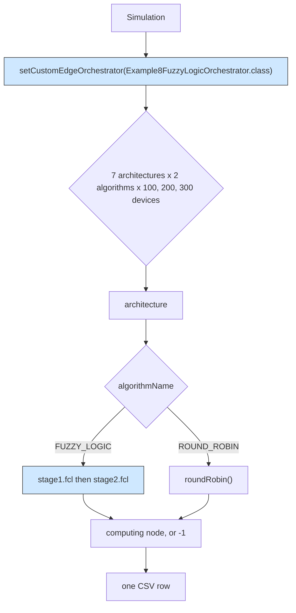

# Example 5: plugging in a custom orchestrator

One line of code replaces the offloading decision of the whole simulator. This
example keeps every default model and injects a real published policy instead of
the built-in round robin, then sweeps the seven orchestration architectures so
the two policies can be read side by side.

## What it shows

`sim.setCustomEdgeOrchestrator(Example8FuzzyLogicOrchestrator.class)` tells the
framework to build its task orchestrator from another class. The class comes from
[Example 8](../Example8/README.md), so this example is the smallest possible
demonstration of the injection point with a policy that actually decides
something. Delete the line and the same scenario runs on `DefaultOrchestrator`.



A custom orchestrator may accept algorithm names that the default class rejects.
`Example8FuzzyLogicOrchestrator` knows `FUZZY_LOGIC` and `ROUND_ROBIN` and throws
on anything else, so this example ships its own `settings/simulation_parameters.properties`
with exactly those two names, while every other file stays the default scenario.

## The scenario

- a 200 by 200 meters map with `edge_devices_range=10` meters;
- the fleet is swept over `CLOUD_ONLY`, `EDGE_ONLY`, `MIST_ONLY`, `MIST_AND_CLOUD`,
  `EDGE_AND_CLOUD`, `MIST_AND_EDGE` and `ALL`, with 100, 200 and 300 devices, so
  the CSV holds 42 rows and each pair of rows shares a workload;
- a ten minute run (`simulation_time=10`) with `enable_orchestrators=false`, so
  every device takes its own decision instead of asking a remote orchestrator;
- three applications: Health (Hard Real-time, 20 % of the devices, 500 MI,
  0.02 s latency), Augmented reality (Soft Real-time, 30 %, 5000 MI, 0.5 s) and
  HEAVY_COMP_APP on the remaining devices.

## Run it

From the repository root:

```bash
mvn clean install -DskipTests
mvn exec:java -Dexec.mainClass="examples.Example5"
```

The orchestrator needs the jFuzzyLogic jar committed at `libs/jFuzzyLogic_v3.0.jar`.
The `exec` plugin of the pom runs with the compile classpath, so the jar is found
and no IDE setup is required. The sweep takes roughly ten minutes. Results go to
`PureEdgeSim/examples/Example5/output/`.

## What to look for

The rows at 100 devices, one pair per architecture:

| Architecture | FUZZY delay (s) | FUZZY succeeded | ROUND_ROBIN delay (s) | ROUND_ROBIN succeeded |
| --- | --- | --- | --- | --- |
| CLOUD_ONLY | 0.75 | 1200 of 11100 | 0.1622 | 1200 of 11100 |
| EDGE_ONLY | 0.0909 | 6900 | 0.1622 | 8100 |
| MIST_ONLY | 0.165 | 2626 | 0.2431 | 3086 |
| MIST_AND_CLOUD | 0.2811 | 4251 | 0.1957 | 5070 |
| EDGE_AND_CLOUD | 0.1622 | 8100 | 0.1622 | 8070 |
| MIST_AND_EDGE | 0.0909 | 6900 | 0.2004 | 8386 |
| ALL | 0.1608 | 8142 | 0.1893 | 8476 |

- The fuzzy rule set is faster wherever an edge data center is reachable: on
  `EDGE_ONLY` and `MIST_AND_EDGE` the average execution delay falls to 0.0909 s,
  against 0.1622 s and 0.2004 s for round robin. Under `ALL` it is 0.1608 s
  against 0.1893 s.
- It pays for that latency with throughput. `EDGE_ONLY` completes 6900 tasks
  instead of 8100, `MIST_ONLY` 2626 instead of 3086, `MIST_AND_CLOUD` 4251
  instead of 5070, and `ALL` 8142 instead of 8476. Stage 2 scores candidates by
  their free capacity and leaves the busiest applications waiting, which is what
  the 2956 deadline failures of the `ALL` row measure against 2564 for round robin.
- `CLOUD_ONLY` is the instructive row for anyone writing their own orchestrator:
  the policy sends only the 1200 tasks that cross its offload threshold to the
  cloud and asks stage 2 for an edge or mist candidate for the rest, which the
  architecture does not offer, so 9900 tasks come back unexecuted. A custom
  orchestrator has to respect the `architecture` array it is handed, or fall back
  to a tier that exists.
- Energy follows the placement. Under `ALL` the fuzzy run consumes 52.0102 Wh
  against 45.3108 Wh, because it parks work in the data centers (9663 tasks on
  edge, 237 on mist) while round robin spreads 5874 on edge and 4042 on mist.

## Files

- `Example5.java`
- `../Example8/Example8FuzzyLogicOrchestrator.java` (owned by
  [Example 8](../Example8/README.md))
- `settings/simulation_parameters.properties` with
  `orchestration_algorithms=FUZZY_LOGIC,ROUND_ROBIN`
- `settings/applications.xml`, `edge_devices.xml`, `edge_datacenters.xml` and
  `cloud.xml`

## Where to go next

- [Example 8](../Example8/README.md) for the fuzzy rule files themselves and a
  longer comparison against round robin on one architecture.
- [Example 1](../Example1/README.md) for every other injection point of the
  `Simulation` class.
- [Writing orchestrators](../../../docs/writing-orchestrators.md) for the API the
  custom class implements.
