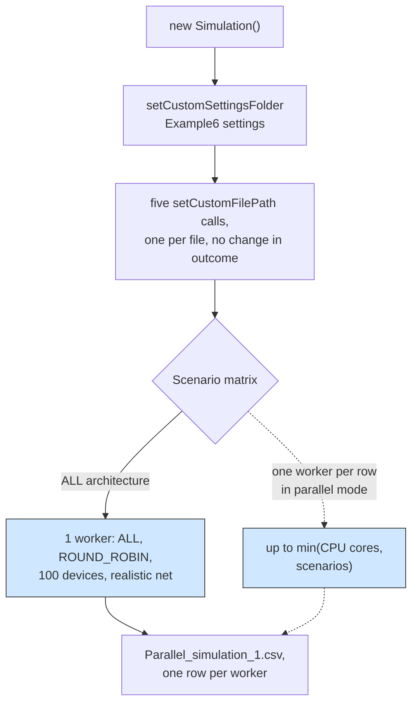

# Example 6: custom settings files and a parallel sweep

## What it shows

Two things that are easy to mix up:

- how to point the simulation at another scenario, either the whole settings
  folder or one file at a time through `setCustomFilePath(..., Files.X)`;
- how a larger sweep behaves when it runs in parallel.

The example sets both. It calls `setCustomSettingsFolder` for the folder, then
sets each of the five files individually, which shows the per-file API without
changing the outcome.



## The scenario

The files in `settings/` were written to make the run observable rather than
fast:

- every architecture is simulated in one sweep, with MIST orchestration and
  container downloads from the cloud registry;
- `realistic_network_model=true`, so transfers progress in steps and share
  links instead of completing instantly;
- `parallel_simulation=true`, so the sweep uses one worker per scenario and
  live charts are disabled automatically;
- `wait_for_all_tasks=false`, so the run stops at `simulation_time` and tasks
  still in flight stay unresolved;
- shorter batteries and higher energy consumption, so devices die during the run
  and the death columns are populated.

## Run it

From the repository root, after `mvn clean install -DskipTests`:

```bash
mvn exec:java -Dexec.mainClass="examples.Example6"
```

## What to look for

The shipped matrix has one architecture, one algorithm, and one device count,
so the parallel sweep is a single worker producing a single row. The file is
`Parallel_simulation_1.csv`, written by `settings/parallel_simulation=true`, and
the run reports `Simulation - Simulation took : 0 minutes, 0 seconds` of wall
clock, so parallel mode is genuinely faster than sequential on one scenario.

The captured row, `ALL / ROUND_ROBIN / 100 devices`, is the whole measurement:

| Metric | Value |
| --- | --- |
| Tasks generated, sent | 10150, 9975 (98.2759 %), 175 unsent at t = 600 s |
| Successfully executed | 994, 9.9649 % of sent |
| Failed on delay, on mobility, on device death | 8821 (88.4311 %), 160 (1.604 %), 0 |
| Average execution delay, waiting, request makespan | 0.6298 s, 0 s, 3.1857 s |
| Tasks placed on cloud, edge, mist | 688 (136 ok), 625 (70 ok), 8662 (788 ok) |
| Network usage total, WAN time, LAN time, MAN time | 26070 s, 10663 s, 15407 s, 0 s |
| Container share of WAN time, share of LAN time | 9287 s (87.0956 %), 0 s (0 %) |
| Total traffic, average bandwidth per task | 20966.88 MBytes, 989.0334 Mbps |
| Energy computing nodes, WAN, MAN, LAN | 50.9355 Wh, 1383.2385 Wh, 0 Wh, 9.6948 Wh |
| Energy by technology, WiFi, cellular | 10.4741 Wh, 1382.3777 Wh |
| Dead devices, first death time, remaining battery | 0, none reported, 98.7823 % |

Reading the run against the point of the example:

- The realistic network model is what dominates the run. WAN time is 10663 s
  against a 600 s simulation because `realistic_network_model=true` lets
  transfers share the link over many network updates, and the container
  downloads alone take 9287 s of it, 87.0956 % of WAN usage. Under the fast
  model in Examples 1 to 4, container traffic is 0 % because the registry is
  disabled.
- Energy follows the same shape. The WAN carries 1383.2385 Wh against a total
  computing energy of only 50.9355 Wh, and 1382.3777 Wh of that WAN energy is
  on the cellular technology. The 1000 Mbps WAN bandwidth in this scenario
  moves container bytes fast but not cheaply, and it is the cost of turning
  the registry on with `registry_mode=CLOUD`.
- The `wait_for_all_tasks=false` setting shows up exactly as documented. 10150
  tasks are generated by the clock, 9975 (98.2759 %) get sent, 175 stay
  unresolved at t = 600 s. Of the 9975 that were sent, only 994 (9.9649 %)
  meet their deadline, and 8821 (88.4311 %) miss it because container downloads
  add 3.1857 s of average request makespan.
- Battery death does not appear in this capture. The console reports 0 dead
  devices among 50 battery-powered devices, first death time empty, average
  remaining battery 98.7823 %. The scenario's shorter batteries and higher
  consumption do not kill a device within the 10 simulated minutes of this
  run, so the "dead device count and per-device death times" columns stay at
  zero and the paper-style death curves are not what this row demonstrates.
- The path API works. The capture prints the five `Example6/settings/` files
  as they load, and `run.properties` records the resolved seed and those five
  paths, so a rerun with `parallel_simulation=false` reproduces the same
  numbers under the same seed.
- Because parallel mode turns live charts off, the map and CPU chart window is
  not visible in this run. Set `parallel_simulation=false` in
  `settings/simulation_parameters.properties` to watch them, and expect the
  output file to become `Sequential_simulation.csv`.

Results go to `PureEdgeSim/examples/Example6/output/`.

## Files

- `Example6.java`
- `settings/` with the scenario parameters and the higher energy consumption

## Where to go next

- [Configuration](../../../docs/configuration.md)
- [Output and metrics](../../../docs/output-and-metrics.md)
- [Models: energy](../../../docs/models.md)
