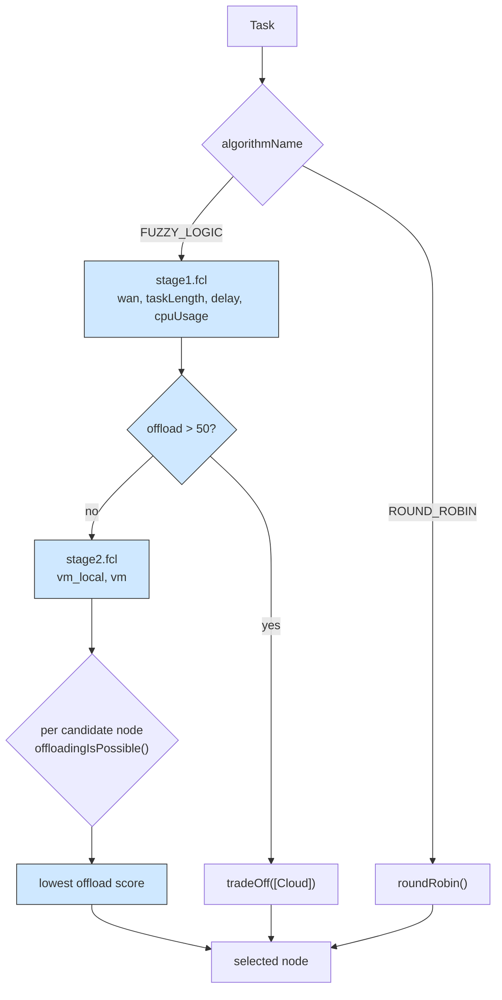

# Example 8: fuzzy logic orchestration

A published offloading policy, running inside PureEdgeSim. The example ports the
two-stage fuzzy workload orchestrator of:

> C. Sonmez, A. Ozgovde and C. Ersoy. Fuzzy Workload Orchestration for Edge
> Computing. IEEE Transactions on Network and Service Management 16(2), 2019,
> 769-782.

and extends it so that mist devices are candidates too. It is the reference case
for plugging a decision-making algorithm that is not a simple threshold into the
orchestrator, and for comparing it against `ROUND_ROBIN` in the same run.

## What it shows

`Example8FuzzyLogicOrchestrator` subclasses `DefaultOrchestrator` and overrides
`findComputingNode`. The rule sets are ordinary Fuzzy Control Language files in
`settings/`, so the policy can be tuned without recompiling anything. The
orchestrator evaluates stage 2 before stage 1, which keeps the complexity down:
when the candidate scan already answers, the tier decision is skipped.



The four stage-1 inputs are the free WAN bandwidth, the task length, the task
latency budget and the average CPU utilisation of the non-cloud candidates. The
two stage-2 inputs compare the local device capacity with the capacity of the
candidate, so a lightly loaded, powerful edge server wins over a busy one.

## The scenario

The files in `settings/` describe:

- the `ALL` architecture, so cloud, edge and mist nodes are all candidates;
- 300 devices on a 200 by 200 meters map, with `edge_devices_range=10` meters and
  `edge_datacenters_coverage=200` meters, so every device sits inside the
  coverage of a data center but only nearby devices can host mist tasks;
- a ten minute run (`simulation_time=10`) with `batch_size=100`;
- `orchestration_algorithms=FUZZY_LOGIC,ROUND_ROBIN`, so both policies are
  measured on the same workload;
- `enable_orchestrators=false`, so each device applies the algorithm locally
  instead of sending its request to a remote orchestrator;
- `enable_registry=false`, `wan_bandwidth=1000` Mbps and `wan_latency=0.06` s.

## Run it

The jFuzzyLogic jar is committed at `libs/jFuzzyLogic_v3.0.jar` and the `pom.xml`
declares it as a system dependency, so no IDE setup is needed. From the
repository root:

```bash
mvn clean install -DskipTests
mvn exec:java -Dexec.mainClass="examples.Example8"
```

The `exec` plugin runs with the compile classpath, which is what makes the jar
visible to `FIS.load`. Results go to `PureEdgeSim/examples/Example8/output/`.

## What to look for

The CSV holds one row per algorithm, with the same workload and the same settings:

| Metric | FUZZY_LOGIC | ROUND_ROBIN |
| --- | --- | --- |
| Average execution delay (s) | 0.1587 | 0.4886 |
| Tasks successfully executed | 20444 of 30450 | 15479 of 30450 |
| Tasks failed (delay) | 10006 | 14774 |
| Tasks failed (mobility) | 0 | 197 |
| Cloud executed / succeeded | 3150 / 3150 | 4184 / 3483 |
| Edge executed / succeeded | 27299 / 17294 | 3928 / 3227 |
| Mist executed / succeeded | 1 / 0 | 22338 / 8769 |
| Total tasks waiting time (s) | 3013.1375 | 1.4 |
| Average edge CPU usage (%) | 39.7964 | 10.1252 |
| Energy consumption (Wh) | 131.8878 | 116.4995 |
| Average request makespan (s) | 0.3631 | 0.7062 |

- The fuzzy policy completes 67 % of the tasks against 51 % for round robin, and
  cuts the average delay from 0.4886 s to 0.1587 s. The request makespan drops by
  the same factor, from 0.7062 s to 0.3631 s.
- It buys that latency by moving work off the phones. Round robin runs 22338
  tasks on mist devices and succeeds with 8769 of them; the fuzzy rule sets run
  one task there, and send 27299 to the edge data centers instead. The 3150
  tasks that cross the `offload > 50` threshold all succeed, because they are
  placed on the cloud by `tradeOff`.
- The price is queueing and energy. Waiting time goes from 1.4 s to 3013.14 s,
  edge CPU from 10.13 % to 39.80 %, and total energy from 116.50 Wh to
  131.89 Wh, because the data centers now draw 46.46 Wh between them instead of
  25.24 Wh while the fleet drops from 91.26 Wh to 85.43 Wh.
- 10006 tasks still miss their deadline, so compare the two policies on the
  delay-sensitive applications rather than on the average.

## Files

- `Example8.java`
- `Example8FuzzyLogicOrchestrator.java`
- `settings/stage1.fcl` and `settings/stage2.fcl`
- `settings/simulation_parameters.properties`, `applications.xml`,
  `edge_devices.xml`, `edge_datacenters.xml` and `cloud.xml`

## Where to go next

- [Example 5](../Example5/README.md) injects this same orchestrator class into a
  sweep over all seven architectures.
- [Writing orchestrators](../../../docs/writing-orchestrators.md) documents the
  API this example implements.
- [Example 11](../Example11/README.md) for a policy that learns its decisions
  instead of reading them from rule files.
