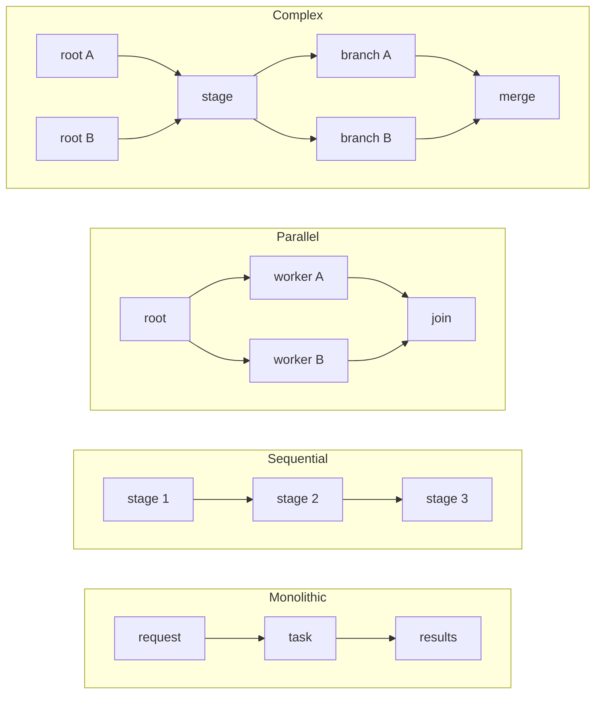

<p align="center">
  
</p>

<h1 align="center">PureEdgeSim</h1>

<p align="center">
  <strong>An open-source, discrete-event simulation framework for performance evaluation of cloud, edge, fog, and mist computing environments.</strong>
</p>

<p align="center">
  <a href="https://www.gnu.org/licenses/gpl-3.0"></a>
  <a href="https://search.maven.org/search?q=g:%22com.mechalikh%22%20AND%20a:%22pureedgesim%22"></a>
  <a href="https://github.com/CharafeddineMechalikh/PureEdgeSim/actions/workflows/coverage.yml"></a>
  <a href="https://github.com/CharafeddineMechalikh/PureEdgeSim/actions/workflows/coverage.yml"></a>
  <a href="https://github.com/CharafeddineMechalikh/PureEdgeSim/actions/workflows/coverage.yml"></a>
  <a href="https://www.codacy.com/gh/CharafeddineMechalikh/PureEdgeSim/dashboard"></a>
  <a href="https://javadoc.io/doc/com.mechalikh/pureedgesim"></a>
  <a href="https://github.com/CharafeddineMechalikh/PureEdgeSim_Python"></a>
</p>

> **PureEdgeSim is now available in Python.** The same simulator, the same five configuration
> files and the same 56-column output, in a companion repository:
> [CharafeddineMechalikh/PureEdgeSim_Python](https://github.com/CharafeddineMechalikh/PureEdgeSim_Python),
> with its own [manual](https://charafeddinemechalikh.github.io/PureEdgeSim_Python/docs/).
> Results from the two versions can be placed side by side, so you can run your study in
> whichever language you work in.

## Citation

**If you use PureEdgeSim in your research, please cite the following papers. Kindly cite the papers rather than the GitHub repository.**

Mechalikh, C., Taktak, H., & Moussa, F. (2021). PureEdgeSim: A simulation framework for performance evaluation of cloud, edge and mist computing environments. *Computer Science and Information Systems*, 18(1), 43-66. https://doi.org/10.2298/CSIS200301042M

Mechalikh, C., Silem, A. E. H., Safavifar, Z., & Golpayegani, F. (2025). Quality matters: A comprehensive comparative study of edge computing simulators. *Simulation Modelling Practice and Theory*, 138, 103042. https://doi.org/10.1016/j.simpat.2024.103042

**BibTeX:**

```bibtex
@article{mechalikh2021pureedgesim,
  title   = {PureEdgeSim: A simulation framework for performance evaluation of cloud, edge and mist computing environments},
  author  = {Mechalikh, Charafeddine and Taktak, Hajer and Moussa, Faouzi},
  journal = {Computer Science and Information Systems},
  volume  = {18},
  number  = {1},
  pages   = {43--66},
  year    = {2021},
  doi     = {10.2298/CSIS200301042M}
}

@article{mechalikh2025quality,
  title   = {Quality matters: A comprehensive comparative study of edge computing simulators},
  author  = {Mechalikh, Charafeddine and Silem, Abd El Heq and Safavifar, Zahra and Golpayegani, Fatemeh},
  journal = {Simulation Modelling Practice and Theory},
  volume  = {138},
  pages   = {103042},
  year    = {2025},
  doi     = {10.1016/j.simpat.2024.103042}
}
```

<p align="center">
  
</p>

## Contents

- [Citation](#citation)
- [What is PureEdgeSim?](#what-is-pureedgesim)
- [Key features](#key-features)
- [Quick start](#quick-start)
- [Use PureEdgeSim as a dependency](#use-pureedgesim-as-a-dependency)
- [Documentation and examples](#documentation-and-examples)
- [Performance and scalability](#performance-and-scalability)
- [Design goals and validation](#design-goals-and-validation)
- [Selected publications using PureEdgeSim](#selected-publications-using-pureedgesim)
- [Version history](#version-history)
- [Roadmap](#roadmap)
- [Contributing and support](#contributing-and-support)
- [License](#license)
- [Keywords](#keywords)

## What is PureEdgeSim?

PureEdgeSim is an open-source **edge computing simulator** written in Java. It models **cloud, edge, fog, and mist computing** environments at large scale, including the **Internet of Things (IoT)** devices, the network that connects them, and the applications that run on top of this infrastructure.

Researchers use PureEdgeSim to evaluate **task offloading**, **workload orchestration**, **resource management**, **service and application placement**, **mobility**, **energy consumption**, and **network performance** across the **edge-to-cloud continuum**. It is a **discrete-event simulator (DES)** with realistic infrastructure, network, mobility, and energy models, and a modular design in which each module addresses one aspect of the simulation.

The **Datacenters Manager** module creates data centers, servers, and heterogeneous end devices. The **Location Manager** handles their geo-distribution and mobility. The **Network** module manages bandwidth allocation and data transfer. The **Workload Orchestrator** module supports online decision making, and the **Task Generator** produces realistic workloads.

PureEdgeSim combines analytical and numerical modeling techniques. The network, for example, is modeled with adjustable mathematical equations rather than at a low level. This abstraction makes it possible to simulate thousands of edge devices while keeping the simulation state observable at any moment. Because it is a discrete-event simulator, characteristics such as network traffic and resource utilization evolve over time, which enables the evaluation of online decision-making algorithms.

Each module provides a default implementation and a set of adjustable settings. Researchers can therefore prototype and evaluate their approaches without specifying low-level details, and they can extend the framework with custom models without modifying its codebase. See the [documentation manual](docs/) for the full documentation.

<p align="center">
  
</p>

<p align="center">A simple representation of the simulation scenarios supported by PureEdgeSim</p>

## Key features

- **Realistic edge computing modeling** (and related computing paradigms)
  - Heterogeneous devices: sensors, smartphones, laptops, servers, battery-powered devices.
  - Heterogeneous connectivity: Wi-Fi, 4G, 5G, Ethernet.
  - Realistic computing infrastructure, tasks, and topology modeling.
  - Realistic network model: latency, bandwidth allocation, peer-to-peer communication, routing.
  - Nine mobility models: random waypoint, random walk, Gauss-Markov, Manhattan, fixed waypoints, circular, Lévy walk, Brownian, and reference point group movement, selected per device type from the scenario file.
  - Realistic energy model.
- **Everything is a random variable**: task sizes, task lengths, arrival gaps, device capacities, battery levels, and initial positions accept any of sixteen probability distributions (uniform, normal, lognormal, exponential, Poisson, gamma, Erlang, Weibull, beta, Pareto, triangular, Bernoulli, binomial, geometric, categorical, constant), or stay a fixed number as before.
- **Monolithic tasks or service graphs**: an application can generate one independent task per request, or a sequential, parallel, or arbitrarily complex acyclic graph of subtasks linked by dependencies, where each stage runs only after the stages it needs have returned their results, the results of a parent are carried as the payload of its children, every request has an end-to-end deadline, optional stages can be skipped, and a required failure cancels the whole subtree. The two styles coexist in one scenario file, and existing scenarios are unchanged.
- **Reproducible runs**: set `random_seed` once and the whole scenario, including node generation and movement, replays identically. Parallel runs of the same sweep reuse the seed per scenario, so conditions stay comparable.
- **Support for online decision making**: task orchestration, scheduling, and offloading.
- **QoS-aware architectures and topologies**.
- **Efficiency and scalability**
  - Simulations with thousands of devices (more than 30,000 devices).
  - Long scenarios (more than 24 hours of simulated time).
  - Multi-threaded execution of independent simulation runs.
- **A wide collection of metrics**
  - Delays: execution time, waiting time, network time.
  - CPU utilization.
  - Network utilization: average bandwidth, total traffic.
  - Energy consumption: computing nodes (cloud, edge, fog servers, edge devices), remaining battery, WAN/MAN/LAN links, and Wi-Fi, cellular, and Ethernet interfaces.
  - Task success rate and failure reasons: lack of resources, mobility, latency, or device death when the battery is depleted.
- **Live visualization** of the simulated environment for debugging and understanding the course of the simulation.
- **Extensibility**: implement custom scenarios and models without changing the PureEdgeSim codebase.
- **Versatility and wide applicability**, from mist computing to cloud data centers.
- **Ease of use**, with sensible defaults and a configuration file for each layer.
- **Reliability and correctness**, backed by an automated test suite and continuous integration.

<p align="center">
  
</p>

<p align="center">The live visualization of the simulated environment</p>

### Application and task-graph shapes

There is no closed list of application types. A workload is defined by its numbers (arrival rate, latency bound, request, result, and container sizes, and task length), and its `type` label is free text used by the orchestrator. What the framework does constrain is the shape of the workload, and every acyclic shape is accepted:



A monolithic application produces one task per request. A service graph produces one task per `<subtask>`, releases each stage only after the stages listed in its `depends_on` have returned their results, adds the results of a parent to the request of its children, gives every subtask its own latency bound and sizes, shares the application `latency` as the end-to-end deadline of the request, skips the stages declared `optional="true"` when their input fails, and fails the whole required subtree when a required parent fails. Graphs are declared in `applications.xml` with `<subtask name="detect" depends_on="capture" task_length="5000"/>`, and both styles can coexist in one scenario.

The model still does not represent conditional branches, loops, or "any parent" joins. See [Simulation models](docs/models.md#task-graph-shapes) for the diagrams and their runtime consequences, and [Configuration](docs/configuration.md#service-graphs) for the XML attributes.

## Quick start

### Requirements

- Java 8 or newer. The continuous integration builds with JDK 17.
- Maven 3.6 or newer.

### Build and run an example

```bash
git clone https://github.com/CharafeddineMechalikh/PureEdgeSim.git
cd PureEdgeSim

# Build the project. Skip tests for a faster first build.
mvn clean install -DskipTests

# Run the first example.
mvn exec:java -Dexec.mainClass="examples.Example1"
```

The examples live in [`PureEdgeSim/examples`](https://github.com/CharafeddineMechalikh/PureEdgeSim/tree/master/PureEdgeSim/examples), and each one has a README, its sources, and its scenario files in the same folder ([`examples/README.md`](PureEdgeSim/examples/README.md)). Each example demonstrates a different feature or computing paradigm. To create a new scenario, add a folder under `PureEdgeSim/examples` with a class in the `examples` package and configure it as shown below.

You can also import the project as a Maven project in Eclipse, IntelliJ IDEA, or NetBeans, and run any example class directly from the IDE.

<p align="center">
  
</p>

<p align="center">Importing the PureEdgeSim project into an IDE (click to zoom)</p>

### Run the tests

```bash
mvn test
```

The test suite contains more than 1100 automated tests. To run only the unit tests, excluding the integration tests:

```bash
mvn test -Punit-tests
```

The JaCoCo HTML report is written to `target/site/jacoco/index.html`, and the XML report is copied to [`jacoco.xml`](jacoco.xml) by the coverage workflow.

### Create a custom scenario

```java
// Create a PureEdgeSim simulation.
Simulation sim = new Simulation();

// Use your own models instead of the default ones.
sim.setCustomMobilityModel(YourCustomMobilityModel.class);
sim.setCustomEdgeOrchestrator(YourCustomOrchestrator.class);
sim.setCustomComputingNode(YourCustomComputingNode.class);
sim.setCustomTaskGenerator(YourCustomTaskGenerator.class);
sim.setCustomNetworkModel(YourCustomNetworkModel.class);
sim.setCustomSimulationManager(YourCustomSimulationManager.class);
sim.setCustomTopologyCreator(YourCustomTopologyCreator.class);

// Use the default models by simply deleting or commenting the corresponding line.

// Launch the simulation.
sim.launchSimulation();
```

## Use PureEdgeSim as a dependency

PureEdgeSim is available on [Maven Central](https://search.maven.org/search?q=g:%22com.mechalikh%22%20AND%20a:%22pureedgesim%22). Version `5.1.0` is the latest published artifact.

Maven:

```xml
<dependency>
  <groupId>com.mechalikh</groupId>
  <artifactId>pureedgesim</artifactId>
  <version>5.1.0</version>
</dependency>
```

Gradle:

```groovy
dependencies {
  implementation 'com.mechalikh:pureedgesim:5.1.0'
}
```

## Documentation and examples

- [Documentation manual](docs/): step-by-step tutorials, architecture, models, output metrics, and a research guide for new users.
- [Published documentation](https://charafeddinemechalikh.github.io/PureEdgeSim/docs/): the same manual, rendered as a website.
- [Wiki](https://github.com/CharafeddineMechalikh/PureEdgeSim/wiki): installation, configuration files, modules, and tutorials.
- [Examples](https://github.com/CharafeddineMechalikh/PureEdgeSim/tree/master/PureEdgeSim/examples): runnable scenarios covering cloud, edge, and mist computing, including service-graph partitioning with graph theory (`Example9`), with a genetic algorithm (`Example10`), and with a plan that is repartitioned every 30 seconds while the simulation runs (`Example24`).
- [Javadoc](https://javadoc.io/doc/com.mechalikh/pureedgesim): API documentation.
- [CHANGELOG.md](CHANGELOG.md): release notes.

## Performance and scalability

A system is efficient when it maintains a specified level of proficiency without using an excessive amount of resources, such as execution time and memory. The theoretical time complexity of a simulation is not trivial to determine because the execution time depends on the scenario (device and task counts, mobility model, resource types, and so on) and on the number of events generated during the simulation.

To demonstrate the scalability of PureEdgeSim, the following experiments were conducted on a single Intel Core i7-8550U:

> A 10-minute simulation scenario with 10,000 devices (which generated 1,131,000 tasks) took 58 seconds.
>
> A 24-hour simulation scenario with 200 devices (3,221,280 generated tasks) took 51 seconds.
>
> A 60-minute scenario with 100 devices took 1 second.

These times depend on the complexity of the decision-making algorithm and on the number of generated events. Even so, the simulator runs faster than real time and scales to scenarios that CloudSim and CloudSim Plus based simulators often cannot start, either because of the number of devices or because of the number of generated events. Independent multi-threaded execution of simulation runs is also supported.

<p align="center">
  
  
</p>

<p align="center">PureEdgeSim support for large-scale scenarios</p>

<p align="center">
  
</p>

<p align="center">A comparison of simulation duration between PureEdgeSim 5.0 and 5.1</p>

## Design goals and validation

<details>
<summary><strong>Simulation accuracy</strong></summary>

PureEdgeSim provides realistic network, energy, and mobility models. Because it is a discrete-event simulator, the time complexity depends on the number of events generated at runtime. To reduce simulation time, PureEdgeSim exposes a collection of parameters that let users balance simulation precision and duration. The update intervals are the main example: shorter intervals produce more precise and realistic results, but also longer simulations.

</details>

<details>
<summary><strong>Versatility and wide applicability</strong></summary>

Edge computing and its related paradigms can be classified by their placement in the IoT architecture. Paradigms of the perception layer, such as mist computing, rely on resource-constrained devices that can join or leave the network at any moment. PureEdgeSim dedicates a configuration file to each layer, so the model is versatile enough to support all kinds of resources and topologies. Mobile devices, servers, and data centers are all defined in these files, including their power consumption rates, mobility, and connectivity.

<p align="center">
  
  
</p>

<p align="center">The computing paradigms supported by PureEdgeSim</p>

```xml
<?xml version="1.0"?>
<edge_devices>
  <device arch="x86" os="linux" vmm="kvm"> <!-- this is a smartphone, for example -->
    <!-- Move like a pedestrian: random waypoints, selected by name. -->
    <mobility model="random-waypoint">true</mobility>
    <connectivity>wifi</connectivity>
    <speed>1.4</speed>
    <minPauseDuration>100</minPauseDuration>
    <maxPauseDuration>400</maxPauseDuration>
    <minMobilityDuration>60</minMobilityDuration>
    <maxMobilityDuration>100</maxMobilityDuration>
    <battery>true</battery>
    <percentage>30</percentage>
    <!-- Each instance of this type draws its own capacity, here from a range. -->
    <cores distribution="uniform" min="4" max="8" />
    <mips distribution="normal" mean="25000" std="4000" min="1000" />
    <ram>4096</ram>
    <storage>128000</storage>
    <!-- Start around the town square instead of anywhere on the map. -->
    <location>
      <x_pos distribution="normal" mean="150" std="20" min="0" max="300" />
      <y_pos distribution="normal" mean="150" std="20" min="0" max="300" />
    </location>
    <idleConsumption>0.078</idleConsumption>
    <maxConsumption>3.3</maxConsumption>
    <batteryCapacity>18.75</batteryCapacity>
    <initialBatteryLevel>100</initialBatteryLevel>
    <isOrchestrator>false</isOrchestrator>
    <generateTasks>true</generateTasks>
  </device>
</edge_devices>
```

<p align="center">How a fleet of smartphones can be modeled in PureEdgeSim</p>

</details>

<details>
<summary><strong>Ease of use</strong></summary>

A simulator helps identify which factors have the greatest impact on performance by evaluating different configurations, such as the number of entities, resource types, and network settings. Each module ships with a default implementation (the Default Mobility Model, the Default Computing Node class, and so on), and all modules expose adjustable settings. Users can therefore start from a working simulation and change only what their research requires. The examples, the Wiki, and the Javadoc provide further guidance, and the console reports incorrect input.

</details>

<details>
<summary><strong>Extensibility</strong></summary>

PureEdgeSim follows software engineering guidelines that favor reusability, accuracy, and extensibility. Users can create and incorporate custom models without changing the PureEdgeSim codebase. The code snippet in [Create a custom scenario](#create-a-custom-scenario) shows how custom mobility models, orchestrators, computing nodes, task generators, network models, simulation managers, and topology creators are integrated.

</details>

<details>
<summary><strong>Correctness</strong></summary>

Correctness is verified with an automated test suite. The JaCoCo coverage reports show how much of the codebase the tests exercise; more than 99% of instructions and 97% of branches are covered. The tests focus on the technical feasibility and logical consistency of simulation scenarios, not on validating simulation outcomes. Validation of the models was performed through a case study, as described in the original PureEdgeSim publication.

</details>

<details>
<summary><strong>Reliability</strong></summary>

PureEdgeSim handles runtime errors with extensive exception handling. Errors do not stop the execution unless they concern critical parameters without which the simulation cannot continue. The models themselves are read-only, and only the output and configuration files can be modified. Continuous integration (GitHub Actions) builds and tests the project on Linux and reports failures promptly.

</details>

## Selected publications using PureEdgeSim

PureEdgeSim has been used to evaluate research on task orchestration, reinforcement learning, service placement, satellite edge computing, caching, networking, and energy-aware computing. The following is a selection of published work built on, extending, or independently evaluating the simulator.

### Featured publications

1. **Mechalikh, C., Taktak, H., & Moussa, F. (2021).** PureEdgeSim: A simulation framework for performance evaluation of cloud, edge and mist computing environments. *Computer Science and Information Systems*, 18(1), 43-66. [doi:10.2298/CSIS200301042M](https://doi.org/10.2298/CSIS200301042M)
2. **Mechalikh, C., Silem, A. E. H., Safavifar, Z., & Golpayegani, F. (2025).** Quality matters: A comprehensive comparative study of edge computing simulators. *Simulation Modelling Practice and Theory*, 138, 103042. [doi:10.1016/j.simpat.2024.103042](https://doi.org/10.1016/j.simpat.2024.103042)
3. **Safavifar, Z., Gyamfi, E., Mangina, E., & Golpayegani, F. (2024).** Multi-objective deep reinforcement learning for efficient workload orchestration in extreme edge computing. *IEEE Access*, 12, 74558-74571. [doi:10.1109/ACCESS.2024.3405411](https://doi.org/10.1109/ACCESS.2024.3405411)
4. **Safavifar, Z., Machalikh, C., Xie, J., & Golpayegani, F. (2025).** Sustainable dependent sub-tasks orchestration at extreme edge computing: A partitioning-based deep reinforcement learning approach. *ACM Journal on Computing and Sustainable Societies*, 3. [doi:10.1145/3723037](https://doi.org/10.1145/3723037)
5. **Briggs, I., Ivy, V., Berdik, D., Wedyan, F., & Jararweh, Y. (2022).** Modeling and simulation of 5G-based edge networks for lightweight machine learning applications. *2022 IEEE Symposium on Computers and Communications (ISCC)*. [doi:10.1109/ISCC55528.2022.9912802](https://doi.org/10.1109/ISCC55528.2022.9912802)
6. **Islam, A., & Ghose, M. (2026).** MECSim: A comprehensive simulation platform for multi-access edge computing. *Journal of Systems Architecture*, 173, 103706. [doi:10.1016/j.sysarc.2026.103706](https://doi.org/10.1016/j.sysarc.2026.103706)
7. **Bendaouch, F., Zaydi, H., Merzouk, S., & Assoul, S. (2025).** Benchmarking IoT simulation frameworks for edge-fog-cloud architectures: A comparative and experimental study. *Future Internet*, 17(9), 382. [doi:10.3390/fi17090382](https://doi.org/10.3390/fi17090382)

<details>
<summary><strong>More research built on PureEdgeSim</strong></summary>

### Reinforcement learning and deep learning scenarios

8. Mechalikh, C., Taktak, H., & Moussa, F. (2020, April). A fuzzy decision tree based tasks orchestration algorithm for edge computing environments. In *International Conference on Advanced Information Networking and Applications* (pp. 193-203). Springer, Cham. [Algorithm available here](https://github.com/CharafeddineMechalikh/FDT_based_workload_orchestration).
9. Safavifar, Z., Ghanadbashi, S., & Golpayegani, F. (2021, November). Adaptive workload orchestration in pure edge computing: A reinforcement-learning model. In *2021 IEEE 33rd International Conference on Tools with Artificial Intelligence (ICTAI)* (pp. 856-860). IEEE.
10. Neelakantam, G., Onthoni, D. D., & Sahoo, P. K. (2020). Reinforcement learning based passengers assistance system for crowded public transportation in fog enabled smart city. *Electronics*, 9(9), 1501.
11. Iftikhar, S., Golec, M., Chowdhury, D., Gill, S. S., & Uhlig, S. (2022). FogDLearner: A deep learning-based cardiac health diagnosis framework using fog computing. In *Australasian Computer Science Week 2022* (pp. 136-144).

### Satellite edge computing

12. Wei, J., Cao, S., Pan, S., Han, J., Yan, L., & Zhang, L. (2020, June). SatEdgeSim: A toolkit for modeling and simulation of performance evaluation in satellite edge computing environments. In *2020 12th International Conference on Communication Software and Networks (ICCSN)* (pp. 307-313). IEEE.
13. Qin, J., Guo, X., Ma, X., Li, X., & Yang, J. (2022). Application and performance evaluation of resource pool architecture in satellite edge computing. *Aerospace*, 9(8), 451.

### Data caching and placement

14. Mechalikh, C., Taktak, H., & Moussa, F. (2019, July). Towards a scalable and QoS-aware load balancing platform for edge computing environments. In *2019 International Conference on High Performance Computing & Simulation (HPCS)* (pp. 684-691). IEEE.
15. Epifâneo, L., Correia, C., & Rodrigues, L. (2021, November). Cathode: A consistency-aware data placement algorithm for the edge. In *2021 IEEE 20th International Symposium on Network Computing and Applications (NCA)* (pp. 1-10). IEEE.
16. Khosroabadi, F., Fotouhi-Ghazvini, F., & Fotouhi, H. (2021). SCATTER: Service placement in real-time fog-assisted IoT networks. *Journal of Sensor and Actuator Networks*, 10(2), 26.
17. Ferrucci, L., Mordacchini, M., Coppola, M., Carlini, E., Kavalionak, H., & Dazzi, P. (2020, June). Latency preserving self-optimizing placement at the edge. In *Proceedings of the 1st Workshop on Flexible Resource and Application Management on the Edge* (pp. 3-8).

### Self-organized and energy-aware architectures

18. Mechalikh, C., Taktak, H., & Moussa, F. (2019, June). A scalable and adaptive tasks orchestration platform for IoT. In *2019 15th International Wireless Communications & Mobile Computing Conference (IWCMC)* (pp. 1557-1563). IEEE.
19. Mordacchini, M., Ferrucci, L., Carlini, E., Kavalionak, H., Coppola, M., & Dazzi, P. (2021, September). Self-organizing energy-minimization placement of QoE-constrained services at the edge. In *International Conference on the Economics of Grids, Clouds, Systems, and Services* (pp. 133-142). Springer, Cham.

### Software-defined networking and other use cases

20. Okwuibe, J., Haavisto, J., Kovacevic, I., Harjula, E., Ahmad, I., Islam, J., & Ylianttila, M. (2021). SDN-enabled resource orchestration for industrial IoT in collaborative edge-cloud networks. *IEEE Access*, 9, 115839-115854.
21. Kaneko, Y., Yokoyama, Y., Monma, N., Terashima, Y., Teramoto, K., Kishimoto, T., & Saito, T. (2020, September). A microservice-based industrial control system architecture using cloud and MEC. In *International Conference on Edge Computing* (pp. 18-32). Springer, Cham.
22. Javaid, H., Saleem, S., Wajid, B., & Khan, U. G. (2021, May). Diagnose a disease: A fog assisted disease diagnosis framework with bidirectional LSTM. In *2021 International Conference on Digital Futures and Transformative Technologies (ICoDT2)* (pp. 1-6). IEEE.
23. Tiburski, R. T. (2021). *Task scheduling and security for edge devices in internet of things applications* (Doctoral dissertation).

</details>

If your paper uses PureEdgeSim, feel free to open a pull request and add it to this list.

## Version history

The full release notes are maintained in [CHANGELOG.md](CHANGELOG.md).

- **6.0**: service graphs gain realistic payloads, one end-to-end deadline per request, optional subtasks with `SKIPPED`, and request-level metrics; all twenty-four examples have a README, and `Example24` replans a service graph every 30 seconds.
- **5.9**: nodes keep separate uplink and downlink (issue #47), the wireless energy model charges each direction correctly, the CSV network usage column includes MAN and WAN, tasks of dead devices are counted as not generated, device types are allocated without truncation, `settings/` and `output/` moved to the repository root, every run writes `run.properties` with a snapshot of its settings, node-generation errors stop the run with the file and element, and failing tests fail the build.
- **5.8**: the quick start example `Example1` is compiled by the default build, and XChart is updated to 3.8.8, clearing four medium advisories.
- **5.7**: probability distributions for every scenario parameter, sixteen distribution types, nine mobility models selectable per device type, placement hotspots, and a `random_seed` parameter for reproducible runs.
- **5.6**: self-documenting simulation parameter files for the default, example, and test configurations, with corrected guidance for ranges, orchestrators, and registry modes.
- **5.5**: comprehensive JUnit 5 test suite, JaCoCo coverage reporting, and a GitHub Actions coverage workflow.
- **5.1**: faster simulations, batched task scheduling, improved extensibility, and the initial energy model improvements.

## Roadmap

Usability work, in the order it is planned. The XML formats and the setter-based extension API stay unchanged, so existing scenarios and published results keep working.

### Phase 1: trust and hygiene

- [x] Make the build fail when a test fails, instead of ignoring test failures.
- [x] Replace the remaining `printStackTrace()` calls in node generation with parser-style errors (file, element, value, cause) that stop the run.
- [x] Move `settings/` and `output/` to the repository root, update the defaults, and remove the legacy `PureEdgeSim/com` and `PureEdgeSim/examples` copies.
- [x] Write a `run.properties` file into each output folder with the resolved settings, the seed, the version, and the git commit.

### Phase 2: one command to run and inspect

- [ ] Add a single `java -jar` entry point that runs a settings folder with overrides and prints a compact result table.
- [ ] Add `validate`, which aggregates all configuration errors, and `explain`, which prints the resolved scenario.
- [ ] Make charts headless-safe and optional, and write a self-contained `report.html` per run.
- [ ] Replace the verbose console stream with a progress line and an ETA, moving the event log behind `--verbose`.

### Phase 3: sweeps and reproducibility

- [ ] Add a `sweep` command that runs a parameter grid, merges the rows into one CSV, and plots the comparison.
- [ ] Ship `create` scenario scaffolding and a Maven archetype for custom models.
- [ ] Publish a shaded CLI jar as a release artifact.
- [ ] Add a troubleshooting page that maps common exceptions to their causes and fixes.

### Phase 4: extensibility

What is already available:

- [x] Eight setter-based extension points on `SimulationAbstract`, plus `setCustomTaskClass` on the task generator: mobility model, computing node, task generator, edge orchestrator, network model, simulation manager, topology creator, and computing nodes generator.
- [x] A runnable example for every point, so each hook can be copied from working code. [Example 23](PureEdgeSim/examples/Example23/README.md) covers the four that the earlier examples leave at their defaults, and [examples/README.md](PureEdgeSim/examples/README.md) lists them all.
- [x] Scenario behavior that needs no code: distributions for every numeric parameter, nine mobility models selectable per device type by name, and the architecture and algorithm matrix.
- [x] The constructor signatures, the event-tag range, and the topology-refresh rule documented in [Customizing models](docs/customizing-models.md), with unit and integration tests for the custom models.
- [x] Every model replaced by composition: the framework has no compile-time switch, no fork, and no generated code.

What comes next:

- [ ] A model registry so a settings file can name any custom class (`task_generator`, `topology_creator`, and the rest) instead of calling a setter.
- [ ] `create model` scaffolding and a Maven archetype that generate a compilable custom model and its test.
- [ ] A compatibility test that builds and boots every custom model of the examples, catching constructor or API drift before a release.
- [ ] A cookbook page with the smallest working recipe per hook, each one linking to its runnable example.
- [ ] `ServiceLoader` discovery for third-party model jars, so a custom model needs no edit to the scenario class.
- [ ] A documented extension API policy: which base classes and methods stay compatible across minor releases.

Acceptance: a user picks a hook, generates or copies a model, names it in the settings file, and runs it without editing framework code.

## Contributing and support

The development and maintenance of PureEdgeSim require considerable effort, and any form of contribution is encouraged.

- **Do not fork to implement your project.** You are not supposed to modify the codebase. Extend it by creating subclasses instead. A fork with personal changes will miss bug fixes and performance improvements from the main project.
- **Report issues and ask questions** in the [issue tracker](https://github.com/CharafeddineMechalikh/PureEdgeSim/issues).
- **Contribute improvements** through a pull request, including a test case when applicable.
- **If PureEdgeSim helps your work**, please add a star to the repository and cite the papers above.

## License

This project is licensed under the [GNU General Public License v3.0](http://www.gnu.org/licenses/gpl-3.0).

## Keywords

Edge computing simulator, fog computing simulator, mist computing, cloud computing simulation, IoT simulation framework, task offloading, workload orchestration, service placement, resource management, energy-aware computing, discrete-event simulation, Java, Maven, open source.

<p align="right"><a href="#pureedgesim">:arrow_up: Back to top</a></p>
