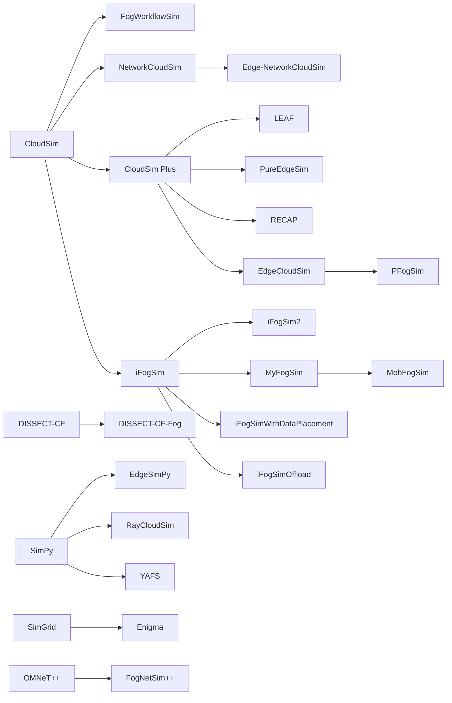

# How PureEdgeSim compares

This page answers one question: should you use PureEdgeSim, or one of the other edge computing simulators? It is written for a researcher choosing a tool for a study they have not run yet, so it names the cases where another simulator is the better choice as clearly as the cases where PureEdgeSim is.

The comparison is not invented here. It follows the methodology and reproduces the measurements of a peer-reviewed study of 24 edge computing simulators published in *Simulation Modelling Practice and Theory* in 2025 (the full citation is at the bottom). That study evaluated PureEdgeSim version 5.2. Everything that changed since then is marked as such.

## Where the numbers come from

Two labels are used throughout, and they mean different things:

- **(study)** quoted from the published comparison, which measured the repositories as they stood in mid 2024, on PureEdgeSim 5.2. These are the numbers to cite if you cite the comparison.
- **(now)** measured on this repository on 28 October 2026, on version 6.0, or read from the continuous integration badges that track the current build.

A number without a label is a property of the framework that you can check in the code or in the configuration files.

## The study behind these numbers

The study screened the literature of the previous five years, kept only open-source numerical simulators designed for edge computing (analytical models, emulators, and general-purpose toolkits such as MATLAB, NS-3 and OMNeT++ were excluded), and assessed the 24 tools that survived on two groups of criteria:

| Group | Criteria |
| --- | --- |
| Functional | infrastructure modeling and heterogeneity, mobility support, application models, energy and cost models, failure modeling, online decision-making, holistic performance evaluation |
| Non-functional, from ISO/IEC 25000 | usability, customization and extensibility, efficiency and scalability, correctness and reliability |

On top of the criteria, the study measured three things that a feature list cannot show: the state of each repository, the quality of each codebase with SonarQube, and the runtime of each tool on a shared scenario. Those three measurements decide most of the ranking, and they are the reason this page exists: a simulator that cannot finish the experiment you design is not the right simulator, however complete its feature list.

The 24 tools are DISSECT-CF-Fog, EdgeCloudSim, Edge-NetworkCloudSim, EdgeSimPy, Enigma, FogDirSim, FogExplorer, FogNetSim++, FogTorchPi, FogWorkflowSim, iFogSim, iFogSim2, iFogSimOffload, iFogSimWithDataPlacement, LEAF, MobFogSim, MyFogSim, PFogSim, PureEdgeSim, RayCloudSim, RECAP, SpanEdge, Sphere, and YAFS.

## What each tool is built on

Most edge simulators are extensions of a cloud simulator, and the base decides what the extension can do. The study maps the lineage, and it explains a great part of the differences below: a tool inherited the network model, the event engine, and often the memory behaviour of its parent.

PureEdgeSim started on CloudSim Plus and left it. Version 5.0 removed the dependency entirely, because the events and memory behaviour of the parent capped the number of devices a run could hold. The simulator now carries its own discrete-event engine, which is the direct cause of the scalability figures below.

## Modeling coverage

No single capability below is unique to PureEdgeSim. What the study found is that no other tool it examined combines them in one run, and that the combination matters: a model that is missing one of them silently changes the result of the others.

| Capability | What it buys you | Where the others stop |
| --- | --- | --- |
| Network delay that follows the load, with separate uplink and downlink | A congestion study sees the congestion it creates | EdgeCloudSim, LEAF and the iFogSim family apply a constant transmission delay or bandwidth |
| Mobility that feeds back into placement, routing, and failures | Movement becomes a measured cause of delay and loss | Enigma moves devices but ignores the effect on execution and failure; FogExplorer, iFogSim and Edge-NetworkCloudSim have no mobility |
| Energy per node, per radio interface, and per link class, with a battery that runs out | A battery-aware orchestrator has something to be aware of | Most energy models in the study cover data centers or one constrained device class |
| A dead battery as a task failure reason, counted apart from latency and resource shortage | Failures are attributable | A cause that is not modeled cannot be attributed |
| Online decision-making over a moving, heterogeneous fleet | Placement, offloading, and scheduling algorithms can be evaluated | FogTorchPi and Sphere place services but do not let a policy decide at runtime |
| Service graphs with interdependent subtasks | A multi-stage application is one request with one deadline | Added after the study. FogExplorer schedules interdependent tasks, but without mobility, energy, or load-aware links in the same run |
| Every numeric scenario parameter drawn from a probability distribution, replayed from one seed | A scenario is a distribution, not a table of constants | Added after the study |
| Replay of a recorded production trace | Measured arrivals instead of an assumption | Added after the study |
| The same simulator in Java and in Python with the same 56-column output | Run the study in the language you work in | Added after the study |

What it does not model, stated plainly: there is no pricing or cost model, which the study records as the main gap of PureEdgeSim, and a service graph is acyclic, so conditional branches, loops, and "wait for any parent" joins are out of scope.

## Efficiency and scalability

The study ran the same baseline scenario in every tool that could start it: 100 mobile augmented-reality users over one simulated hour. Two numbers came out of it.

Execution time of the shared baseline **(study)**:

| Simulator | Wall-clock time |
| --- | --- |
| PureEdgeSim | **1.81 s** |
| EdgeCloudSim | 3.53 s |
| LEAF | 49.4 s |
| PFogSim | 259 s |
| FogNetSim++ | 42.1 h |

The largest scenario each tool could still run **(study)**:

| Simulator | Devices before the run stops being usable |
| --- | --- |
| PureEdgeSim | **about 80,000** |
| EdgeCloudSim | about 10,000 |
| LEAF | about 7,000 |
| PFogSim | about 250 |
| FogNetSim++ | about 4 |

The same study reports PureEdgeSim traversing up to 4500 seconds of simulated time in one wall-clock second **(study)**, and notes that iFogSimWithDataPlacement needs about 13,400 seconds to simulate 3,000 fog nodes.

The repository README carries three further measurements taken on an Intel Core i7-8550U, which are the ones you can reproduce from this checkout: a 10-minute scenario with 10,000 devices and 1,131,000 tasks in 58 seconds, a 24-hour scenario with 200 devices and 3,221,280 tasks in 51 seconds, and a 60-minute scenario with 100 devices in 1 second.

Two honest caveats. Execution time depends on your orchestrator: a policy that scans the fleet for every task costs more than the engine does, and the figures above use the default placement. And the tools that lose the runtime comparison are not worse simulators in general. FogNetSim++ is slow because it simulates real network protocols and packet behaviour, which is exactly what you want if your research question is about the network.

## Code quality

The study ran SonarQube on every codebase after excluding inherited cloud-simulator code and Javadoc files. The PureEdgeSim row, at version 5.2 **(study)**:

| Metric | PureEdgeSim | How the field compares |
| --- | --- | --- |
| Lines of code | 6,187 | iFogSim 8,397, iFogSim2 15,685, RECAP 43,669 |
| Classes | 92 | average class size 67 lines, against 257 for FogNetSim++ |
| Unwanted comments (commented-out code, TODOs) | 0 | best of the field, with LEAF, FogTorchPi, FogExplorer and EdgeSimPy |
| Code duplication | 0% | best of the field, with FogExplorer and FogTorchPi; EdgeCloudSim 26.8%, SpanEdge 35.2% |
| Cognitive complexity | 9.3 | lowest group, with Enigma at 7.6; RECAP 37.9 |
| Code smells per 100 lines | 5.3 | lowest group; SpanEdge 40.5, Edge-NetworkCloudSim 16.2 |
| Bugs | 0 | the field ranges from 2 (LEAF) to 193 (iFogSim2) |
| Test coverage | 91% | the only simulator in the study that reports coverage at all |

The last line is the one the study stresses: coverage was the only quantitative evidence available that a simulator's code is actually executed by something, and PureEdgeSim was the only tool that published it.

**(now)** The current build reports 98.2% of instructions and 96.2% of branches covered by more than 1,100 automated tests, measured by the coverage workflow that maintains the badges on the repository front page. The codebase has grown to 113 framework source files.

## Maintenance

The study treated the repository as a first-class evaluation criterion, on the argument that a simulator you cannot build, or that has been abandoned since before your paper is reviewed, is a risk to a research project. Its headline finding is that edge computing simulators are maintained for 12 months on average, with Sphere and RECAP the least maintained of the set. Only four tools were still being updated when the study closed: YAFS, PureEdgeSim, DISSECT-CF-Fog and RayCloudSim, with YAFS and PureEdgeSim maintained for over four years.

PureEdgeSim in that table **(study)**: first commit 28 December 2016, last commit 4 April 2024, 319 commits, latest release 5.2, 3 contributors, GPLv3.

For contrast, the most cited tool of the field, iFogSim, shows 72 commits between 1 March 2016 and 21 September 2016 **(study)**. Its own authors list the missing features (mobility, scalability, dynamic placement, QoS-aware placement, battery-aware policies) as future work, and the study reviews several derivatives that exist to patch those gaps one at a time: iFogSim2, MyFogSim, MobFogSim, iFogSimWithDataPlacement and iFogSimOffload.

**(now)** 403 commits, the latest release being 6.0, published on Maven Central under `io.github.charafeddinemechalikh`, with a companion Python port kept in lockstep. The maintainer works with three outside contributors. The license is unchanged: GPLv3.

## Adoption

Citation share of the simulators, as measured by the study from records available to July 2024 **(study)**: iFogSim 42%, EdgeCloudSim 14%, FogTorchPi 12%, YAFS and FogNetSim++ 5% each, iFogSim2 4%, MobFogSim, SpanEdge and MyFogSim 3% each, PureEdgeSim 2%.

PureEdgeSim sits at the low end of that distribution, and the distribution is a measure of age and of the citation habits of the fog community, not of quality: iFogSim's share comes from being the default choice of an earlier generation of papers. The study's own selection of work built on PureEdgeSim, and the list maintained in the repository README, cover task orchestration, reinforcement learning, service placement, satellite edge computing, caching, and energy-aware computing.

## The drawbacks the study listed, and where they stand

The comparison names four limitations of PureEdgeSim. Three of them were addressed in the releases that followed version 5.2, and one was not.

| Drawback at version 5.2 **(study)** | Status in 6.0 |
| --- | --- |
| No pricing or cost model | Still true. PureEdgeSim models energy, not money. If your study reports cost, use DISSECT-CF-Fog, FogNetSim++, FogTorchPi, Sphere or YAFS, or convert the energy output yourself and state the conversion |
| Weak documentation, adding to the learning curve | Addressed. A manual of thirteen guides covers the architecture, every configuration parameter, the task lifecycle, the models, and how to write an orchestrator, published as a website alongside the Javadoc, and every one of the 26 examples has its own README with measured results |
| Complex parametrization, because the framework is versatile | Partially addressed. Every parameter file is now self-documenting, an incorrect value stops the run with the file, the element and a suggestion instead of a stack trace, and each run writes a `run.properties` snapshot of its resolved settings. The number of parameters has not shrunk, and a first scenario still takes reading |
| No modeling of applications with interdependent tasks | Addressed in 6.0. An application can now be a sequential, parallel, or arbitrarily complex acyclic graph of subtasks, where each stage waits for the results of the stages it depends on, parent results are carried as payload, the request carries one end-to-end deadline, optional stages can be skipped, and a required failure cancels its subtree |

## Choosing between PureEdgeSim and a specific alternative

The honest answer to "which simulator should I use" is a list of cases where the answer is not PureEdgeSim.

| Your study needs | Better fit |
| --- | --- |
| Monetary cost, pricing schemes, or a billing model | DISSECT-CF-Fog, FogNetSim++, FogTorchPi, Sphere, YAFS |
| Packet-level network realism, protocol behaviour, lossy links, MQTT/CoAP/AMQP | FogNetSim++, and accept its runtime |
| Virtual machine migration that follows a user's movement | MyFogSim, MobFogSim |
| An interactive design-space exploration of where to place application modules, with a GUI | FogExplorer |
| Energy-aware routing over a directed multigraph of links, without mobility | LEAF |
| Fog node failures and dynamic placement in a Python, network-centric model | YAFS |
| A cloud-only study, no edge devices, no mobility | CloudSim or CloudSim Plus directly |
| Large-scale, heterogeneous, mobile, energy-constrained infrastructure with online decisions, and the failures that follow from all of it | PureEdgeSim |

## Reproducing a comparison of your own

If you cite this page in a paper, the numbers you can re-derive yourself are the runtime ones. Every run ends with a line that prints the wall-clock duration of the simulation, so from the repository root, after `mvn clean install -DskipTests`, run any example and read it: `mvn exec:java -Dexec.mainClass="examples.Example1"`. To scale a scenario up, change the device counts in `edge_devices.xml` and the simulated duration in `simulation_parameters.properties`, and set `random_seed` so that two simulators you compare see the same arrivals.

The scenario parameters that decide a comparison are the ones the study fixed: the number of devices, the number of generated tasks, the simulated duration, and the update interval, since a shorter interval produces more events and a longer run.

## Citation

If you use this comparison, cite the study it comes from:

> Mechalikh, C., Silem, A. E. H., Safavifar, Z., & Golpayegani, F. (2025). Quality matters: A comprehensive comparative study of edge computing simulators. *Simulation Modelling Practice and Theory*, 138, 103042. https://doi.org/10.1016/j.simpat.2024.103042

And the simulator itself:

> Mechalikh, C., Taktak, H., & Moussa, F. (2021). PureEdgeSim: A simulation framework for performance evaluation of cloud, edge and mist computing environments. *Computer Science and Information Systems*, 18(1), 43-66. https://doi.org/10.2298/CSIS200301042M

## Further reading

- [Documentation home](README.md)
- [Architecture](architecture.md): how the discrete-event engine works.
- [Simulation models](models.md): the computing, energy, mobility, and network models behind the coverage table.
- [Research guide](research-guide.md): how to design and report a simulation study.
