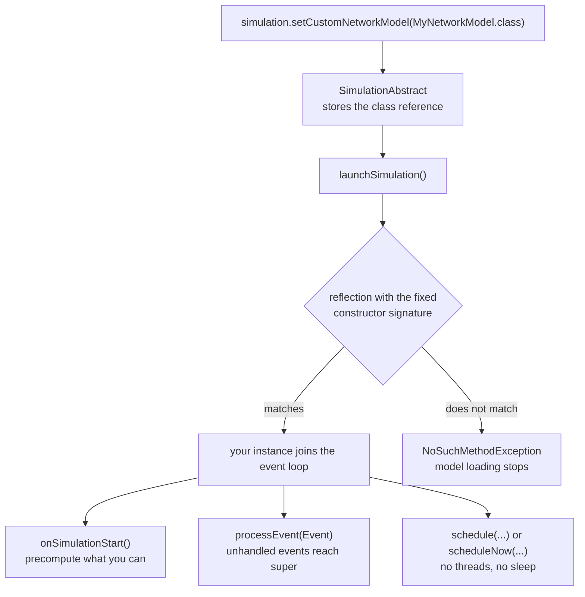

# Customizing models

PureEdgeSim is designed to be extended. Every default model is a class that you can subclass, and the simulator instantiates your class reflectively instead of the default. This guide explains each extension point, shows the smallest working pattern for each one, and lists the traps that are easy to hit.

The behavioral details of the defaults are in [Models](models.md). Read that first if you have not already.

## The extension points

| What you want to change | Setter | Base class to extend |
| --- | --- | --- |
| Task arrival pattern or task fields | `setCustomTaskGenerator` | `TaskGenerator` or `DefaultTaskGenerator` |
| Task object itself | `setCustomTaskClass` on your generator | `TaskAbstract` or `DefaultTask` |
| Per-node resources, queueing, execution | `setCustomComputingNode` | `DefaultComputingNode` |
| Device movement | `setCustomMobilityModel`, or the `model` attribute per device type | `MobilityModel` |
| Routing, transfers, caching | `setCustomNetworkModel` | `DefaultNetworkModel` or `NetworkModel` |
| Topology layout | `setCustomTopologyCreator` | `DefaultTopologyCreator` |
| Node and device creation | `setCustomComputingNodesGenerator` | `DefaultComputingNodesGenerator` |
| Overall control flow and failure policy | `setCustomSimulationManager` | `DefaultSimulationManager` |
| Offloading decisions | `setCustomEdgeOrchestrator` | `Orchestrator` or `DefaultOrchestrator` |

Every hook has a runnable example. [Example 23](https://github.com/CharafeddineMechalikh/PureEdgeSim/tree/master/PureEdgeSim/examples/Example23) implements the four that the earlier examples leave at their defaults (task generator, topology creator, computing nodes generator, and simulation manager), and the [examples index](https://github.com/CharafeddineMechalikh/PureEdgeSim/tree/master/PureEdgeSim/examples) lists the example for each of the others.

All setters are on `SimulationAbstract`, so they are available on `Simulation` before `launchSimulation()`.

Registration follows the same path for every model:



## Rules that apply to every custom model

1. **Match the constructor exactly.** The simulator uses reflection with fixed parameter lists. If the signature differs, you get a `NoSuchMethodException` during model loading.
2. **Do not create threads and do not sleep.** The simulator is a discrete-event engine. Use `schedule(this, delay, tag, data)` and `scheduleNow(this, tag, data)`. A thread would run outside simulated time and break reproducibility.
3. **Do not collide with event tags.** A subclass's own event tags should start above the range used by the base classes. The examples use `12000` for this reason.
4. **Call `super.processEvent(ev)` for events you do not handle.** Otherwise you disable the base class behavior, such as energy updates and status refreshes. The same applies to `onSimulationStart`.
5. **Keep per-simulation state in instance fields.** Each scenario creates fresh models. Static mutable state leaks across parallel simulations.
6. **Respect units.** Time is seconds, bandwidth is bits per second, sizes are bits inside the simulator, energy is watt-hours, capacity is MIPS. Configuration files use human units and the parser converts them. If you read a parameter directly, use the converted `SimulationParameters` field.
7. **Do not change the topology or node lists after the simulation starts** unless you also update the cached shortest paths. The network model and the orchestrator cache information aggressively.
8. **Return, do not throw, for normal control flow.** Exceptions during the event loop usually abort the whole scenario and hide the CSV row.

## Custom task generator

A custom generator decides what tasks exist and when they appear. The simplest useful change is to use a custom task class with extra fields:

```java
package examples;

import com.mechalikh.pureedgesim.taskgenerator.DefaultTask;

public class UrgentTask extends DefaultTask {

    protected boolean urgent;

    public UrgentTask(int id) {
        super(id);
    }

    public boolean isUrgent() {
        return urgent;
    }

    public void setUrgent(boolean urgent) {
        this.urgent = urgent;
    }
}
```

Register the task class from the generator constructor, because the generator instance is not exposed by the simulation manager:

```java
package examples;

import com.mechalikh.pureedgesim.simulationmanager.SimulationManager;
import com.mechalikh.pureedgesim.taskgenerator.DefaultTaskGenerator;

public class UrgentTaskGenerator extends DefaultTaskGenerator {

    public UrgentTaskGenerator(SimulationManager simulationManager) {
        super(simulationManager);
        setCustomTaskClass(UrgentTask.class);
    }
}
```

The default generator creates tasks through reflection with a single `int` constructor argument, then fills the standard fields. Your custom task can add fields, but the generator will not populate them unless you override `insert` or `generate`.

Every field of a generated task is drawn from the distribution attached to the application parameter, through `Application.sampleRequestSize()`, `sampleResultsSize()`, `sampleContainerSize()`, `sampleTaskLength()`, `sampleLatency()` and `sampleTasksPerMinute()`. When the scenario file gives a plain number, that distribution is a constant one, so overriding the single-task `insert(app, dev, appParams, time)` is enough to change the shape of a task, while overriding `generateTasksForDevice` or `generateRandomlyArrivingTasks` changes when tasks appear.

To change the traffic pattern itself, override `generate()` or `generateTasksForDevice`. A periodic generator that ignores the application rates can look like this:

```java
package examples;

import com.mechalikh.pureedgesim.datacentersmanager.ComputingNode;
import com.mechalikh.pureedgesim.scenariomanager.SimulationParameters;
import com.mechalikh.pureedgesim.simulationengine.FutureQueue;
import com.mechalikh.pureedgesim.simulationmanager.SimulationManager;
import com.mechalikh.pureedgesim.taskgenerator.Application;
import com.mechalikh.pureedgesim.taskgenerator.DefaultTask;
import com.mechalikh.pureedgesim.taskgenerator.Task;
import com.mechalikh.pureedgesim.taskgenerator.TaskGenerator;

public class PeriodicTaskGenerator extends TaskGenerator {

    protected int id = 0;

    public PeriodicTaskGenerator(SimulationManager simulationManager) {
        super(simulationManager);
    }

    @Override
    public FutureQueue<Task> generate() {
        Application application = SimulationParameters.applicationList.get(0);
        ComputingNode registry = simulationManager.getDataCentersManager()
                .getComputingNodesGenerator().getCloudOnlyList().get(0);

        for (ComputingNode device : devicesList) {
            for (double time = 30; time < SimulationParameters.simulationDuration; time += 30) {
                Task task = new DefaultTask(++id);
                task.setTime(time);
                task.setType(application.getType());
                task.setLength(application.getTaskLength());
                task.setFileSizeInBits(application.getRequestSize());
                task.setOutputSizeInBits(application.getResultsSize());
                task.setContainerSizeInBits(application.getContainerSizeInBits());
                task.setMaxLatency(application.getLatency());
                task.setApplicationID(0);
                task.setEdgeDevice(device);
                task.setRegistry(registry);
                taskList.add(task);
            }
        }
        return taskList;
    }
}
```

`devicesList` is built by the `TaskGenerator` constructor from the generated Mist node list. If your generator needs a different population, clear or replace it before generating.

### A generator that reads a file

Nothing forces a generator to sample a distribution. `generate()` is called once,
before the first event, and returns whatever queue you can build, so a recorded
workload can be replayed line by line. [Example 25](../PureEdgeSim/examples/Example25/README.md)
does exactly that with a published production trace of 8819 LLM inference
requests: each line carries an arrival offset and two token counts, and becomes
one task whose generation time, sizes, length and latency budget come from the
file rather than from `applications.xml`.

Three things are worth copying from that generator:

- It maps workload *descriptors* to simulator units through named constants
  (tokens to bytes, tokens to millions of instructions, completion length to a
  latency budget) instead of hiding the conversion inside the sampling. Each one
  is a documented tuning knob, so a reader can disagree with the calibration
  without touching the code.
- A recorded stream describes a service, not a device. The example hands the
  requests to the devices in turn, which keeps the offered load of the fleet even
  while the instantaneous arrival rate stays as measured.
- It reports what it replayed. The first console line of the run says how many
  requests were scheduled, over what simulated period, and how many were dropped
  because they arrive after `simulation_time`, so a truncated replay is visible
  instead of silent.

The framework clock resolution is one second, so arrival offsets are rounded to
their second. That preserves bursts, but not the internal order of the requests
that land in the same second: in the hour of that trace, 99.6 percent of the
requests share their second with another one, and one second holds 68 of them.

The payoff is measurable. On the same scenario, with the same mean rate and the
same mean task sizes, the recorded trace produced 120201 seconds of queueing
against 173 for poisson arrivals, and 36.06 percent of its requests met their
latency requirement against 100 percent. A generator tuned to the means of a
real workload reproduces its average and loses the part that breaks systems.

## Custom computing node

Extending `DefaultComputingNode` gives you the resource bookkeeping and execution loop. The constructor order is `(SimulationManager, mipsPerCore, cores, storage, ram)`.

A typical use is to add statistics or a new event without disturbing the base behavior:

```java
package examples;

import com.mechalikh.pureedgesim.datacentersmanager.DefaultComputingNode;
import com.mechalikh.pureedgesim.simulationengine.Event;
import com.mechalikh.pureedgesim.simulationmanager.SimulationManager;

public class InstrumentedComputingNode extends DefaultComputingNode {

    protected int completedTasks = 0;

    public InstrumentedComputingNode(SimulationManager simulationManager, double mipsPerCore,
            int numberOfCPUCores, double storage, double ram) {
        super(simulationManager, mipsPerCore, numberOfCPUCores, storage, ram);
    }

    @Override
    protected void executionFinished(Event event) {
        super.executionFinished(event);
        completedTasks++;
        simulationManager.getSimulationLogger().deepLog(
                simulationManager.getSimulation().clock() + ": node " + getId()
                        + " completed " + completedTasks + " tasks");
    }
}
```

Computing nodes do not have a `simLog` field. Access the logger through `simulationManager.getSimulationLogger()`, as above.

`executionFinished` is protected, so you can extend it. `startExecution` is also protected, and that is the correct place to change scheduling or timing, for example to model two cores per task or a different speedup curve. If you override it, still decrement the available cores, reserve RAM, set the execution start time, and schedule `EXECUTION_FINISHED`, or the task will never complete. If you override `processEvent` for your own events, call `super.processEvent(event)` for everything else.

For a different queue discipline, override `getTasksQueue()` to return a custom list, or override `submitTask` and implement admission control. Keep the contract: a task that is accepted must eventually either execute or be failed explicitly through the simulation manager. Silently dropping tasks makes the CSV totals inconsistent.

[Example 26](../PureEdgeSim/examples/Example26/README.md) takes the second route in both senses: its node overrides `submitTask` to put a hard real-time task at the head of the queue when every core is already taken, and refuses an incoming task outright when its container no longer fits in the free storage or RAM, or when the battery is almost flat and the traffic is elastic. The refusal is decided by the orchestrator through a public predicate on the node, so the placement never lands on a device that would drop it; the task that is refused is reported as a normal failure, with the reason, and stays inside the CSV totals.

Subclass `ComputingNode` directly only if you need a fundamentally different node. The interface has many methods used by the orchestrator, logger, topology, and network model, and the default implementations take care of all of them.

## Custom mobility model

PureEdgeSim already ships random-waypoint, random-walk, Gauss-Markov, Manhattan, waypoint, circular, Lévy-walk, Brownian and reference-point-group models, selected per device type with the `model` attribute of the `<mobility>` element (see [Models](models.md#mobility-model)). Write your own only when none of them fits.

A mobility model only has to answer one question: given the current location, where is the device at the next update tick? The base class handles path precomputation, closest data center lookup, and time-indexed lookup.

```java
package examples;

import com.mechalikh.pureedgesim.locationmanager.Location;
import com.mechalikh.pureedgesim.locationmanager.MobilityModel;
import com.mechalikh.pureedgesim.scenariomanager.SimulationParameters;
import com.mechalikh.pureedgesim.simulationmanager.SimulationManager;

public class PatrolMobilityModel extends MobilityModel {

    protected double angle = 0;
    protected final double radius;

    public PatrolMobilityModel(SimulationManager simulationManager, Location startLocation) {
        super(simulationManager, startLocation);
        // Options come from the attributes of the <mobility> element.
        radius = getParameter("radius", Math.min(SimulationParameters.simulationMapLength,
                SimulationParameters.simulationMapWidth) / 4.0);
    }

    @Override
    protected Location getNextLocation(Location location) {
        angle += Math.toRadians(1);
        double centerX = SimulationParameters.simulationMapLength / 2.0;
        double centerY = SimulationParameters.simulationMapWidth / 2.0;
        return reflectLocation(new Location(centerX + radius * Math.cos(angle),
                centerY + radius * Math.sin(angle)));
    }
}
```

Read your options through `getParameters()`, `getParameter(name, default)`, `getParameterInt`, `getParameterBoolean` or `getRequiredParameter`; names are matched case-insensitively and every attribute except `model` becomes an option. The base class also provides the geometry helpers used above: `getStepDistance()` (`speed * update_interval`), `getTicksCount()`, `randomInRange(min, max)`, `moveTowards(from, target, distance)`, `reached(from, target, tolerance)` and `reflectLocation(location)`, which brings a device that crossed a border back into the map. Use them instead of re-implementing the arithmetic, and read `SimulationParameters.updateInterval` rather than assuming one second.

The generator sets `isMobile`, speed, pause durations, and mobility durations from the device's XML entry before `generatePath()` is called. If `isMobile` is false, `generatePath()` returns early and the device stays at its initial location. Your `getNextLocation` is then never called.

Register the class with `setCustomMobilityModel(PatrolMobilityModel.class)` to make it the default for every device, or keep the default class and name yours in the scenario file: `<mobility model="examples.PatrolMobilityModel">true</mobility>`. The factory calls the `(SimulationManager, Location)` constructor reflectively, so keep that signature.

If your model needs to react to events rather than follow a precomputed path, override `generatePath()` and `updateLocation(...)`, and make sure `getClosestEdgeDataCenter()` still returns a valid attachment. The lazy `LocationAwareNode.connectWith(...)` logic depends on it.

## Custom probability distribution

Any numeric value of the scenario files may be drawn from a distribution instead of being fixed. To add one, implement `Distribution` (`sample()`, `mean()`, `getName()`, `isDiscrete()`, and the optional `getMin()`/`getMax()` bounds), then register its name in `DistributionFactory`. Continuous implementations extend `AbstractDistribution`, discrete ones extend `AbstractDiscreteDistribution`, which already truncates `sampleInt()` to the drawn outcome. Keep the theoretical mean exact: the reports print the mean of the distribution, so an inconsistent `mean()` makes the CSV and the charts lie about the scenario.

## Custom network model

The network model receives events for each transfer stage. Extending `DefaultNetworkModel` and overriding `transferFinished` is the usual pattern, as in `Example7CustomNetworkModel`:

```java
package examples;

import com.mechalikh.pureedgesim.network.DefaultNetworkModel;
import com.mechalikh.pureedgesim.network.TransferProgress;
import com.mechalikh.pureedgesim.simulationmanager.SimulationManager;

public class InstrumentedNetworkModel extends DefaultNetworkModel {

    public InstrumentedNetworkModel(SimulationManager simulationManager) {
        super(simulationManager);
    }

    @Override
    protected void transferFinished(TransferProgress transfer) {
        simulationManager.getSimulationLogger().deepLog(simulationManager.getSimulation().clock()
                + ": transfer " + transfer.getTransferType()
                + " of task " + transfer.getTask().getId() + " finished");
        super.transferFinished(transfer);
    }
}
```

If you handle a case yourself, you must perform the follow-up action that `super.transferFinished` would have performed:

- `REQUEST`: notify the orchestrator (`offloadingRequestRecievedByOrchestrator`).
- `TASK`: execute the task or download the container.
- `CONTAINER`: execute the task and charge the energy.
- `RESULTS_TO_ORCH`: forward the results to the device.
- `RESULTS_TO_DEV`: finish the task at the simulation manager.

Forgetting one of these produces a simulation that simply stops advancing some tasks, with no error.

`DefaultNetworkModel.send(...)` routes through the topology. If you override it, keep the `TransferProgress` bookkeeping: the progress object must know the full vertex list and edge list, and the first edge must receive the transfer. `NetworkLink.transferFinished` removes the first hop and forwards to the next edge.

For a new link behavior, extend `NetworkLink` and override `updateTransfer` or `getBandwidth`. Keep the rule that `transferFinished` is called exactly once per transfer, and that it schedules the next stage rather than calling it.

## Custom topology

The topology creator builds the graph and fills the path cache. Extend `DefaultTopologyCreator` and override `generateTopologyGraph()` when you need a different layout:

```java
package examples;

import com.mechalikh.pureedgesim.datacentersmanager.ComputingNode;
import com.mechalikh.pureedgesim.datacentersmanager.DefaultTopologyCreator;
import com.mechalikh.pureedgesim.datacentersmanager.ComputingNodesGenerator;
import com.mechalikh.pureedgesim.network.NetworkLink;
import com.mechalikh.pureedgesim.network.NetworkLinkWanUp;
import com.mechalikh.pureedgesim.simulationmanager.SimulationManager;

public class StarTopologyCreator extends DefaultTopologyCreator {

    public StarTopologyCreator(SimulationManager simulationManager,
            ComputingNodesGenerator computingNodesGenerator) {
        super(simulationManager, computingNodesGenerator);
    }

    @Override
    public void generateTopologyGraph() {
        // Build your own edges with infrastructureTopology.addLink(...), then:
        infrastructureTopology.savePathsToMap(computingNodesGenerator.getEdgeAndCloudList());
    }
}
```

`infrastructureTopology`, `computingNodesGenerator`, and `simulationManager` are protected fields. A realistic custom topology still needs a cloud attachment, a link for every mobile device, and, if you use the registry, a path from the cloud to every destination. The shortest-path cache is computed from the graph, so an incomplete graph produces missing paths and failures at the first transfer.

If you only want to change the WAN structure, override `createWanLink()` and reuse the rest of the default method.

## Custom computing nodes generator

This is the most invasive extension point. `DefaultComputingNodesGenerator` reads the XML files, creates nodes, assigns mobility and energy models, and fills the lists that the orchestrator and logger depend on.

Extend `DefaultComputingNodesGenerator` and override one of its protected methods:

- `createComputingNode(Element, TYPES)` to parse additional XML attributes,
- `insertEdgeDevice(ComputingNode)` to register a node in all the internal lists,
- `generateDevicesInstances(Element)` to change how device types are expanded,
- `generateDatacentersAndDevices()` only if you want to replace the whole process.

If you replace the whole process, you must produce consistent values for every list used elsewhere: `mistOnlyList`, `mistOnlyListSensorsExcluded`, `edgeOnlyList`, `cloudOnlyList`, `edgeAndCloudList`, `mistAndCloudListSensorsExcluded`, `mistAndEdgeListSensorsExcluded`, `allNodesList`, `allNodesListSensorsExcluded`, and `orchestratorsList`. The getters return these lists, and the default orchestrator and logger assume they are populated.

## Custom simulation manager

`DefaultSimulationManager` owns the task pipeline and the failure policy. Extending it is appropriate when you want to change:

- batching of tasks from the task list to the orchestrator,
- failure checks or the definition of a failed task,
- the order in which stages are scheduled,
- additional logging that needs access to every task.

Most methods are protected, including `sendTaskToOrchestrator`, `sendFromOrchToDestination`, `sendResultsToOchestrator`, `setFailed`, and `taskFailed`. Override them and call `super` for the parts you do not intend to replace.

Changing the event tags or the schedule order can break the simulation silently. If a task never reaches `RESULT_RETURN_FINISHED`, it is never counted, and the CSV loses a row of information without an exception.

The same extension is how a scenario injects a fault of its own. [Example 26](../PureEdgeSim/examples/Example26/README.md) schedules three events on tags of its own, crashes the orchestrating device halfway through the run, boots its cold standby ten seconds later, and counts the requests that were in flight with the primary when it died. Because the framework has no notion of an outage, the loss is measured from the tasks the manager still sees: a task whose device is alive but whose orchestrator is dead never reaches a placement, and the example reports those, per class of traffic, in the console summary it prints on top of the usual CSV row.

A manager is also the place to measure something the aggregate report does not keep. [Example 27](../PureEdgeSim/examples/Example27/README.md) overrides the two terminal hooks, `RESULT_RETURN_FINISHED` inside `processEvent` and `taskFailed`, and stores the delay breakdown of every task that reaches either, successes and failures alike. That is what lets it report the median, ninetieth percentile and maximum of the network time of a congested link, where the standard report would print one mean over the requests that completed and hide the tail behind it. Deduplicate by task identifier: a failed task passes through `taskFailed` at each of the three checkpoints, and sampling it three times would weight the average by the number of checks rather than by the number of tasks.

## Testing a custom model

1. **Start with one scenario.** Set `simulation_time=1`, one architecture, one algorithm, and one device count. A custom model that has an initialization bug usually fails in the first seconds.
2. **Turn on deep logging.** `deep_log_enabled=true` shows the model's decisions and the task identifiers. Turn it off for long runs.
3. **Compare against the default.** Run the same configuration with and without your custom class. If the task count, failure reasons, or CSV row count differ in ways you cannot explain, the model is changing more than intended.
4. **Check units in the CSV.** A delay that is exactly 1000 times too large usually means a milliseconds/seconds mix. A bandwidth that has no effect usually means `realistic_network_model=false`.
5. **Run twice.** Task times, sizes and mobility are random. Two runs with the same configuration should be statistically compatible, not identical. To get one identical run for debugging, set `random_seed` in `simulation_parameters.properties`: every module then draws from that seed, including your custom model, as long as it uses `Randomness.getRandom()` instead of creating its own generator.

## A checklist before you trust a custom model

- The class has the exact constructor signature.
- The class is registered with the matching setter.
- `super.processEvent` is called for unhandled events.
- Custom event tags do not collide with base tags.
- The model schedules future work instead of blocking.
- All node and topology lists are consistent.
- The CSV row count equals the number of scenarios.
- Failure reasons are the ones you expect.
- The same configuration with the default model still runs, so the difference is attributable to your change.

## Where to go next

- Write the decision policy: [Writing orchestrators](writing-orchestrators.md).
- Interpret the resulting CSV: [Output and metrics](output-and-metrics.md).
- Design a repeatable experiment: [Research guide](research-guide.md).
