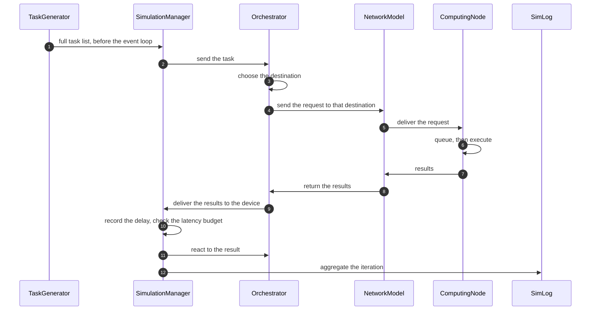

# Simulation models

PureEdgeSim is built from a small set of replaceable models. Each model answers one question: when are tasks generated, where can they run, how long does execution and communication take, how much energy is consumed, where are devices located, and which destination does the orchestrator choose. This guide explains the default answer to each question, including the exact formulas used in the code, so that you can reason about your results and decide which model to replace.

If you only want to change a parameter, read [Configuration](configuration.md) instead. If you want to implement your own model, read [Customizing models](customizing-models.md) after this page.

## How models are selected

`SimulationAbstract` holds one class reference per model. The defaults are the classes described in this guide. Replace any of them before calling `launchSimulation()`:

```java
Simulation simulation = new Simulation();
simulation.setCustomTaskGenerator(MyTaskGenerator.class);
simulation.setCustomComputingNode(MyComputingNode.class);
simulation.setCustomMobilityModel(MyMobilityModel.class);
simulation.setCustomNetworkModel(MyNetworkModel.class);
simulation.setCustomEdgeOrchestrator(MyOrchestrator.class);
simulation.launchSimulation();
```

Models are instantiated reflectively, so the constructor signature must match exactly:

| Model | Required constructor |
| --- | --- |
| Task generator | `(SimulationManager)` |
| Computing node | `(SimulationManager, double mipsPerCore, int cores, double storage, double ram)` |
| Mobility model | `(SimulationManager, Location)` |
| Network model | `(SimulationManager)` |
| Orchestrator | `(SimulationManager)` |

A model also inherits a lifecycle from `SimEntity`:

- `onSimulationStart()` is called once, before the event loop begins. The mobility model precomputes its path here.
- `processEvent(Event)` receives the events that the model scheduled for itself.
- Computing nodes receive a periodic `UPDATE_STATUS` event every `update_interval`, which is where energy and location are refreshed.

Every model runs inside the same discrete-event engine. It must not use its own threads or wall-clock timers, and it must schedule events rather than sleep.

## Task generation model

`DefaultTaskGenerator` pre-generates the complete task list before the simulation starts. Nothing is generated on the fly during the event loop.

### When tasks are created

Without an arrival pattern, the generator works per minute. For each simulation minute `st`, every generating device creates its burst at a random second within that minute:

```text
time = st * 60 + random(0, 15)
```

Each application has a `rate`, interpreted as tasks per minute. For a burst starting at time `t`, the generator inserts `rate` tasks spaced by `60 / rate` seconds:

```text
task 0: t
task 1: t + 60/rate
task 2: t + 2*60/rate
...
```

With `rate=6`, a device produces one task every 10 seconds while the application is active. The number of minutes comes from `simulation_time` converted to seconds and then divided by 60, so a 10-minute scenario generates 10 tasks per device per rate unit, not 10 tasks in total.

An application may replace that fixed spacing with an arrival pattern, which is the time between two consecutive tasks of one device, in seconds:

```xml
<arrival>poisson</arrival>
<arrival distribution="weibull" shape="2" scale="3"/>
```

`poisson` (or `exponential`) draws exponential gaps with a mean of `60 / rate`, which is the classical Poisson traffic model. `uniform` draws gaps between zero and twice that mean, so the average rate is preserved. A distribution element gives you the exact inter-arrival law. With an arrival pattern, tasks are no longer grouped by minute: the device emits one task each time the drawn gap expires, from the start of the simulation until its end, and a gap is never shorter than one second.

Both the burst size and the arrival time can vary per task, and every random value now comes from `Randomness`, the shared source of randomness. Set `random_seed` in the properties file and a run becomes fully reproducible: the same scenario, the same task times, the same sizes. Without a seed each run draws its own values, as in previous versions, and comparing algorithms means averaging several runs.

### Which device runs which application

Application usage percentages are assigned to devices once, before generation:

- For every application except the last one in `applications.xml`, `usage_percentage` selects `(int)(percentage * deviceCount / 100)` devices at random.
- Remaining devices are assigned to the last application. This is why the last application acts as the residual category: percentages do not have to sum to 100, and any rounding remainder falls into the last application.

Devices with `isGeneratingTasks()` false are removed before this assignment. Sensors created from datacenter definitions are not task generators.

### What a task carries

Every generated task receives:

- request size, results size, and container size in bits (converted from kB in the XML),
- maximum tolerated latency,
- task length in million instructions,
- application identifier and task type,
- the generating edge device,
- the registry, which defaults to the first node in the cloud list.

Each of those numeric parameters is drawn from the application's distribution, so two tasks of the same application are not identical unless the value was written as a plain number. The scalar getters of `Application` still return the mean of the distribution, which is what the reports and the charts print.

The task identifiers are global and increasing within one simulation. They are useful for tracing a task through the debug log.

### What to override

| Goal | Method |
| --- | --- |
| Change when tasks appear | `generateTasksForDevice(ComputingNode, int)` |
| Change the arrival pattern only | `generateRandomlyArrivingTasks(ComputingNode, int, Application)` |
| Change application-to-device assignment | `generate()` |
| Change the fields of one task | `insert(int, ComputingNode, Application, int)` and `createTask(int)` |
| Change a whole burst | `insert(int, int, ComputingNode)` |
| Use a completely different traffic model | Extend `TaskGenerator` and override `generate()` |

`DefaultTaskGenerator` is intentionally simple. Real workloads often need bursts, diurnal patterns, or correlated tasks; those belong in a custom generator.

## Computing node model

`DefaultComputingNode` models a resource pool with CPU, RAM, and storage.

### Resources and sensors

A node is constructed with `mipsPerCore`, `cores`, `storage`, and `ram`, in that order; the last two are easy to swap by mistake. Total MIPS capacity is `mipsPerCore * cores`, and the same number is used both for execution timing and for utilization accounting.

If `mipsPerCore <= 0`, `cores <= 0`, or `storage <= 0`, the node is marked as a sensor. Sensors are excluded from the Mist candidate lists and cannot be selected as offloading destinations. The generator uses this rule to turn entries with zero resources into pure data sources.

### Receiving a task

`submitTask(Task)` does three things:

1. Records the arrival time.
2. Reserves storage equal to the container size.
3. Starts execution immediately if at least one core and enough RAM are free. Otherwise the task joins a FIFO queue.

RAM is only reserved when execution starts, not when the task is queued. A queued task can therefore start later even if RAM has become tighter in the meantime; the queue is a scheduling device, not a hard admission-control mechanism. Storage is reserved earlier, at arrival.

### Execution time

Execution uses exactly one core:

```text
executionTime = task.length / mipsPerCore
```

The number of cores controls how many tasks can execute concurrently, not how fast a single task runs. A node with 8 cores and 1000 MIPS per core executes four tasks in parallel, each at 1000 MIPS, and the fifth waits.

### Completion

When a task finishes, the node:

- frees one core, the task's RAM, and the task's storage,
- records the execution finish time,
- immediately schedules `TRANSFER_RESULTS_TO_ORCH` to the simulation manager,
- starts the first waiting task, if any.

There is no preemption and no priority. A long task occupies its core until it finishes, and waiting tasks are served strictly in arrival order.

### Utilization accounting

Two different CPU metrics are maintained:

- Current utilization: the sum of the lengths of currently executing tasks, divided by total MIPS capacity, capped at 100 percent.
- Average utilization: total executed instructions divided by `totalMipsCapacity * currentClock`, capped at 100 percent.

The average metric is what the CSV reports. It is a ratio of work done over capacity offered, so it can look low even when the node is busy in bursts.

### Death

`EnergyAwareNode.updateStatus()` runs every `update_interval`. It adds static energy and, when the node is battery powered, marks it dead as soon as the battery reaches zero. Dead nodes:

- are rejected by `Orchestrator.offloadingIsPossible`,
- cause tasks already in flight to fail in the phase checks described in [Task lifecycle](task-lifecycle.md),
- stop generating tasks, because generation checks the device state.

Death is only checked on the update tick. A device can consume more than its remaining battery during one interval and die at the end of it.

### What to override

Extend `DefaultComputingNode` to change scheduling (for example, shortest-job-first), to add GPU or accelerator resources, to model a different execution-time formula, or to add admission control. Extend `ComputingNode` directly only if you also provide the many accessors used by the orchestrator and the logger; `DefaultComputingNode` already implements them.

## Energy model

`EnergyModelComputingNode` implements a linear power model. Power is expressed in watts, energy in watt-hours, and simulation time in seconds.

### Static consumption

While a node is alive, every update tick adds:

```text
idleConsumption / 3600 * update_interval
```

This is the energy the node consumes merely by existing. It is charged even when no task is running. The `3600` converts watts and seconds into watt-hours.

### Dynamic consumption

When a task starts, the node charges the extra power used during execution in one lump sum:

```text
(maxActiveConsumption - idleConsumption) / 3600 * task.length / totalMipsCapacity
```

The denominator is total capacity rather than per-core capacity. This is intentional in the current implementation: the dynamic energy is spread over the whole node while the task occupies one core. It is a modeling choice worth knowing when you compare nodes with different core counts.

Idle energy for the same execution period continues to be added by the periodic tick, so the total while running is approximately `maxActiveConsumption` scaled by the fraction of the node's capacity that the task uses.

### Total and battery

```text
totalEnergy = cpuEnergyConsumption + networkEnergyConsumption
```

A battery-powered node starts with `initialBatteryLevel` percent of `batteryCapacity` watt-hours. Remaining energy is capacity minus total consumption, clamped at zero. `getBatteryLevelWattHour()` returns `-1` for a node that is not battery powered, and `getBatteryLevelPercentage()` divides that by the capacity, which is typically zero for such nodes. Callers must check `isBatteryPowered()` before asking for a battery level, as the logger does.

The edge-device XML controls `battery`, `batteryCapacity`, `initialBatteryLevel`, and `connectivity`. Data centers are not battery powered by default.

### Network energy

Two separate mechanisms exist:

- `EnergyModelNetworkLink` charges `energyPerBit * transmittedBits` for wired links. WAN and MAN links receive this model; the per-bit values come from the properties file.
- `EnergyModelComputingNode.updatewirelessEnergyConsumption(bits, flag)` charges edge devices for sending and receiving over wireless links, using the per-bit values for the device's configured connectivity (`wifi`, `cellular`, or `ethernet`).

`DefaultNetworkModel` passes the flag according to the role of each node, so a device that sends a transfer is charged the transmission rate of its connectivity and a device that receives one is charged the reception rate. The reception and transmission rates of `wifi`, `cellular`, and `ethernet` are configured separately in the properties file.

### What to override

Subclass `EnergyModelComputingNode` for nonlinear CPU power curves, sleep states, or cooling models. Since the default node creates its energy model internally, you may need to extend `DefaultComputingNode` as well and assign your model, or set a custom model from a custom computing node constructor.

## Network model

`DefaultNetworkModel` moves requests, containers, and results through a topology of links. The topology is a directed weighted multigraph built by `DefaultTopologyCreator`.

### Topology construction

The default topology contains:

- a WAN path between the cloud and the rest of the system,
- one edge data center named `dc1` connected to the cloud by WAN,
- MAN links between edge data centers, read from `edge_datacenters.xml`,
- LAN links between each edge device and its closest peripheral edge data center within `edge_data_centers_range`,
- a device-to-device link used for direct Mist communication.

Each link is directional. The creator normally adds an up link and a down link for every pair, using the device's configured connectivity (wifi, cellular, or ethernet). The link subclasses copy bandwidth, latency, and per-bit energy from the properties file, so changing `wifi_bandwidth` affects every WiFi link at construction time.

When `use_one_shared_wan_link=true`, the creator inserts a router between edge data centers and the cloud and marks the two WAN links as `IGNORE` to avoid double-counting energy. This is what makes a single shared WAN bottleneck visible in the network chart. When the option is false, every edge data center has its own WAN link to the cloud.

### Routing

`InfrastructureGraph` is backed by JGraphT. The shortest path between two nodes is computed once, cached by an identifier derived from the endpoint node identifiers, and reused for later transfers. The cache is per simulation, so a topology that never changes has stable routes.

Edge devices are special because their attachment point can change with mobility. `DefaultNetworkModel.send(...)` handles four cases:

1. Device to device: one direct hop.
2. Device to edge data center: the device's current up link plus the cached path from its current attachment point.
3. Edge data center to device: the cached path to the device's current attachment point plus the device's down link.
4. Everything else: the cached shortest path.

A route is a list of vertices and a list of edges. Each hop consumes the link's bandwidth and adds the link's latency once, when the data has finished serializing on that hop.

### Bandwidth sharing and progress

A link can carry several transfers at once. On every `network_update_interval`, each link:

1. Divides its bandwidth equally among the transfers currently on it: `bandwidth / activeTransfers`.
2. Advances each transfer by `network_update_interval * allocatedBandwidth` bits, if the realistic network model is enabled.
3. Adds the elapsed transfer time to the task's network time and to the appropriate LAN, MAN, or WAN usage counter.
4. Finishes transfers whose remaining size reaches zero.

With `realistic_network_model=false`, the remaining size is set to zero on the first update, so the transfer finishes in a single step. Its network time is still computed as `fileSize / allocatedBandwidth` and added to the task delay, but the transfer does not occupy the link over later intervals. Bandwidth therefore still affects each transfer's delay through the share it receives when it starts, while queueing and temporal congestion between transfers that start at different times are not modeled. This makes runs much faster, but it is not a latency-only model.

Latency is added per hop when that hop finishes. There is no propagation delay while bits are being serialized, and no processing delay at intermediate nodes. The model is store-and-forward at the granularity of `network_update_interval`.

### What travels over the network

| Transfer type | From | To | Size |
| --- | --- | --- | --- |
| Request | Device | Orchestrator | Request size |
| Task | Orchestrator | Destination | Request size |
| Container | Registry (cloud) | Destination | Container size |
| Results to orchestrator | Destination | Orchestrator | Results size |
| Results to device | Orchestrator | Device | Results size |

If the orchestrator is the device itself, or the destination is the device itself, the corresponding network step is skipped and the next stage is scheduled immediately. Likewise, the container download is skipped when the registry is disabled, when the registry mode is not `CLOUD`, or when the destination is already the cloud.

The simulated result is that a task's total delay is the sum of every hop latency, every bandwidth-limited transfer time, queueing at the destination, and execution time. See [Task lifecycle](task-lifecycle.md) for the exact sequence and failure checks.

### Network energy and accounting

After each completed transfer, `DefaultNetworkModel` charges the origin device if it is an edge device and the destination device if it is an edge device. Wired links charge through their `EnergyModelNetworkLink`. The link also accumulates `totalTransferredData`, which the logger reads to report network usage.

### What to override

Extend `DefaultNetworkModel` to add link failures, dynamic routing, TCP-like congestion control, or a different energy accounting scheme. Extend `NetworkLink` to change how bandwidth is shared, for example to give priority to results over requests. Keep the event contract: the simulation manager expects the next stage to be scheduled, not called directly.

## Mobility model

`MobilityModel` is the base class of every mobility model. `DefaultMobilityModel` implements the classic random-waypoint model with pause and move phases.

### Path precomputation

`generatePath()` runs once at simulation start:

1. It records the closest edge data center for the current position.
2. If the device is not mobile, it stops.
3. Otherwise it steps through the whole simulation at `update_interval` granularity, storing a location and a closest data center for every tick.

The path is a map keyed by milliseconds. `updateLocation(time)` reads the entry for the current time, and `getClosestEdgeDataCenter()` reads the matching data center. Precomputing makes mobility cheap at runtime, but it also means a custom mobility model cannot change course in response to events unless it overrides this mechanism.

A model only implements `getNextLocation(Location)`. The base class gives it everything else it needs: the map size, the step distance (`speed * update_interval`), the number of ticks, `randomInRange`, `moveTowards`, `reached`, and `reflectLocation` for bouncing off the borders. Options are read with `getParameter`, `getParameterInt`, and `getParameterBoolean` from the attributes of the `<mobility>` element.

### Movement of the default model

At each step, the default model:

- keeps the current position while a pause is active,
- reflects the direction when the device reaches the map boundary,
- starts a new pause after `mobilityDuration` expires,
- resumes after `pauseDuration` expires and picks a new random orientation.

The distance travelled in one tick is `speed * update_interval`, split into X and Y components with the orientation angle. Speeds and durations come from the edge-device XML entries, not from the global properties file.

The model does not avoid obstacles, does not follow roads, and does not coordinate devices. It is a baseline random-waypoint model, suitable for relative comparisons rather than for reproducing a specific city.

### Choosing a model per device type

Since PureEdgeSim 5.7 the `<mobility>` element selects the model by name, and every other attribute of that element becomes the options of the model. Different device types can then move in different ways inside one scenario:

```xml
<device arch="x86" os="linux" vmm="xen">
    <mobility model="gauss-markov" alpha="0.8" std="15">true</mobility>
    <speed>1.4</speed>
    ...
</device>
<device arch="x86" os="linux" vmm="xen">
    <mobility model="waypoint" waypoints="100,100;400,100;400,400">true</mobility>
    <speed>10</speed>
    ...
</device>
```

Without the `model` attribute the class configured with `setCustomMobilityModel` is used, which is `DefaultMobilityModel` unless you replaced it, so existing scenarios behave exactly as before. An unknown name fails with the list of the known names, and a fully qualified class name is accepted too, as long as the class has the `(SimulationManager, Location)` constructor.

| Name | Class | What it does | Options (default) |
| --- | --- | --- | --- |
| `random-waypoint`, `default` | `DefaultMobilityModel` | Straight runs separated by pauses, random direction. The historical behavior. | none, uses the pause and mobility durations of the device |
| `random-walk` | `RandomWalkMobilityModel` | New direction every tick, never stops, reflects off the borders. | none |
| `gauss-markov` | `GaussMarkovMobilityModel` | Direction and speed mean-revert to their previous value, giving smooth curved trajectories. | `alpha` (0.7), `std` in degrees (30), `speed_std` in m/s (20% of the speed) |
| `manhattan` | `ManhattanMobilityModel` | Axis-aligned movement along a street grid, turning at intersections. | `grid_size` in meters (100) |
| `waypoint` | `WaypointMobilityModel` | Follows a fixed route at the device speed, optionally looping. | `waypoints` as `x,y;x,y;...` (required), `loop` (true); the dwell time is the device `minPauseDuration` |
| `circular` | `CircularMobilityModel` | Orbits a circle, starting from the angle of the initial location. | `radius` in meters (required), `center_x`, `center_y` (the map center), `clockwise` (true) |
| `levy-walk` | `LevyWalkMobilityModel` | Straight flights with Pareto-distributed lengths: mostly short hops, occasional long jumps. | `shape` (1.5), `min_step` (one tick of travel), `max_step` (the map diagonal) |
| `brownian` | `BrownianMobilityModel` | Independent Gaussian increments per coordinate, for a slowly drifting device. | `std` in meters per tick (one tick of travel) |
| `group`, `rpgm` | `ReferencePointGroupMobilityModel` | Devices sharing a group name follow one moving reference point while keeping their initial relative position. | `group` ("1"), `anchor_speed` (the device speed), `anchor_pause` in seconds (0) |

The group model derives the path of its reference point from the group name alone, so all members of a group agree on it without sharing mutable state, and the whole group is reproducible from `random_seed`.

`DefaultMobilityModel` is also the one that uses the pause and mobility durations of the device; the deterministic models (`waypoint`, `circular`, `manhattan`) ignore them except where their options say otherwise, and `random-walk` and `brownian` never pause.

### Reconnection

`LocationAwareNode.updateStatus()` calls `updateLocation()` and `connectWith(getClosestEdgeDataCenter())` every tick. Connecting rewrites the device's current up and down links to the new edge data center. If the device's device-to-device destination is farther than `edge_data_centers_range`, the application placement is invalidated, so the next task is re-orchestrated instead of being sent to a destination that is no longer reachable.

### Initial placement

Devices are placed uniformly at random on the map. A device type may cluster its instances around an area instead, by adding a `location` element whose coordinates are distributions:

```xml
<device arch="x86" os="linux" vmm="xen">
    <location>
        <x_pos distribution="normal" mean="150" std="30" min="0" max="300"/>
        <y_pos distribution="normal" mean="150" std="30" min="0" max="300"/>
    </location>
    ...
</device>
```

Each instance draws its own position, and the value is clamped to the map. This is how you model a stadium, a intersection, or a factory aisle rather than a featureless field of devices.

### What to override

| Goal | How |
| --- | --- |
| Use a built-in model | Add a `model` attribute to the `<mobility>` element |
| Write a new model | Extend `MobilityModel`, implement `getNextLocation(Location)`, add its name to `MobilityModelFactory` or select it by fully qualified class name |
| Keep a model private to your project | Call `setCustomMobilityModel(MyModel.class)`; it stays the default when the XML names no model |
| React to events during the run | Override `generatePath()` as well, since locations are precomputed |

You must keep the `(SimulationManager, Location)` constructor, and the base class takes care of the speed and duration setters. If your model needs external data, load it in the constructor or in `generatePath()`.

## Probability distributions

The `com.mechalikh.pureedgesim.distribution` package lets any numeric parameter of a scenario vary from one object to the next instead of being fixed. A distribution is written as attributes on the element that normally holds a number:

```xml
<request_size distribution="lognormal" mean="25" std="10"/>
<mips distribution="normal" mean="25000" std="3000" min="5000"/>
```

A plain number still works and behaves exactly as before: it is read as a constant distribution. Two attributes are shared by every distribution: `min` and `max` bound the generated values. For `uniform` and `triangular` they define the support; for anything else the value is drawn again until it falls inside the range, and clamped after one hundred attempts.

Where distributions may be used:

| File | Elements | What varies |
| --- | --- | --- |
| `applications.xml` | `rate`, `latency`, `container_size`, `request_size`, `results_size`, `task_length`, `arrival` | Each task |
| `edge_devices.xml` | `mips`, `cores`, `ram`, `storage`, `speed`, `batteryCapacity`, `initialBatteryLevel`, `idleConsumption`, `maxConsumption`, the four pause and mobility durations, `x_pos` and `y_pos` of a `location` element | Each device instance |
| `cloud.xml`, `edge_datacenters.xml` | `mips`, `cores`, `ram`, `storage`, consumption values | Each data center entry |

The size parameters of `applications.xml` stay in kilobytes: the distribution is sampled and then converted to bits, exactly like a plain value. The mean of the distribution is what the scenario reports and the charts use, so a run with a lognormal request size remains comparable with the run that used a constant one.

Available distributions:

| Name | Attributes | Support | Typical use |
| --- | --- | --- | --- |
| `constant` | `value` | the value | a fixed parameter, written as a bare number |
| `uniform` | `min`, `max` | `[min, max]` | sizes and delays with no preferred value |
| `triangular` | `min`, `mode`, `max` | `[min, max]` | a most likely value between two extremes |
| `normal` | `mean`, `std` | all reals | measurement noise, hardware capacity |
| `lognormal` | `mean`, `std` | positive reals | request and file sizes, which are skewed to the right |
| `exponential` | `mean` | positive reals | inter-arrival times, service times |
| `erlang` | `shape`, `scale` | positive reals | a sum of exponential phases |
| `gamma` | `shape`, `scale` | positive reals | waiting times with a long tail |
| `weibull` | `shape`, `scale` | positive reals | failure times, bursty traffic |
| `pareto` | `scale`, `shape` | values at or above `scale` | heavy-tailed flows, the flight lengths of a Levy walk |
| `beta` | `alpha`, `beta` | `[0, 1]` | a fraction, such as a battery level |
| `bernoulli` | `probability` | 0 or 1 | a device that fails, a task that is a duplicate |
| `binomial` | `trials`, `probability` | 0 to `trials` | the number of successes in a batch |
| `geometric` | `probability` | 1 and above | attempts before the first success |
| `poisson` | `mean` | integers, 0 and above | the number of tasks generated each minute |
| `categorical` | `values`, optional `weights` | the listed values | a choice between a few profiles |

Each distribution exposes `sample()`, `sampleInt()`, `mean()`, `getMin()`, `getMax()` and `isDiscrete()`, so a custom model can draw from the same objects the scenario parser built. `BoundedDistribution` and `ScaledDistribution` wrap any of them to clip or rescale a value, and `DistributionFactory.create("normal", options, random)` builds one from a name.

Values come from `Randomness`, which holds the shared generator. Without a seed it is a strong secure generator and every run differs. With `random_seed` set in the properties file, each thread gets its own stream derived from the seed, so runs are reproducible and parallel sweeps stay fast. Call `Randomness.beginScenario(salt)` when you want several repetitions that are each reproducible but different from one another.

## Orchestration model

`DefaultOrchestrator` implements two algorithms. Both receive the same candidate list and the same architecture layers.

### Candidate eligibility

A node is eligible only if its type appears in the architecture layers and the location rules pass:

- Cloud nodes are always eligible when the architecture includes Cloud.
- Edge data centers are eligible only if they are the current attachment of the task's device or of the task's orchestrator. This encodes the one-hop rule: a device cannot offload to an edge data center it is not attached to.
- Mist devices are eligible when they are within `edge_devices_range` of the device or of its orchestrator, are alive, and are not sensors.

The orchestrator's candidate list is built once from the architecture name. For example, `ALL` contains cloud, edge, and mist nodes, while `EDGE_AND_CLOUD` contains only cloud and edge data centers. Sensors are excluded from every list.

### TRADE_OFF

For each eligible node, the score is:

```text
score = (assignedTasks + 1) * weight * task.length / node.mipsPerCore
```

The node with the smallest score wins. Weights are:

| Node type | Weight | Interpretation |
| --- | --- | --- |
| Edge data center | 1.2 | Baseline. Close, but shared by many devices. |
| Mist (edge device) | 1.3 | Very close, but devices are resource constrained. |
| Cloud | 1.8 | Plenty of capacity, but high latency and energy cost. |

The score combines three ideas: more assigned tasks make a node less attractive, a larger weight makes a layer less attractive, and more MIPS per core makes a node more attractive. The `assignedTasks` counter only increases. It is a load proxy, not a queue length, and it is never decremented when a task finishes.

TRADE_OFF does not look at link latency, bandwidth, current queue length, battery level, or network energy. It is a fast heuristic, not a network-aware scheduler. If your research question depends on any of those, write a custom orchestrator.

### ROUND_ROBIN

ROUND_ROBIN selects the eligible node with the smallest `assignedTasks` count, breaking ties by list order, and increments that count. It ignores task length and node capacity. It is useful as a simple baseline and as a sanity check that the network and logging paths work.

### Application placement

The orchestrator is not called for every task. The first task of a device triggers a decision, and the chosen destination is stored on the device as the application placement. Later tasks go directly to that destination. The placement is cleared when:

- a task fails for any reason (`setFailed` clears it),
- the device moves out of range of its device-to-device destination,
- a custom model explicitly calls `setApplicationPlaced(false)`.

This caching is why the CSV can show a stable destination per device even when the algorithm is stochastic. It also means a change in conditions is only noticed when a failure occurs or when mobility invalidates the placement.

### Orchestrator deployment

`enable_orchestrators` controls whether requests travel to a separate orchestrator. The deployment mode is read from the properties file:

- `CLOUD`: the first cloud node orchestrates.
- `EDGE`: the device's closest edge data center orchestrates.
- `MIST`: the device orchestrates itself, so no request transfer is simulated.
- Any other non-empty value: the orchestrator is chosen as the node in the orchestrator list with the smallest topology delay to the device.

When orchestrators are disabled, each device orchestrates its own tasks. This removes the request and result forwarding legs from the delay, which is a common source of confusion when comparing runs with different settings.

### What to override

`Orchestrator` provides the candidate lists, the eligibility helper, architecture parsing, and the placement side effects. A custom orchestrator usually overrides `findComputingNode` and `resultsReturned`. It can use any information exposed by `ComputingNode`, the topology, the task, or external state. See [Writing orchestrators](writing-orchestrators.md) for a worked example.

## How the models interact

The following sequence is the shortest accurate summary of a default run:

1. The task generator creates the full task list.
2. The simulation manager sends each task to the orchestrator, over the network if orchestrators are enabled.
3. The orchestrator selects a destination, possibly after a network request and a placement check.
4. The network model transfers the request to the destination, downloading a container first if the registry is enabled.
5. The computing node queues or executes the task.
6. The network model returns the results to the orchestrator, then to the device.
7. The simulation manager records delays, checks the latency budget, and asks the orchestrator to react to the result.
8. The logger aggregates the iteration into one CSV row.



Each arrow in that list is a place where a model can be replaced without touching the others, provided the event contract and the constructor signature are respected.

## Known modeling caveats

These are properties of the current default models that matter when interpreting results:

- TRADE_OFF ignores network state and never decays its load counter.
- The average CPU utilization is a lifetime ratio, not an instantaneous average, and it is capped at 100 percent.
- With the realistic network model off, a transfer completes in one step and its delay is computed from the bandwidth share available at that instant; this removes temporal congestion but not the bandwidth dependence.
- The realistic network model advances transfers in discrete steps of `network_update_interval`; the final step can overshoot the remaining size, and the overshoot is clamped.
- Bandwidth is shared equally among active transfers on a link, with no priority and no per-flow fairness beyond that.
- Mobility paths are precomputed, so a mobile device cannot react to network conditions during the run.
- Task generation and every distribution draw from `Randomness`: with `random_seed` empty the runs are stochastic and must be replicated before comparing algorithms, and with a seed they are reproducible, which also means that a single seed is a single sample of the process.
- Distributions with unbounded support, like the normal one, are clipped to the range you give in `min` and `max`, so a poorly chosen standard deviation silently produces a truncated distribution.
- The static energy tick and the death check happen at `update_interval` granularity, so very short battery lifetimes can be overestimated.

None of these invalidates comparative experiments, but each should be stated in a paper's methodology if it could affect the conclusion.

## Where to go next

- Replace one of these models: [Customizing models](customizing-models.md).
- Write a decision algorithm: [Writing orchestrators](writing-orchestrators.md).
- Understand the event sequence: [Task lifecycle](task-lifecycle.md).
- Tune the parameters mentioned here: [Configuration](configuration.md).
