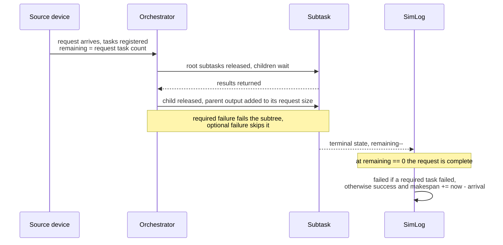

# Output and metrics

A PureEdgeSim run produces a CSV row per scenario, an optional text report, and optional chart images. This guide describes where each artifact is written, what every column means, how the values are computed, and which metrics need a caveat before they appear in a paper.

## Where the output goes

The output folder is `SimulationParameters.outputFolder`. The default is `PureEdgeSim/output/`; change it with `sim.setCustomOutputFolder("path/with/trailing/slash/")`. Each launch creates a timestamped folder named `yyyy-MM-dd_HH-mm-ss`.

`clear_output_folder=true` deletes that folder at the start of the first iteration. If you point the output folder at a directory that contains other work, that work is removed. The default is `false`, so old runs remain until you delete them.

### Reproducing a run

Each timestamped folder receives two provenance artifacts:

- `run.properties`, with the framework `version`, the `git.commit` of the checkout, the `random.seed` (`unset` when the run was not seeded), the `parallelism` flag, the absolute `output.folder`, and the absolute path of each input file under `settings.*`.
- `settings/`, a snapshot of the five configuration files the run actually parsed, named after their role (`simulation_parameters.properties`, `applications.xml`, `edge_datacenters.xml`, `edge_devices.xml`, `cloud.xml`). A custom file such as `fast.properties` is stored under the role name, so the folder still describes the run.

To reproduce a result, pass that `settings/` folder to `setCustomSettingsFolder` and the recorded seed to `Randomness.setSeed`.

### File names

| Mode | Files |
| --- | --- |
| Sequential | `<timestamp>/Sequential_simulation.csv`, and `Sequential_simulation.txt` when `save_log_file=true` |
| Parallel | `<timestamp>/Parallel_simulation_<id>.csv` per worker, and the matching `.txt` files |

In both modes the CSV is opened in append mode. The header is written only by the first iteration, and each later iteration appends one row. In parallel mode each worker writes its own file, because there is no shared writer and no merge step.

### Charts

Two independent mechanisms write images:

- `ChartsGenerator` reads the finished sequential CSV and writes aggregate comparisons under `<timestamp>/Final results/`. It runs when `save_charts=true` and parallel mode is off. The subfolders are `Architectures Energy`, `Algorithms Energy`, `Architectures CPU Utilization`, `Algorithms CPU Utilization`, `Architectures Network`, `Algorithms Network`, `Architectures Tasks`, and `Algorithms Tasks`. File names have the form `<metric>__<series>.png`, for example `Average energy consumption (Wh/Computing node)__TRADE_OFF.png`.
- `SimulationVisualizer.saveCharts()` writes per-iteration snapshots under `<timestamp>/simulation_<id>/iteration_<n>__<scenario>/` while the live charts are open. It runs when `display_real_time_charts=true` and `save_charts=true`. Files are `map_chart.png`, `cpu_usage.png`, `tasks_success_rate.png`, and, when `use_one_shared_wan_link=true`, `network_usage.png`.

The aggregate charts are the ones intended for publications. The per-iteration snapshots are debugging aids.

### The text report

When `save_log_file=true`, the `.txt` file contains the console report for every iteration: task counts, success and failure percentages, request counts, network usage, CPU utilization, and energy breakdown. The numbers have more decimal places in the console than in the CSV, and the report includes a few values that never reach the CSV, such as MAN usage.

The task section starts with the four counters that explain what happened before
execution: tasks not sent because the device died, tasks lost to a failed
dependency, tasks skipped because their optional input failed, and tasks sent.
The `Requests` block at the end of the same section reports the number of
requests generated, the percentage that completed successfully, the number that
failed, and the average end-to-end makespan of the successful requests. A request
is one invocation of an application, so it has one to seven tasks. Its bookkeeping
follows the lifecycle below; the `Requests` block and columns 54 to 56 report the
outcome of that bookkeeping.



For a
service graph, the request block is the one to quote when the claim is about the
whole service rather than about individual subtasks.

## Reading the CSV correctly

The CSV uses a comma separator and a dot decimal separator, with at most four decimals per value. It is a flat table with one row per scenario. The scenario identity is the first three columns, which makes it easy to pivot.

Some columns are not what their names suggest. The notes below are based on the current implementation, not on the intent implied by the header.

### Scenario and delay columns

| # | Column | Meaning |
| --- | --- | --- |
| 1 | Orchestration architecture | Architecture name for the scenario |
| 2 | Orchestration algorithm | Algorithm name from the properties file |
| 3 | Edge devices count | Number of edge devices in the scenario |
| 4 | Total tasks execution delay (s) | Sum of CPU execution time, not end-to-end delay |
| 5 | Average execution delay (s) | CPU execution time divided by executed tasks |
| 6 | Total tasks waiting time (s) | Sum of destination queue time |
| 7 | Average waiting time (s) | Queue time divided by executed tasks |

The execution delay columns exclude network time. End-to-end task delay exists inside the simulator as `task.getTotalDelay()`, which is network time plus waiting time plus CPU time, but it is not written to the CSV. It is used for the latency failure check. The request-level end-to-end makespan of a service graph is written in column 56. If your paper needs per-task end-to-end delay, compute it from a custom logger or a custom simulation manager, or extend `SimLog`. Do not relabel columns 4 and 5 as end-to-end.

Executed tasks in columns 5 and 7 are tasks that finished CPU execution and entered the result-return path. A task that later fails the latency check at phase 3 is still included in these averages.

### Task counts

| # | Column | Meaning |
| --- | --- | --- |
| 8 | Number of generated tasks | Every task in the pre-generated list |
| 9 | Tasks successfully executed | `sentTasks - failedTasks`, see the warning below |
| 10 | Task not executed (No resources available or long waiting time) | No eligible destination, or insufficient RAM/storage at the destination |
| 11 | Tasks failed (delay) | Total delay reached the task latency bound, or the result returned after the request deadline |
| 12 | Tasks failed (device dead) | Device, orchestrator, or destination died before the task completed |
| 13 | Tasks failed (mobility) | Destination moved out of range before or during offloading |
| 14 | Tasks not generated due to the death of devices | Tasks whose generating device died before they were offloaded; they are not failed tasks |
| 15 | Tasks not executed because a dependency failed | Required subtasks that were never offloaded because a parent subtask failed; they are not counted as sent-task failures |
| 16-17 | Total / successful tasks executed (Cloud) | Tasks sent to the cloud and those without failure |
| 18-19 | Total / successful tasks executed (Edge) | Tasks sent to edge data centers and those without failure |
| 20-21 | Total / successful tasks executed (Mist) | Tasks sent to edge devices and those without failure |

Column 9 is computed as sent tasks minus all failed tasks. Tasks whose device died before offloading are not counted as failures: they were never sent, so they reduce the number of sent tasks and appear in column 14 instead. Column 15 exists only for [service graphs](configuration.md#service-graphs): a required subtask that waits for a parent which failed is never sent either, so it stays out of the failure rate and is reported separately. Optional subtasks in the same situation are skipped, not failed, and appear in column 53.

For a robust success rate, derive it from the failure breakdown:

```text
completed_or_failed = column 10 + column 11 + column 12 + column 13
successful = column 8 - column 14 - column 15 - column 53 - completed_or_failed - still_in_flight
```

A request-level alternative is available in columns 54 to 56: a request succeeds only when none of its required subtasks failed, and its makespan is measured from the request arrival to the return of its last result. The average makespan in column 56 covers the successful requests only, because failed requests stop contributing at the failure time and would understate the cost of an outdated placement.

`still_in_flight` is not reported. Tasks whose execution or transfer is still in progress when the simulation horizon is reached are neither successful nor failed in the CSV. This is right-censoring at the end of the run. Keep the simulation long enough relative to task rates and delays, or state the censoring in the methodology.

The per-level totals count tasks whose destination is of that type, including tasks that later failed. The per-level successful values subtract the failures of that type. A task that fails before a destination is assigned is not attributed to any level.

### Network columns

| # | Column | Meaning |
| --- | --- | --- |
| 22 | Network usage (s) | Sum of the time spent transferring over LAN, MAN and WAN links |
| 23 | Wan usage (s) | Sum of time spent transferring over WAN links |
| 24 | Lan usage (s) | Sum of time spent transferring over LAN links |
| 25 | Total network traffic (MBytes) | Sum of transfer sizes, counted once per completed transfer |
| 26 | Containers wan usage (s) | WAN time attributable to container downloads |
| 27 | Containers lan usage (s) | LAN time attributable to container downloads |
| 28 | Average bandwidth per task (Mbps) | Mean allocated bandwidth per progress update, not throughput per task |

MAN usage has no column of its own: it is included in the total of column 22, and the text report prints it. Do not add column 22 to columns 23 and 24, since it already contains them.

"Usage" is time spent transferring, not bandwidth and not bytes. A longer usage with the same traffic means a slower or more congested path. `Average bandwidth per task` is the average of the bandwidth allocations observed by every finished transfer, converted from bits per second to megabits per second. It is not `traffic / time` and it is not per task. It is still useful as a relative indicator of how much bandwidth transfers received.

Transfers still in flight when the simulation ends are not included in any network column.

### CPU columns

| # | Column | Meaning |
| --- | --- | --- |
| 29 | Average CPU usage (%) | Average of the lifetime utilization of all nodes |
| 30 | Average CPU usage (Cloud) (%) | Same, restricted to cloud nodes |
| 31 | Average CPU usage (Edge) (%) | Same, restricted to edge data centers |
| 32 | Average CPU usage (Mist) (%) | Same, restricted to mist devices |

Each node's value is `totalExecutedInstructions / (totalMipsCapacity * currentClock)`, capped at 100. Because the denominator grows with the clock and includes idle time, this is a lifetime average. It is not the average of instantaneous utilization samples. The overall column is an average of the three per-level values weighted by node count, not by capacity. A single idle cloud node with a large capacity can therefore pull the overall value down more than its share of work would suggest.

### Energy columns

| # | Column | Meaning |
| --- | --- | --- |
| 33 | Energy consumption of computing nodes (Wh) | Cloud plus edge plus mist CPU and wireless energy |
| 34 | Average energy consumption (Wh/Computing node) | Total divided by cloud and edge data centers plus the scenario device count |
| 35 | Cloud energy consumption (Wh) | All cloud nodes |
| 36 | Average Cloud energy consumption (Wh/Data center) | Total divided by number of cloud data centers |
| 37 | Edge energy consumption (Wh) | All edge data centers |
| 38 | Average Edge energy consumption (Wh/Data center) | Total divided by number of edge data centers |
| 39 | Mist energy consumption (Wh) | All edge devices, including their wireless energy |
| 40 | Average Mist energy consumption (Wh/Device) | Total divided by scenario device count |
| 41 | WAN energy consumption (Wh) | Link energy for links typed WAN |
| 42 | MAN energy consumption (Wh) | Link energy for links typed MAN |
| 43 | LAN energy consumption (Wh) | Link energy for links typed LAN |
| 44 | WiFi energy consumption (Wh) | Link energy for WiFi link classes |
| 45 | Cellular energy consumption (Wh) | Link energy for cellular link classes, whatever radio technology the parameters describe |
| 46 | Ethernet energy consumption (Wh) | Link energy for Ethernet link classes |

The energy in columns 33 to 40 comes from the computing node energy models, including the wireless transmit and receive charges added to edge devices. The energy in columns 41 to 46 comes from the link energy models and is not part of columns 33 to 40.

The categories are not mutually exclusive. Columns 41 to 43 classify links by type (WAN, MAN, LAN), while columns 44 to 46 classify them by technology. A WiFi link used to reach the cloud is included in both the WAN column and the WiFi column, and its per-bit cost includes the WiFi, access point, and WAN components. Do not add all energy columns and present the result as a system total. Choose one accounting boundary and state it.

The average energy per computing node includes idle nodes, and its denominator uses the scenario device count rather than the number of Mist nodes. This matters when some device entries are sensors or when the generated node count differs from the configured count.

### Battery and death columns

| # | Column | Meaning |
| --- | --- | --- |
| 47 | Dead devices count | Edge devices whose battery reached zero |
| 48 | Average remaining power (Wh) | Mean remaining energy over battery-powered devices that are still alive |
| 49 | Average remaining power (%) | Same, as a percentage of capacity |
| 50 | First edge device death time (s) | Earliest death time, or `-1` if no device died |
| 51 | List of remaining power (%) (only battery powered devices / 0 = dead) | Dash-separated per-device values |
| 52 | List of the time when each device died (s) | Dash-separated death times for devices that died |
| 53 | Tasks skipped because their optional input failed | Optional subtasks whose dependency failed; they are not failures and do not fail the request |
| 54 | Requests generated | One per request; equals the number of generated tasks for a monolithic application |
| 55 | Successful requests | Requests whose required subtasks all completed successfully |
| 56 | Average request makespan (s) | Mean end-to-end time from request arrival to the last result, over successful requests |

Column 47 counts only edge devices. Data centers are not battery powered by default, so their deaths are not tracked here. Dead devices contribute `0` to the remaining-power list but are excluded from the average, which is computed over alive battery-powered devices only. A high average remaining power can therefore coexist with many dead devices; read columns 47 and 49 together.

When no battery-powered device remains alive, the implementation divides by one instead of zero, so the average is `0` rather than `NaN`. When no device has died, column 50 is `-1`, which must be filtered before plotting.

### Missing and non-finite values

Several averages divide by counts that can be zero:

- Average execution or waiting delay when no task finished execution.
- Average bandwidth when no transfer finished.
- Per-level CPU averages when the architecture contains no node of that level.

The result can be `NaN` (for example `0.0 / 0`) or `Infinity` when a value is divided by a very small count. Treat these as missing data, not as zero. A scenario with no tasks is usually a configuration error: check `simulation_time`, `min_number_of_edge_devices`, and the application usage percentages.

## Deriving the metrics you actually want

The CSV is a summary, not a complete event log. Common research metrics and how to obtain them:

| Metric | How to obtain it |
| --- | --- |
| End-to-end task delay | Not in the CSV. Add a custom logger or extend `DefaultSimulationManager` and record `task.getTotalDelay()` in `resultsReturned`. |
| End-to-end request makespan | Column 56 (average over successful requests), or the console `Requests` block. For per-request values, extend `SimLog` and use the request identifier carried by every task. |
| Success rate | Derive from generated tasks and the failure breakdown, since column 9 is unreliable with pre-send failures. State how in-flight tasks are handled. For a service graph, prefer the request success rate in column 55. |
| Throughput | Successful tasks divided by a time window, using the scenario duration and the number of tasks. Do not use the execution-delay columns. |
| Energy per successful task | Energy of computing nodes divided by successful tasks. Decide whether link energy belongs in the numerator and state it. |
| WAN utilization | WAN usage time divided by simulation duration, or use `getWanUpUtilization()` while the simulation runs. The CSV has usage seconds, not a percentage. |
| Latency compliance | `Tasks failed (delay)` relative to the number of executed tasks. Note that only phase 3 checks the latency budget. |
| Device lifetime | First death time and the death list. For distributions, use the per-device death list, not the average. |

## Reading the charts

The aggregate chart folders follow the comparison design:

- `Architectures Energy` and similar folders fix one algorithm and plot one line per architecture.
- `Algorithms Energy` and similar folders fix one architecture and plot one line per algorithm.

The x-axis is `Edge devices count`, so a sweep over device counts is required for a meaningful line. If your scenario has a single device count, the charts contain a single point per series. The y-axis label is set per metric family: consumed energy in Wh, CPU in percent, network in seconds, tasks as counts, and delays in seconds.

Chart titles include the metric and the fixed series. File names replace slashes with ` per ` to keep them valid on every filesystem.

## A minimal analysis workflow

1. Run the full sweep with `save_charts=false` and `display_real_time_charts=false` for speed. Keep `save_log_file=true` for the detailed report.
2. Inspect the CSV row count. It should equal architectures times algorithms times device counts.
3. Check for `NaN`, `-1` death times, and negative success counts before any aggregation.
4. Recompute success and completion metrics from the failure breakdown rather than trusting column 9.
5. Re-run the sweep with charts enabled only when you need figures, or read the CSV into Python or R and plot there for full control.
6. Keep the raw CSV with the paper or thesis artifact. It is the primary record; the charts are derivative.

A short Python sketch:

```python
import pandas as pd

df = pd.read_csv("PureEdgeSim/output/2026-10-24_23-29-48/Sequential_simulation.csv")
df.columns = [c.strip() for c in df.columns]

df["failed"] = df[["Task not executed (No resources available or long waiting time)",
                   "Tasks failed (delay)",
                   "Tasks failed (device dead)",
                   "Tasks failed (mobility)"]].sum(axis=1)
df["never_sent"] = df[["Tasks not generated due to the death of devices",
                       "Tasks not executed because a dependency failed"]].sum(axis=1)
df["success_rate"] = ((df["Number of generated tasks"] - df["failed"] - df["never_sent"])
                      / df["Number of generated tasks"])
print(df.groupby("Orchestration algorithm")["success_rate"].mean())
```

The sketch ignores in-flight tasks at the horizon. For short runs, that omission can be significant; lengthen the simulation or record completion explicitly.

## What the console shows

The console prints progress, then a formatted block per iteration with percentages and totals. The block is convenient for a quick sanity check and is the same data that goes to the text report. It includes a few derived percentages that are not in the CSV, such as the share of WAN usage caused by container downloads. Watch for `NaN` in this block as well, for the same division-by-zero reasons.

With deep logging enabled, the console and the text report also contain one line per task and per decision. That output is useful for debugging but is far too large for routine experiments.

## Where to go next

- Change what is measured or how it is written: [Customizing models](customizing-models.md) and the `SimLog` class.
- Design the sweep that produces these rows: [Research guide](research-guide.md).
- Understand the delays that are not in the CSV: [Task lifecycle](task-lifecycle.md).
