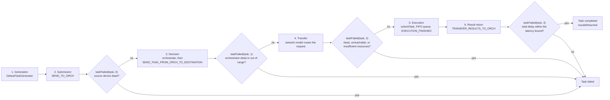

# Task lifecycle

This guide follows one task from generation to result. It explains every decision point, every network transfer, and every failure reason in the default implementation. Use it to interpret results, debug unexpected failures, and find the right extension point for a new algorithm.

The classes involved are `DefaultTaskGenerator`, `DefaultSimulationManager`, `DefaultOrchestrator`, `DefaultNetworkModel`, `DefaultComputingNode`, and `SimLog`.

## Overview

A task passes through six stages:

1. **Generation.** The task generator creates an offloading request for a device at a future simulation time.
2. **Submission.** The batch scheduler sends the request to an orchestrator.
3. **Decision.** The orchestrator chooses an execution destination.
4. **Transfer.** The network model carries the request from the orchestrator to the destination.
5. **Execution.** The destination queues and executes the task.
6. **Result return.** The output travels back to the source device, and the task is recorded as successful or failed.

The event tags that implement these stages are defined in `SimulationManager` and processed in `DefaultSimulationManager.processEvent`.



## Stage 1: generation

`DefaultTaskGenerator.generate()` produces the entire workload before the event loop starts. This design makes the task list deterministic and lets the logger know the total number of tasks in advance.

The generator:

1. Converts the simulation duration from minutes to `simulationTime = simulationDuration / 60`.
2. Keeps only devices that have `generateTasks=true` in `edge_devices.xml`.
3. Assigns each generating device a random application based on the `usage_percentage` values in `applications.xml`. Devices are independent, so the realized percentages are approximately, not exactly, the configured ones.
4. For each device, generates `rate` tasks per simulated minute, where `rate` comes from the application.
5. Sets each task time to `minute * 60 + random(0..14)` seconds. The random offset prevents all tasks of a minute from arriving at exactly the same instant.
6. Creates a `DefaultTask` with the application's length, request size, container size, results size, latency bound, and type, and associates it with the source device.

All sizes are converted to bits during parsing (`kilobytes * 8000`). Task length remains in million instructions (MI). Latency remains in seconds.

The result is a `FutureQueue<Task>` sorted by task time. The manager receives this list through `setTaskList`.

## Stage 2: submission to the orchestrator

At simulation start, `DefaultSimulationManager` schedules the first `batch_size` tasks as `SEND_TO_ORCH` events at their respective times. When a batch has been scheduled, a `NEXT_BATCH` event schedules the following batch. This keeps the event queue small without changing task times.

When `SEND_TO_ORCH` fires:

1. The manager calls `taskFailed(task, 0)`, the first failure check. If the source device is dead at this point, the task fails with `FAILED_BECAUSE_DEVICE_DEAD`.
2. The manager selects the orchestrator. If `enable_orchestrators=true`, it uses the device's assigned orchestrator. If `enable_orchestrators=false`, `DefaultTask.getOrchestrator()` lazily returns the source device itself and marks it as an orchestrator. In that case, the device makes its own decisions.
3. The manager asks the network model to send the request from the device to the orchestrator (`SEND_REQUEST_FROM_DEVICE_TO_ORCH`).

If the orchestrator is the source device, no network transfer occurs for this request. If the orchestrator is remote (a cloud or edge data center), the request travels over the configured links and consumes network time and energy.

## Stage 3: the orchestration decision

When the request reaches the orchestrator, the network model calls `offloadingRequestRecievedByOrchestrator`, which schedules `SEND_TASK_FROM_ORCH_TO_DESTINATION` on the manager.

The manager then applies a behavior that is easy to miss: **application placement caching**.

- On the first task of a device, `isApplicationPlaced()` is false. The manager calls `edgeOrchestrator.orchestrate(task)`, which calls `findComputingNode`.
- If a destination is found, `assignTaskToComputingNode` sets the task destination and calls `task.getEdgeDevice().setApplicationPlacementLocation(node)`. The device is now marked as placed.
- On later tasks from the same device, the manager skips orchestration and sends the task directly to the previously selected node.
- If a task fails at any phase, `setFailed` calls `setApplicationPlaced(false)`, so the next task from that device triggers a fresh orchestration decision.

This caching models application placement: the first decision determines where the application runs, and subsequent tasks reuse that placement. It also means that a stateless `findComputingNode` is not called for every task. If your research requires a decision for every task, override `DefaultSimulationManager.sendFromOrchToDestination` or reset the placement flag in your orchestrator after each decision.

### How the default orchestrator chooses

`DefaultOrchestrator.findComputingNode` supports two algorithms selected by `orchestration_algorithms`:

- `TRADE_OFF`: computes a score for each candidate and returns the index of the lowest score. The score is `(history + 1) * weight * taskLength / mipsPerCore`. `history` is the number of tasks already assigned to the node. The weight is 1.8 for cloud nodes, 1.3 for edge devices, and 1.2 otherwise. Lower MIPS increases the score, so faster nodes are preferred, and the history term penalizes nodes that already received many tasks. Higher weights push work away from a tier.
- `ROUND_ROBIN`: returns the candidate that has been assigned the fewest tasks so far.

Before scoring, the orchestrator filters candidates with `offloadingIsPossible`, which enforces architecture membership and reachability:

- **Cloud** is always allowed if the architecture includes `Cloud`.
- **Edge data center** is allowed if the architecture includes `Edge`, and the node is either the current uplink destination of the source device or the current uplink destination of the orchestrator. In other words, the edge server must cover the device or its orchestrator.
- **Mist (edge device)** is allowed if the architecture includes `Mist`, the candidate is within `edge_devices_range` of the source device (or of the orchestrator when orchestrators are enabled), the candidate is not dead, and the candidate is not a sensor.

If no candidate passes, `findComputingNode` returns `-1`. The manager then sets `NO_OFFLOADING_DESTINATIONS`, increments the resource-unavailable counter, and the task ends as failed. This is common when the architecture excludes the only layers that can reach the device, or when edge coverage is too small.

## Stage 4: transfer to the destination

After the decision, the manager calls `taskFailed(task, 1)`, the second failure check, and then asks the network model to send the request to the destination (`SEND_REQUEST_FROM_ORCH_TO_DESTINATION`).

The network model routes the request:

- Device to device: a direct one-hop link.
- Device to its serving edge data center: the device uplink plus the path from that edge data center to the destination.
- Edge data center to device: the path to the device's downlink edge data center plus the device downlink.
- All other pairs: the shortest path in the infrastructure graph, cached by source-destination pair.

Each transfer is represented by a `TransferProgress` object. Links admit transfers according to their bandwidth and latency, and the transfer finishes at a computed future time. The network model then calls back into the manager.

If the application registry is enabled (`enable_registry=true`), the registry mode is `CLOUD`, and the destination is not a cloud node, the destination first downloads the container (`DOWNLOAD_CONTAINER`). Only after the container transfer finishes does the task execute.

## Stage 5: execution

When the destination receives the request, the manager performs `taskFailed(task, 2)`, the third failure check. If the task is still valid, it calls `submitTask` on the destination.

`DefaultComputingNode.submitTask`:

1. Records the arrival time, which starts the waiting-time measurement.
2. Reserves container storage.
3. If a CPU core is free and enough RAM is available, starts execution immediately.
4. Otherwise, appends the task to the node's FIFO execution queue.

`startExecution`:

1. Updates CPU utilization and reserves RAM and one core.
2. Records the execution start time.
3. Adds dynamic energy consumption based on the task length and the node's total MIPS capacity.
4. Schedules `EXECUTION_FINISHED` after `task.getLength() / mipsPerCore` seconds.

When the execution finishes, the node frees the core, RAM, and storage, records the finish time, and schedules a results transfer. If tasks are waiting, the next one starts on the freed core immediately.

Important properties of this model:

- **Parallelism is per core.** A node executes up to `cores` tasks concurrently. The execution time of each task is its length divided by the per-core MIPS rating, not by the total MIPS rating.
- **Waiting time is FIFO.** There is no priority scheduling. A task waits until a core and enough RAM are free.
- **RAM and storage are checked at submission.** A task that does not fit is rejected before execution. The check uses the container size in megabytes for both RAM and storage.
- **Sensors cannot execute tasks.** A sensor has zero cores, zero MIPS, and zero memory, and the orchestrator filters it out. If a custom orchestrator selects one, `checkComputingNode` throws an exception.

## Stage 6: result return

The result path mirrors the request path:

1. The destination notifies the manager (`TRANSFER_RESULTS_TO_ORCH`).
2. The manager records the task in `finishedTasks` and asks the network model to send the results to the orchestrator.
3. If the task executed locally (destination equals orchestrator), the manager schedules `RESULT_RETURN_FINISHED` directly, without a transfer.
4. Otherwise, the network model transfers the results from the destination to the orchestrator, then from the orchestrator to the source device if the orchestrator is not the device.
5. When the results reach the source device, the manager performs `taskFailed(task, 3)`, the final failure check.
6. If the task survived, the manager calls `edgeOrchestrator.resultsReturned(task)` and increments the completed-task counter.
7. If the task belongs to a [service graph](configuration.md#service-graphs), the manager releases the subtasks that depend on it: every dependent whose last parent has now returned enters the queue through `SEND_TO_ORCH` at the current time.

Total delay is defined as:

```text
totalDelay = actualNetworkTime + waitingTime + actualCpuTime
```

- `actualNetworkTime` accumulates the duration of every network transfer for the task.
- `waitingTime` is `executionStartTime - arrivalTime`, where arrival is when the destination received the task.
- `actualCpuTime` is `executionFinishTime - executionStartTime`.

A task fails due to latency when `totalDelay >= maxLatency` at the final check. The comparison is inclusive, so a task whose delay exactly equals its bound fails.

## Failure phases and reasons

Failures are checked at four points. The `phase` argument identifies the check.

| Phase | When it runs | Conditions | Failure reason |
| --- | --- | --- | --- |
| 0 | Before sending to the orchestrator | Source device is dead | `FAILED_BECAUSE_DEVICE_DEAD` |
| 1 | After the decision, before sending to the destination | Orchestrator is dead; or the orchestrator is not cloud and the source device and orchestrator are no longer in range | `FAILED_BECAUSE_DEVICE_DEAD` or `FAILED_DUE_TO_DEVICE_MOBILITY` |
| 2 | When the destination receives the request | Destination is dead; RAM or storage is insufficient; or the destination or orchestrator is no longer reachable from the source device | `FAILED_BECAUSE_DEVICE_DEAD`, `INSUFFICIENT_RESOURCES`, or `FAILED_DUE_TO_DEVICE_MOBILITY` |
| 3 | When the results reach the source device | Total delay is greater than or equal to the application latency bound | `FAILED_DUE_TO_LATENCY` |
| Decision | After orchestration | No candidate satisfies the architecture and reachability rules | `NO_OFFLOADING_DESTINATIONS` |
| Cascade | When a task fails at any point | The task has subtasks that depend on it | `FAILED_BECAUSE_DEPENDENCY_FAILED` on every descendant |

A failing task propagates the failure to its whole subtree: the descendants are never sent, so they do not count as sent-task failures. They increment the dependency counter that feeds the "Tasks not executed because a dependency failed" column and the corresponding text report line.

The `INSUFFICIENT_POWER` and `NOT_GENERATED_BECAUSE_DEVICE_DEAD` enum values exist in the `Task.FailureReason` enumeration, but the default manager does not assign them. Device death is reported through `FAILED_BECAUSE_DEVICE_DEAD`, including when the source device dies before its tasks are sent. Keep this in mind when you aggregate failure reasons.

Mobility failures are deliberately simple. They compare locations at check time, not continuous connectivity. If a device moves out of range between the decision and the reception, the task fails. If it moves back before the check, the task may succeed. This is documented behavior, not a bug, and it is one reason to keep `update_interval` small in mobility-heavy scenarios.

## Local execution

A task can run on its source device. This happens when the orchestrator selects the device itself, which is possible only when the architecture includes mist and the device is not a sensor. In that case:

- No request transfer is needed after the decision if the orchestrator is the device.
- `sendRequestFromOrchToDest` detects that the destination equals the source device and executes the task directly.
- The result path also skips transfers, and the task finishes at `RESULT_RETURN_FINISHED`.

Local execution is often the baseline for comparing offloading strategies. If your orchestrator never returns the source device, mist-only scenarios will have no valid destination.

## Where to customize

| Goal | Change |
| --- | --- |
| Different workload arrival pattern | Subclass `DefaultTaskGenerator` and override `generate` or `generateTasksForDevice` |
| Different decision rule | Subclass `DefaultOrchestrator` and override `findComputingNode` |
| Decision per task instead of per application placement | Override `sendFromOrchToDestination` in a custom simulation manager, or reset placement in the orchestrator |
| Different failure policy | Override `taskFailed` in a custom simulation manager |
| Different transfer behavior | Subclass `DefaultNetworkModel` and override transfer initiation or completion |
| Different execution scheduling | Subclass `DefaultComputingNode` and override `submitTask` or `startExecution` |

See [Writing orchestrators](writing-orchestrators.md) and [Customizing models](customizing-models.md) for complete examples.

## Related reading

- [Simulation models](models.md): energy, mobility, and network mechanics.
- [Output and metrics](output-and-metrics.md): how these events become CSV columns.
- [FAQ](faq.md): common causes of each failure reason.
