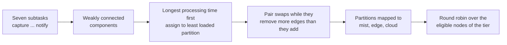

# Example 9: partitioning a service graph with graph theory

## What it shows

How to route the subtasks of one request to different nodes. The applications
file declares a video analytics pipeline: seven subtasks connected by
dependencies, from `capture` to `notify`. A single request therefore produces a
small graph instead of one task.

Before the simulation starts, `GraphPartitioner` cuts that graph:

1. it finds the weakly connected components of the dependency graph;
2. inside each component it assigns the heaviest subtasks first to the least
   loaded partition (longest processing time first);
3. it then swaps pairs of subtasks between partitions while the swap removes
   more dependency edges than it adds, and while no partition exceeds the
   balance tolerance.

`Example9PartitioningOrchestrator` maps the resulting partitions to the
available tiers in the order mist, edge, cloud. The subtask name and the
application identifier select the partition at runtime, and the orchestrator
picks the next eligible node of that tier in round robin.



## The API detail this example exists to show

PureEdgeSim caches an application placement: after the first decision, later
tasks of the same device reuse the same destination. A per-subtask plan needs
the opposite. The orchestrator therefore clears the flag after every decision:

```java
@Override
public void orchestrate(Task task) {
    super.orchestrate(task);
    task.getEdgeDevice().setApplicationPlaced(false);
}
```

Without those two lines, only the first subtask of each request would follow the
plan and the others would go to the same node.

## The scenario

The files in `settings/` describe:

- 150 devices on a 2000 by 2000 meters map, with a 50 meters device-to-device
  range so a requesting device can reach a few neighbours;
- four linked edge data centers, so each tier has more than one candidate;
- the `ALL` architecture and the `TRADE_OFF` fallback;
- five simulated minutes, a fixed seed of 42, and no container registry;
- a 60 percent share for the graph application and 40 percent for a monolithic
  application, which shows that both styles can coexist.

## Run it

From the repository root, after `mvn clean install -DskipTests`:

```bash
mvn exec:java -Dexec.mainClass="examples.Example9"
```

## What to look for

The console prints the plan before the run starts:

```text
Example9PartitioningOrchestrator - Application 0 (Soft Real-time): 3 partitions, cut 4 edges (720000 bits per request)
  P0.0 [detect] (4000 MI)
  P0.1 [classify] (2500 MI)
  P0.2 [capture, preprocess, track, aggregate, notify] (1950 MI)
```

- The cut counts how many dependency edges cross a partition boundary, and the
  traffic is the result size of their parents, which is what must travel between
  nodes at runtime.
- The three partitions go to mist, edge, and cloud, so the run uses all three
  tiers. The per-tier count columns show how many subtasks executed on each.
- With seed 42 the shipped scenario exceeds 99.9 percent success. The graph
  tasks and the monolithic tasks are counted together.
- Results go to `output/Example9_output/`.

Change `PARTITIONS_PER_COMPONENT` in the orchestrator to see the trade-off: more
partitions spread the load further but cut more edges.

## Files

- `src/main/java/com/mechalikh/pureedgesim/examples/Example9.java`
- `src/main/java/com/mechalikh/pureedgesim/examples/Example9PartitioningOrchestrator.java`
- `src/main/java/com/mechalikh/pureedgesim/examples/GraphPartitioner.java`
- `src/main/java/com/mechalikh/pureedgesim/examples/ServiceGraph.java`
- `settings/applications.xml` with the service graph

## Where to go next

- [Writing orchestrators: placing the subtasks of a service graph](../../docs/writing-orchestrators.md#placing-the-subtasks-of-a-service-graph)
- [Configuration: service graphs](../../docs/configuration.md#service-graphs)
- [Example 10: the same problem with a genetic algorithm](../Example10/README.md)
